# Procedimiento Operativo Estandarizado · Generación, Organización y Liberación de Archivos de Maquinado desde Cabinet Vision hacia Odoo y Producción

- **ID del Workflow:** `WF-ING-MAQ-01`
- **Entregable principal:** Paquete consolidado de archivos de maquinado (`SEC`, `LABEL`, `NANXING` condicional y 2 reportes PDF) vinculado a la tarjeta del producto en Odoo y liberado formalmente al área de Maquinados.
- **Revisión:** `0.1` · **Fecha:** 13 de noviembre de 2026
- **Estado documental:** `En revisión operativa` (Reconstrucción fiel del procedimiento ejecutado; controles propuestos y verificaciones en estación acotados explícitamente).
- **Caso práctico de referencia:** Proyecto **Ibero** (`BD-IB-GIA-2026`) · Concepto **Puerta Intercom Grande**.
- **Método aplicado:** `04_PROCESOS/GESTION_PROYECTOS/DOCUMENTAR_WORKFLOWS_VISUALES.md` (Cerebro IA · Graphify) y `base-enciclopedica-del-proyecto.md` (§§2–5 y 7).

---

## 1. Alcance, Principio Rector y Matriz de Responsabilidades (RASCI)

### 1.1. Propósito y alcance operativo
Este procedimiento establece la secuencia exacta, determinista y verificable para:
1. Recibir un lote de corte o maquinado previamente definido y autorizado.
2. Ingresar a **Cabinet Vision** bajo el perfil de maquinado y validar el filtrado y cantidad de muebles en **Screen to Machine Center (`C2M Center`)**.
3. Configurar las máquinas de corte, enchapado y maquinado secundario (P2P condicional), así como el parámetro crítico **`Premill Edge Banding`**.
4. Optimizar el lote, exportar códigos NC y etiquetas en rutas temporales cortas dentro de la carpeta compartida **`Producción`** y emitir los dos reportes PDF obligatorios (**`Material Summary`** y **`Saw Cut List Landscape`**).
5. Consolidar la carpeta del concepto, vincular los entregables y la ruta de red en la tarjeta del producto dentro de **Odoo (`Manufactura ‣ Productos`)**, comprobar el acceso desde un segundo equipo y ejecutar la liberación comunicada al área de **Maquinados** (incluyendo el flujo alternativo en la PC de la seccionadora cuando Producción no disponga de acceso a Odoo).

> **Principio rector:** Garantizar que los archivos de fabricación sean correctos, estén organizados bajo una estructura rastreable y puedan consultarse desde un punto de referencia compartido (Odoo + repositorio de red), evitando la dispersión de información, las decisiones arbitrarias de loteo y la dependencia de comunicaciones informales.

### 1.2. Matriz RASCI por etapa

| Actividad / Etapa | Líder de Ingeniería | Ingeniero de Producto (Ejecutor) | Coordinación / Área de Maquinados | Operador de Seccionadora / CNC |
| :--- | :---: | :---: | :---: | :---: |
| **Definición y autorización de lotes de corte** | **A / R** | C | **C / R** | I |
| **Configuración, optimización y exportación en Cabinet Vision** | A | **R** | I | I |
| **Organización en red, carga en Odoo y prueba en 2.ª PC** | A | **R** | I | I |
| **Comunicación y liberación operativa a Maquinados** | C | **R** | **A / R (Receptor)** | I |
| **Acceso alternativo en PC de seccionadora (Flujo B)** | I | **R** | C | **R (Receptor)** |

*(R: Responsable de ejecución · A: Autoridad / Aprobador · C: Consultado · I: Informado)*

---

## 2. Resumen de las 12 Etapas y Resultados Esperados

| Etapa | ID de Tramo | Nombre de la Etapa | Resultado Esperado Verificable | Carácter |
| :---: | :---: | :--- | :--- | :---: |
| **1** | `ET-01` | **Planeación** | Lote de corte definido y autorizado en el archivo de configuración de lotes de corte/maquinado. | **Obligatorio / Crítico** |
| **2** | `ET-02` | **Preparación** | Perfil `Machine Edit` seleccionado y proyecto correcto (`Ibero`) abierto en el workspace de `Diseño` en Cabinet Vision. | **Obligatorio** |
| **3** | `ET-03` | **Filtrado** | Concepto (`Puerta Intercom Grande`) filtrado en `C2M Center` y cantidad de muebles validada contra el lote autorizado. | **Obligatorio / Crítico** |
| **4** | `ET-04` | **Configuración** | Seccionadora, enchapadora, máquina P2P (condicional) y `Premill Edge Banding` configurados según las máquinas reales del lote. | **Obligatorio / Crítico** |
| **5** | `ET-05` | **Optimización** | Procesamiento ejecutado (`Run` → `OK`) y diagramas de corte visualizados en `Screen to Machine Center`. | **Obligatorio** |
| **6** | `ET-06` | **Exportación** | Carpetas cortas (`SEC`, `NANXING`, `LABEL`) creadas en `Producción`, rutas asignadas en `Output Data` y códigos NC/etiquetas generados. | **Obligatorio / Crítico** |
| **7** | `ET-07` | **Reportes** | PDFs de resumen de materiales cortables (`Material Summary`) y diagramas de corte (`Saw Cut List Landscape`) guardados en la carpeta del concepto. | **Obligatorio** |
| **8** | `ET-08` | **Organización** | Subcarpetas renombradas con sufijo del concepto y movidas (`Ctrl + X`) dentro de `Puerta Intercom Grande` junto a los dos PDFs. | **Obligatorio / Crítico** |
| **9** | `ET-09` | **Integración** | Archivos cargados en la pestaña `Documentos` de Odoo y ruta de red sin comillas registrada en `Notas internas` del producto. | **Obligatorio / Crítico** |
| **10** | `ET-10` | **Validación** | Ruta compartida copiada desde `Notas internas` de Odoo en una segunda computadora y acceso verificado a todos los archivos en red. | **Obligatorio / Crítico** |
| **11** | `ET-11` | **Comunicación** | Liberación comunicada directamente a Maquinados (presencial, llamada o Meet) confirmando alcance, máquinas, ubicación y operaciones manuales. | **Obligatorio / Crítico** |
| **12** | `ET-12` | **Acceso alternativo** | Nota visible con ruta completa, proyecto y concepto colocada y comprobada con el operador en la laptop/PC de la seccionadora. | **Condicional (Flujo B)** |

---

## 3. Representación Visual del Flujo y Reglas de Decisión

### 3.1. Mapa general extremo a extremo (12 etapas)

```mermaid
flowchart TD
    accTitle: Mapa general del flujo de generación, organización y liberación de archivos de maquinado
    accDescr: Inicia con el lote de corte autorizado, recorre Cabinet Vision y C2M Center, valida cantidades, configura máquinas y Premill Edge Banding, optimiza, exporta a carpetas cortas, genera dos PDFs, consolida la carpeta del concepto, vincula en Odoo, valida desde segunda PC y cierra con la comunicación a Maquinados y el acceso alternativo en la seccionadora cuando aplica.
    E1(["1. Planeación · Lote de corte autorizado (MQ-01)"]) --> E2["2. Preparación · Perfil Machine Edit y proyecto en Diseño (MQ-02)"]
    E2 --> E3["3. Filtrado · C2M Center y selección del concepto (MQ-03)"]
    E3 --> C02{"¿Cantidad filtrada = cantidad del lote autorizado?"}
    C02 -->|No coincide| BLOQ1["Detener · Conciliar cantidad en Diseño o con Líder de Ingeniería"]
    C02 -->|Sí coincide| E4["4. Configuración · Seleccionar corte, enchapado y P2P condicional (MQ-04)"]
    E4 --> C03{"¿Enchapadora asignada al lote?"}
    C03 -->|Enchapadora nueva Nanxing| PRE_ON["Activar Premill Edge Banding (valor máx. = 3) (MQ-05)"]
    C03 -->|Otra enchapadora sin precorte| PRE_OFF["Desactivar Premill Edge Banding (MQ-05)"]
    PRE_ON --> E5["5. Optimización · Verificar 5 puntos y ejecutar Run → OK (MQ-06)"]
    PRE_OFF --> E5
    E5 --> E6A["6A. Carpetas cortas · Crear SEC, NANXING y LABEL en Producción (MQ-07)"]
    E6A --> E6B["6B. Exportación · Asignar rutas en Output Data y generar NC/etiquetas (MQ-08 y MQ-09)"]
    E6B --> E7["7. Reportes PDF · Material Summary y Saw Cut List Landscape (MQ-10 y MQ-11)"]
    E7 --> E8["8. Organización · Renombrar SEC/NANXING/LABEL y mover a carpeta del concepto (MQ-12)"]
    E8 --> C07{"¿Paquete completo y verificado en red?"}
    C07 -->|Faltan archivos o no corresponden| REC1["Regenerar salida o corregir organización antes de subir"]
    C07 -->|Paquete íntegro| E9["9. Integración Odoo · Cargar en Documentos y pegar ruta sin comillas en Notas internas (MQ-13 a MQ-15)"]
    E9 --> E10["10. Validación · Comprobar ruta desde Odoo en 2.ª computadora (MQ-16)"]
    E10 --> C10{"¿Abre carpeta y archivos en 2.ª PC?"}
    C10 -->|Falla ruta o permisos| REC2["Corregir ruta de red o permisos de carpeta compartida"]
    C10 -->|Acceso verificado| E11["11. Comunicación · Reunión/llamada/Meet de liberación con Maquinados (MQ-17)"]
    E11 --> C12{"¿La PC de seccionadora tiene acceso y usuario en Odoo?"}
    C12 -->|Sí tiene acceso a Odoo| FIN(["Cierre · Liberación operativa completada"])
    C12 -->|No tiene acceso a Odoo| E12["12. Flujo B · Nota con ruta en PC de seccionadora y validación con operador (MQ-18)"]
    E12 --> FIN
```



### 3.2. Tabla de decisión formal (DMN) · Selección de máquinas, `Premill Edge Banding` y `Output Data`

| Regla | Enchapadora en lote autorizado | ¿Requiere maquinado secundario P2P? | `Preferences ‣ Geometry ‣ Premill Edge Banding` | Valor máximo `Premill` | Máquina P2P en `C2M Center` | Ruta `Image` y `Label Output Path` | Ruta Seccionadora (`Dimensionadora Zaragoza`) | Ruta Máquina P2P en `Output Data` | Estado esperado de `NANXING_<Concepto>` |
| :---: | :--- | :--- | :--- | :---: | :--- | :--- | :--- | :--- | :--- |
| **R1 (Caso Ibero · Puerta Intercom Grande)** | **Enchapadora nueva Nanxing** (con precorte) | **No** (perforaciones posteriores manuales) | **ACTIVADO (`☑`)** | **`3`** (no modificar) | **Sin máquina P2P** | Carpeta `LABEL` | Carpeta `SEC` | **Sin configurar** | Se crea y conserva **vacía** |
| **R2** | **Enchapadora nueva Nanxing** (con precorte) | **Sí** (ej. CNC P2P Nanxing) | **ACTIVADO (`☑`)** | **`3`** (no modificar) | **Máquina P2P asignada** | Carpeta `LABEL` | Carpeta `SEC` | Carpeta `NANXING` | Contiene **programas P2P** |
| **R3** | **Otra enchapadora** (sin función de precorte) | **No** (operaciones posteriores manuales) | **DESACTIVADO (`☐`)** | **`3`** (sin compensación activa) | **Sin máquina P2P** | Carpeta `LABEL` | Carpeta `SEC` | **Sin configurar** | Se crea y conserva **vacía** |
| **R4** | **Otra enchapadora** (sin función de precorte) | **Sí** (ej. CNC P2P Nanxing) | **DESACTIVADO (`☐`)** | **`3`** (sin compensación activa) | **Máquina P2P asignada** | Carpeta `LABEL` | Carpeta `SEC` | Carpeta `NANXING` | Contiene **programas P2P** |

> **Advertencia crítica de configuración:** Cabinet Vision no garantiza conservar el estado correcto de `Premill Edge Banding` entre corridas ni cambia automáticamente esta casilla al elegir enchapadora. Es **obligatorio** entrar a `File ‣ Preferences ‣ Geometry` y comprobar la casilla en **cada lote**.

### 3.3. Transformación de la estructura de carpetas (Rutas cortas de exportación → Consolidación final)

Debido a que Cabinet Vision puede presentar fallos al leer o escribir en rutas de archivo excesivamente largas, la exportación desde `Output Data` se realiza primero hacia tres carpetas de nombre corto creadas directamente bajo `Producción` y, una vez concluida la exportación, se renombran y trasladan dentro de la carpeta del concepto:

```text
FASE A · ESTRUCTURA TEMPORAL DE SALIDA CORTA (Durante Etapas 6 y 7)
Luis del Ángel/
└── Ibero/
    └── Producción/
        ├── Puerta Intercom Grande/
        │   ├── Lista de materiales_Puerta Intercom Grande.pdf      [Reporte 1: Material Summary]
        │   └── Diagramas de corte_Puerta Intercom Grande.pdf       [Reporte 2: Saw Cut List Landscape]
        ├── SEC/                                                    [Ruta asignada a Dimensionadora Zaragoza]
        ├── NANXING/                                                [Estructura estándar P2P; sin ruta en este lote]
        └── LABEL/                                                  [Ruta asignada a Image y Label Output Path]

──────────────────────────────────────────────────────────────────────────────────────────────────────────────

FASE B · ESTRUCTURA FINAL CONSOLIDADA POR CONCEPTO (Al cerrar Etapa 8)
Luis del Ángel/
└── Ibero/
    └── Producción/
        └── Puerta Intercom Grande/
            ├── Lista de materiales_Puerta Intercom Grande.pdf      [Resumen de materiales cortables]
            ├── Diagramas de corte_Puerta Intercom Grande.pdf       [Diagramas de corte de seccionadora]
            ├── SEC_Puerta Intercom Grande/
            │   └── [Programas de seccionadora con nombres originales de Cabinet Vision]
            ├── NANXING_Puerta Intercom Grande/
            │   └── [Vacía en este lote / Programas P2P cuando aplique]
            └── LABEL_Puerta Intercom Grande/
                └── [Archivos e imágenes de etiquetado con nombres originales de Cabinet Vision]
```

---

## 4. Procedimiento Operativo Detallado por Actividad (Fichas `MQ-01` a `MQ-18`)

Cada actividad especifica los 8 atributos exigidos para su reproducción e integración al manual visual: **Punto de partida**, **Acción**, **Ubicación**, **Configuración**, **Condición**, **Resultado**, **Verificación** y **Error potencial / Recuperación**.

---

### Etapa 1 · Planeación: Definición y validación de los lotes de corte

#### Ficha `MQ-01` · Verificar el archivo autorizado de configuración de lotes de corte (`★ Punto Crítico`)
- **Estado:** `Reportado` · **Fuente:** `F01 §2` · **Control asociado:** `C01`
- **1. Punto de partida:** Solicitud de generación de programas de fabricación antes de abrir o procesar cualquier mueble en Cabinet Vision.
- **2. Acción:**
  1. Solicitar y abrir el **archivo de configuración de lotes de corte o lotes de maquinado** emitido por el líder de Ingeniería en coordinación con el área de Maquinados.
  2. Identificar los 8 datos rectores del lote:
     - Proyecto al que pertenece el mobiliario (`Ibero`).
     - Concepto o mueble que se fabricará (`Puerta Intercom Grande`).
     - Cantidad exacta de unidades que integran el lote.
     - Agrupación de los muebles que deberán procesarse juntos (un solo mueble, varias unidades del mismo concepto o combinación de muebles diferentes).
     - Seccionadora o dimensionadora asignada (`Dimensionadora Zaragoza`, correspondiente a una Nanxing).
     - Enchapadora asignada (`Enchapadora nueva Nanxing`).
     - Máquina de perforado o maquinado posterior P2P, cuando corresponda (`Sin máquina P2P` para este lote; perforaciones posteriores manuales).
     - Indicaciones especiales de procesamiento.
- **3. Ubicación:** Archivo de configuración de lotes de corte / maquinado entregado por el líder de Ingeniería.
- **4. Configuración:** Uso estricto de los parámetros autorizados en el documento de lotes; prohibido definir o reagrupar lotes arbitrariamente durante la sesión de Cabinet Vision.
- **5. Condición:** Obligatoria antes de iniciar cualquier procesamiento en Cabinet Vision.
- **6. Resultado:** Parámetros de lote, máquinas asignadas, cantidad de unidades y alcance de procesamiento manual vs. máquina identificados sin ambigüedad.
- **7. Verificación (`C01`):** Confirmar que los 8 campos del lote están definidos y que no existen contradicciones respecto al modelo vigente.
- **8. Error potencial y recuperación:**
  - *Error:* Agrupar muebles por criterio propio en Ingeniería o asumir máquinas por costumbre.
  - *Recuperación:* Si falta algún dato o existe discrepancia entre lo solicitado y lo configurado en Cabinet Vision, **detener el flujo** y resolverlo con el líder de Ingeniería y Maquinados antes de continuar.
- **Evidencia visual requerida:** Captura o formato del archivo de configuración de lotes de corte con la línea autorizada de `Puerta Intercom Grande` (`P-01`).

---

### Etapa 2 · Preparación: Ingreso a Cabinet Vision y apertura del proyecto

#### Ficha `MQ-02` · Seleccionar el perfil `Machine Edit` y abrir el proyecto en el workspace de Diseño
- **Estado:** `Reportado` · **Fuente:** `F01 §3` · **Control asociado:** `C01`
- **1. Punto de partida:** Escritorio o selector de inicio de Cabinet Vision, con el lote de corte ya validado (`MQ-01`).
- **2. Acción:**
  1. Seleccionar el perfil de Cabinet Vision correspondiente a las operaciones de maquinado, preferentemente **`Machine Edit`**.
  2. Abrir **Cabinet Vision**.
  3. Abrir el archivo del proyecto previamente proporcionado (para el caso de referencia, el proyecto **`Ibero`**).
  4. Confirmar en el título o estructura que se trata del archivo de proyecto correcto.
  5. Acceder al workspace de **`Diseño`**.
- **3. Ubicación:** Selector de perfil al iniciar Cabinet Vision → Menú de apertura de archivo → Workspace de **`Diseño`**.
- **4. Configuración:** Perfil **`Machine Edit`** (se selecciona preferentemente porque durante el mismo proceso podría ser necesario generar o modificar determinados reportes).
- **5. Condición:** Obligatoria al iniciar la sesión de generación de entregables de maquinado.
- **6. Resultado:** Proyecto **`Ibero`** abierto dentro del workspace de **`Diseño`** bajo el perfil **`Machine Edit`**.
- **7. Verificación:** Comprobar que el perfil activo es `Machine Edit`, que el proyecto corresponde a `Ibero` y que están visibles las pestañas superiores del workspace de `Diseño` (incluida `C2M Center` al extremo derecho).
- **8. Error potencial y recuperación:**
  - *Error:* Ingresar con un perfil que restrinja la edición o emisión de reportes, o abrir una copia desactualizada del proyecto.
  - *Recuperación:* Cerrar el proyecto, reiniciar Cabinet Vision seleccionando `Machine Edit` y abrir el archivo vigente autorizado por Ingeniería.
- **Evidencia visual requerida:** Captura del selector de perfil con `Machine Edit` y vista del workspace de `Diseño` con el proyecto `Ibero` abierto (`P-02`).

---

### Etapa 3 · Filtrado: Acceso a Screen to Machine Center (`C2M Center`) y control de cantidades

#### Ficha `MQ-03` · Abrir `C2M Center`, filtrar el concepto y validar la cantidad del lote (`★ Punto Crítico`)
- **Estado:** `Reportado` · **Fuente:** `F01 §4` · **Control asociado:** `C02`
- **1. Punto de partida:** Proyecto `Ibero` abierto en el workspace de `Diseño`.
- **2. Acción:**
  1. Localizar y abrir la pestaña **`C2M Center`** (Screen to Machine Center), ubicada al extremo derecho del workspace de `Diseño`.
  2. Localizar y abrir la función de **filtrado del mobiliario** dentro de `C2M Center`.
  3. Seleccionar únicamente el concepto o agrupación que corresponde al lote de corte (en el ejercicio, seleccionar **`Puerta Intercom Grande`**).
  4. Confirmar la selección pulsando el botón **`OK`**.
  5. Revisar el resultado del filtro en pantalla e identificar el **primer número mostrado en el resultado**, el cual indica la **cantidad de muebles incluidos en el procesamiento** (configurada previamente en el concepto dentro de la vista de diseño).
  6. Comparar ese primer número contra la cantidad establecida en el archivo de lotes de corte (`MQ-01`).
- **3. Ubicación:** Workspace de `Diseño` ‣ Pestaña **`C2M Center`** (extremo derecho) ‣ Función de filtrado de mobiliario ‣ Árbol de selección ‣ Botón **`OK`** ‣ Indicador numérico del resultado del filtro.
- **4. Configuración:** Concepto seleccionado = **`Puerta Intercom Grande`**; cantidad mostrada en el primer número del resultado = cantidad autorizada del lote.
- **5. Condición:** Obligatoria para todo lote antes de configurar máquinas u optimizar.
- **6. Resultado:** Mobiliario filtrado exclusivamente para el lote activo y cantidad de unidades conciliada con el archivo de lotes.
- **7. Verificación (`C02` · Punto de control obligatorio):** **Únicamente continuar cuando el primer número mostrado en el resultado del filtro coincida exactamente con la cantidad del lote autorizado.**
- **8. Error potencial y recuperación:**
  - *Error:* Dejar muebles adicionales seleccionados en el árbol o procesar una cantidad distinta porque el concepto tenía otra cantidad capturada en la vista de diseño.
  - *Recuperación:* Si hay muebles demás, repetir el filtrado y confirmar con `OK`. Si la cantidad del concepto no coincide con el lote autorizado, regresar a la vista de diseño de Cabinet Vision o conciliar con el líder de Ingeniería antes de continuar (`I-01`).
- **Evidencia visual requerida:** Captura de la pestaña `C2M Center`, ventana de filtrado con `Puerta Intercom Grande`, botón `OK` y primer número del resultado mostrando la cantidad de muebles (`P-02`).

---

### Etapa 4 · Configuración: Selección de máquinas y `Premill Edge Banding`

#### Ficha `MQ-04` · Configurar las máquinas de corte, enchapado y maquinado secundario P2P (`★ Punto Crítico`)
- **Estado:** `Reportado` · **Fuente:** `F01 §5` · **Control asociado:** `C03`
- **1. Punto de partida:** `Screen to Machine Center` (`C2M Center`) con el filtro del concepto aplicado y la cantidad validada (`C02`).
- **2. Acción:**
  1. Dirigirse a las opciones de selección de máquinas situadas en la **parte inferior del menú lateral izquierdo** de `Screen to Machine Center`.
  2. Configurar la **Categoría 1 · Máquina de corte o dimensionadora:** seleccionar **`Dimensionadora Zaragoza`** (correspondiente a una seccionadora Nanxing) según el archivo de lotes.
  3. Configurar la **Categoría 2 · Máquina de enchapado:** seleccionar **`Enchapadora nueva Nanxing`** según el archivo de lotes.
  4. Revisar la **Categoría 3 · Máquina de maquinado posterior al corte (CNC punto a punto / P2P):**
     - En el caso de **`Puerta Intercom Grande`**: dejar **sin máquina P2P** seleccionada, ya que las perforaciones posteriores se realizan manualmente cuando corresponda.
     - En otros lotes que sí requieran maquinado secundario: seleccionar la máquina P2P asignada en el archivo de lotes (por ejemplo, la CNC P2P Nanxing).
- **3. Ubicación:** `Screen to Machine Center` ‣ Menú lateral izquierdo (parte inferior) ‣ Selectores de máquina de corte, enchapadora y máquina secundaria P2P.
- **4. Configuración (Caso de referencia `Ibero · Puerta Intercom Grande`):**
  - Corte: **`Dimensionadora Zaragoza`** (Nanxing).
  - Enchapado: **`Enchapadora nueva Nanxing`**.
  - Maquinado posterior: **`Sin máquina P2P`** (perforaciones manuales cuando corresponda).
- **5. Condición:** La selección de máquina de corte y enchapadora aplica a todo lote de tableros; la selección de máquina secundaria P2P es **condicional** y depende exclusivamente de lo estipulado en el archivo de configuración de lotes de maquinado (nunca asumirla como obligatoria para todos los muebles).
- **6. Resultado:** Las tres categorías de maquinaria reflejan exactamente la ruta de fabricación acordada con Maquinados para el lote activo.
- **7. Verificación (`C03`):** Cotejar visualmente los tres selectores inferiores del panel izquierdo contra el archivo de configuración de lotes.
- **8. Error potencial y recuperación:**
  - *Error:* Asumir que toda puerta o mueble lleva máquina P2P, o dejar seleccionada una seccionadora/enchapadora de un lote anterior.
  - *Recuperación:* Corregir los selectores en la parte inferior del menú lateral izquierdo conforme al archivo de lotes antes de pasar a `Preferences` y `Run`.
- **Evidencia visual requerida:** Captura de la parte inferior del menú lateral izquierdo de `Screen to Machine Center` mostrando `Dimensionadora Zaragoza`, `Enchapadora nueva Nanxing` y la ausencia de P2P (`P-02`).

---

#### Ficha `MQ-05` · Configurar el precorte (`Premill Edge Banding`) según la enchapadora asignada (`★ Punto Crítico`)
- **Estado:** `Reportado` · **Fuente:** `F01 §6` · **Control asociado:** `C04`
- **1. Punto de partida:** `Screen to Machine Center` con las máquinas del lote ya seleccionadas (`MQ-04`).
- **2. Acción:**
  1. En `Screen to Machine Center`, localizar el menú **`File`** situado en el área superior izquierda, debajo de la barra superior.
  2. Abrir el menú **`File`**.
  3. Seleccionar **`Preferences`**, identificado mediante el ícono de engrane correspondiente.
  4. En la ventana de preferencias, ingresar a la pestaña **`Geometry`**.
  5. Localizar la opción **`Premill Edge Banding`**.
  6. Comprobar que el **valor máximo configurado** esté establecido en **`3`** y **no modificar ese valor**.
  7. Activar o desactivar la casilla **`Premill Edge Banding`** aplicando estrictamente la regla condicional de la enchapadora asignada al lote:
     - **Si el lote va a la `Enchapadora nueva Nanxing` (como en `Puerta Intercom Grande`):** **Activar (`☑`)** la casilla `Premill Edge Banding` y conservar el valor máximo de **`3`**.
     - **Si el lote va a cualquier otra enchapadora que NO dispone de precorte:** **Desactivar (`☐`)** la casilla `Premill Edge Banding` para no aplicar esta compensación dimensional.
- **3. Ubicación:** `Screen to Machine Center` ‣ Área superior izquierda (debajo de la barra superior) ‣ Menú **`File`** ‣ **`Preferences`** (ícono de engrane) ‣ Pestaña **`Geometry`** ‣ Opción **`Premill Edge Banding`**.
- **4. Configuración:**
  - Para `Enchapadora nueva Nanxing`: `Premill Edge Banding` = **Activado (`☑`)**, Valor máximo = **`3`** (inmutable).
  - Para otras enchapadoras sin precorte: `Premill Edge Banding` = **Desactivado (`☐`)**.
- **5. Condición:** La **verificación** en `File ‣ Preferences ‣ Geometry` es **obligatoria en cada lote**. La **activación** de la casilla es **condicional** (exclusiva para la enchapadora nueva Nanxing que cuenta con tupí/precorte).
- **6. Resultado:** El cálculo dimensional de las piezas considera (o excluye) la compensación de precorte del cubrecanto en correspondencia exacta con la enchapadora real que procesará el lote.
- **7. Verificación (`C04` · Advertencia crítica):** Confirmar visualmente en la pestaña `Geometry` el estado de la casilla `Premill Edge Banding` y el número `3` antes de ejecutar la optimización. No asumir jamás que Cabinet Vision conservó el ajuste correcto del lote anterior.
- **8. Error potencial y recuperación:**
  - *Error:* Dejar `Premill Edge Banding` activado para una enchapadora sin precorte (las piezas saldrán sobremedida) o dejarlo desactivado para la enchapadora nueva Nanxing con precorte (las piezas quedarán subdimensionadas tras el precorte) (`I-02`).
  - *Recuperación:* Si se detecta antes de cortar en planta, entrar a `File ‣ Preferences ‣ Geometry`, corregir la casilla `Premill Edge Banding`, volver a ejecutar la optimización (`MQ-06`) y regenerar tanto los programas NC/etiquetas (`MQ-09`) como los reportes PDF (`MQ-10` y `MQ-11`).
- **Evidencia visual requerida:** Captura del menú `File ‣ Preferences` (engrane) y de la pestaña `Geometry` mostrando `Premill Edge Banding` activado y el valor máximo en `3` (`P-02`).

---

### Etapa 5 · Optimización: Ejecución y generación de diagramas de corte

#### Ficha `MQ-06` · Verificar los 5 puntos de control previos y ejecutar la optimización (`Run`)
- **Estado:** `Reportado` · **Fuente:** `F01 §7` · **Control asociado:** `C02`, `C03`, `C04`, `C05`
- **1. Punto de partida:** `Screen to Machine Center` tras configurar máquinas (`MQ-04`) y `Premill Edge Banding` (`MQ-05`).
- **2. Acción:**
  1. Realizar la comprobación integral de los **5 puntos previos**:
     - Lote y cantidad filtrados correctamente (`Puerta Intercom Grande`).
     - Dimensionadora asignada (`Dimensionadora Zaragoza`).
     - Enchapadora asignada (`Enchapadora nueva Nanxing`).
     - Presencia o ausencia de máquina secundaria P2P (`Sin máquina P2P`).
     - Estado correcto de `Premill Edge Banding` (`Activado`, valor máximo `3`).
  2. Ejecutar la función de **optimización**.
  3. Seleccionar **`Run`**.
  4. Esperar a que termine el procesamiento por completo.
  5. Confirmar el diálogo final pulsando **`OK`**.
- **3. Ubicación:** `Screen to Machine Center` ‣ Comando de optimización ‣ Botón **`Run`** ‣ Botón de confirmación **`OK`** ‣ Área central de visualización de tableros/diagramas.
- **4. Configuración:** Ejecución con los parámetros validados en `C02`, `C03` y `C04`.
- **5. Condición:** Obligatoria en todo lote; únicamente se ejecuta tras confirmar los 5 puntos previos.
- **6. Resultado:** Cabinet Vision muestra en pantalla los diagramas de corte y el desarrollo de la optimización de los tableros del lote. *(El procedimiento aún no concluye: falta exportar códigos NC, etiquetas y reportes PDF).*
- **7. Verificación (`C05`):** Comprobar que la optimización finaliza con `OK` y que los tableros apilados y diagramas mostrados en `Screen to Machine Center` corresponden al concepto y materiales del lote.
- **8. Error potencial y recuperación:**
  - *Error:* Dar por terminado el trabajo al ver los diagramas en pantalla o haber optimizado antes de cambiar `Premill Edge Banding`.
  - *Recuperación:* Si se modificó cualquier ajuste de filtro, máquina o `Premill Edge Banding` después de optimizar, es obligatorio volver a pulsar `Run` y confirmar con `OK` antes de pasar a `NC Codes and Labels`.
- **Evidencia visual requerida:** Captura del botón `Run`, confirmación `OK` y vista resultante con los tableros apilados y diagramas de corte en `Screen to Machine Center` (`P-02`).

---

### Etapa 6 · Exportación: Creación de carpetas cortas y generación de códigos NC y etiquetas

#### Ficha `MQ-07` · Abrir `Output Data` y preparar las carpetas temporales de ruta corta en `Producción` (`★ Punto Crítico`)
- **Estado:** `Reportado` · **Fuente:** `F01 §§8–9` · **Control asociado:** `C06`
- **1. Punto de partida:** Optimización finalizada en `Screen to Machine Center` (`MQ-06`) y acceso en el Explorador de archivos de Windows a la carpeta compartida del proyecto (`Luis del Ángel / Ibero / Producción`).
- **2. Acción:**
  1. En `Screen to Machine Center`, pulsar el botón **`NC Codes and Labels`** para abrir la ventana emergente **`Output Data`**.
  2. Antes de exportar, abrir el **Explorador de archivos de Windows** y navegar a la carpeta compartida del proyecto: **`Luis del Ángel / Ibero / Producción`**.
  3. Crear (si aún no existe) la carpeta específica para el concepto: **`Puerta Intercom Grande`**.
  4. **Mitigación de longitud de ruta:** Debido a que Cabinet Vision puede presentar problemas para leer o procesar rutas de salida demasiado largas (`I-03`), crear los tres directorios temporales de salida **directamente dentro de `Producción`** (y no dentro de `Puerta Intercom Grande`):
     - Presionar **`Ctrl + Shift + N`** para crear una nueva carpeta y nombrarla **`SEC`** (programas de seccionadora).
     - Duplicar la carpeta `SEC` dos veces dentro de `Producción`.
     - Seleccionar cada una de las dos copias, presionar **`F2`** para renombrarlas y asignarles los nombres **`NANXING`** (maquinado secundario P2P) y **`LABEL`** (información de etiquetado).
  5. Confirmar que dentro de `Producción` existen las tres carpetas estándar (**`SEC`**, **`NANXING`** y **`LABEL`**) además de **`Puerta Intercom Grande`**.
  6. **Copia de rutas con atajos del explorador:** Para cada carpeta temporal (`SEC`, `LABEL` y, cuando aplique, `NANXING`), entrar a la carpeta, presionar **`F4`** para activar la barra de direcciones del explorador, copiar la dirección completa y regresar a la carpeta anterior (`Producción`).
  7. *Recomendación operativa:* Mantener habilitado el **historial del portapapeles** para recuperar y pegar las rutas directamente en `Output Data`.
- **3. Ubicación:**
  - En Cabinet Vision: `Screen to Machine Center` ‣ Botón **`NC Codes and Labels`** ‣ Ventana emergente **`Output Data`**.
  - En Windows: Explorador de archivos ‣ `Luis del Ángel / Ibero / Producción` ‣ Barra de direcciones (`F4`).
- **4. Configuración:**
  - Nombres exactos de las carpetas temporales en `Producción`: **`SEC`**, **`NANXING`**, **`LABEL`**.
  - Nombre de la carpeta del concepto en `Producción`: **`Puerta Intercom Grande`**.
- **5. Condición:** Las tres carpetas (`SEC`, `NANXING`, `LABEL`) se crean siempre como **estructura estándar**, incluso cuando el lote específico no utilice máquina secundaria P2P.
- **6. Resultado:** Ventana `Output Data` abierta, estructura de carpetas temporales cortas creada en `Producción` y rutas completas disponibles en el portapapeles.
- **7. Verificación (`C06`):** Comprobar en `Luis del Ángel / Ibero / Producción` la presencia de `Puerta Intercom Grande`, `SEC`, `NANXING` y `LABEL`, verificando que las tres carpetas temporales estén vacías antes de iniciar la exportación.
- **8. Error potencial y recuperación:**
  - *Error:* Crear `SEC`, `NANXING` y `LABEL` dentro de una subcarpeta profunda provocando que Cabinet Vision falle al escribir los archivos (`I-03`), o exportar sobre carpetas temporales que aún contengan archivos de un lote anterior.
  - *Recuperación:* Crear siempre `SEC`, `NANXING` y `LABEL` al nivel directo de `Producción` y verificar que estén limpias antes de asignar sus rutas en `Output Data`.
- **Evidencia visual requerida:** Captura del botón `NC Codes and Labels` y vista del explorador en `Luis del Ángel / Ibero / Producción` con las carpetas `Puerta Intercom Grande`, `SEC`, `NANXING` y `LABEL` (`P-03`).

---

#### Ficha `MQ-08` · Asignar las rutas de salida en la ventana `Output Data` (`★ Punto Crítico`)
- **Estado:** `Reportado` · **Fuente:** `F01 §10` · **Control asociado:** `C06`
- **1. Punto de partida:** Ventana emergente **`Output Data`** abierta en `Screen to Machine Center` y rutas de `LABEL` y `SEC` (y `NANXING` cuando aplique) copiadas desde el explorador (`MQ-07`).
- **2. Acción:**
  1. Regresar a la ventana **`Output Data`**.
  2. En el campo **`Image Output Path`**, pegar la ruta completa de la carpeta **`LABEL`** (`...\Luis del Ángel\Ibero\Producción\LABEL`).
  3. En el campo **`Label Output Path`**, pegar la misma ruta completa de la carpeta **`LABEL`**.
  4. En el campo correspondiente a **`Dimensionadora Zaragoza`**, pegar la ruta completa de la carpeta **`SEC`** (`...\Luis del Ángel\Ibero\Producción\SEC`).
  5. En el campo de **salida de máquina P2P**:
     - Para el ejemplo **`Puerta Intercom Grande`**: dejar **sin configurar**, dado que no se seleccionó máquina de maquinado posterior.
     - Para otros lotes con máquina secundaria P2P activa: pegar la ruta completa de la carpeta **`NANXING`**.
  6. Revisar caracter por caracter las rutas asignadas antes de ejecutar.
- **3. Ubicación:** `Screen to Machine Center` ‣ Ventana emergente **`Output Data`** ‣ Campos `Image Output Path`, `Label Output Path`, `Dimensionadora Zaragoza` y salida P2P.
- **4. Configuración (Caso `Ibero · Puerta Intercom Grande`):**
  - `Image Output Path` = Ruta de carpeta **`LABEL`**.
  - `Label Output Path` = Ruta de carpeta **`LABEL`**.
  - `Dimensionadora Zaragoza` = Ruta de carpeta **`SEC`**.
  - Salida de máquina P2P = **Sin configurar**.
- **5. Condición:** Los campos `Image Output Path`, `Label Output Path` y la seccionadora asignada son obligatorios; la ruta de máquina P2P es condicional y solo se asigna cuando el lote lleva procesamiento P2P.
- **6. Resultado:** Todos los canales de exportación activos en `Output Data` apuntan a su carpeta temporal corta correspondiente dentro de `Producción`.
- **7. Verificación (`C06`):** Confirmar que tanto `Image Output Path` como `Label Output Path` apuntan a `LABEL`, que `Dimensionadora Zaragoza` apunta a `SEC` y que ninguna ruta remite a otro proyecto o carpeta equivocada.
- **8. Error potencial y recuperación:**
  - *Error:* Cruzar la ruta de `SEC` con `LABEL` o dejar en `Output Data` una ruta perteneciente al lote anterior.
  - *Recuperación:* Corregir la ruta en el campo respectivo de `Output Data` antes de lanzar la generación; si ya se ejecutó, vaciar las carpetas `SEC`/`LABEL`, corregir las rutas y repetir la exportación.
- **Evidencia visual requerida:** Captura de la ventana `Output Data` con los campos `Image Output Path`, `Label Output Path` y `Dimensionadora Zaragoza` configurados (`P-02`).

---

#### Ficha `MQ-09` · Ejecutar la exportación de códigos NC y etiquetas y verificar su creación en disco (`★ Punto Crítico`)
- **Estado:** `Reportado` · **Fuente:** `F01 §11` · **Control asociado:** `C07`
- **1. Punto de partida:** Ventana `Output Data` con las rutas verificadas (`MQ-08`).
- **2. Acción:**
  1. Ejecutar la generación de archivos desde `Output Data`.
  2. Observar el procesamiento de los comandos en pantalla (durante la ejecución pueden mostrarse mensajes del sistema como **`Starting Output Runtime`** y **`Create SCM Automatic Fields`**).
  3. Esperar a que finalice la ejecución sin interrumpir el proceso.
  4. Revisar los mensajes del sistema y cerrar las ventanas de ejecución cuando corresponda.
  5. Esperar a que aparezca la confirmación **`OK`** y pulsar **`OK`** para finalizar.
  6. Abrir el explorador de archivos y comprobar físicamente en las carpetas `SEC` y `LABEL` (y `NANXING` si aplica) que los archivos fueron creados.
- **3. Ubicación:** Ventana `Output Data` ‣ Botón de ejecución ‣ Ventanas de progreso (`Starting Output Runtime` / `Create SCM Automatic Fields`) ‣ Diálogo **`OK`** ‣ Carpetas `SEC` y `LABEL` en el explorador.
- **4. Configuración:** Procesamiento completo hasta la confirmación `OK`, conservando intactos los nombres de archivo generados por Cabinet Vision.
- **5. Condición:** Obligatoria para generar los programas de máquina y archivos de etiquetado.
- **6. Resultado:** Programas de corte generados dentro de `SEC` y archivos/imágenes de etiquetas generados dentro de `LABEL`.
- **7. Verificación (`C07` · Regla crítica de validación):** **No dar por buena la exportación solo porque aparecieron los mensajes `Starting Output Runtime` o `Create SCM Automatic Fields` o el botón `OK` (`I-04`).** La validación real exige abrir `SEC` y `LABEL` en el explorador y confirmar que contienen los archivos del lote.
- **8. Error potencial y recuperación:**
  - *Error:* Confiar únicamente en el mensaje `OK` de Cabinet Vision cuando una carpeta quedó vacía por bloqueo de ruta o permiso (`I-04`).
  - *Recuperación:* Si `SEC` o `LABEL` están vacías o incompletas, revisar la longitud de la ruta en `Output Data` (`MQ-08`), verificar permisos de escritura en red y ejecutar nuevamente `NC Codes and Labels`.
- **Evidencia visual requerida:** Captura de los mensajes de ejecución (`Starting Output Runtime` / `Create SCM Automatic Fields`), diálogo `OK` y vista del contenido generado en `SEC` y `LABEL` (`P-02`, `P-03`).

---

### Etapa 7 · Reportes: Generación de los dos reportes PDF en `Screen to Machine Center`

#### Ficha `MQ-10` · Exportar el Reporte 1: `Material Summary` (Resumen de materiales cortables) en PDF
- **Estado:** `Reportado` · **Fuente:** `F01 §12 (Reporte 1)` · **Control asociado:** `C07`
- **1. Punto de partida:** `Screen to Machine Center` tras concluir la exportación de códigos NC y etiquetas (`MQ-09`).
- **2. Acción:**
  1. En el menú lateral izquierdo de `Screen to Machine Center`, debajo del área donde se visualizan los tableros apilados, localizar la sección **`Reports`**.
  2. Seleccionar el reporte **`Material Summary`**.
  3. Exportar el reporte en formato **PDF**.
  4. En el diálogo de guardado, navegar a la carpeta del concepto dentro de `Producción`: **`Luis del Ángel / Ibero / Producción / Puerta Intercom Grande`**.
  5. Guardar el archivo con un nombre que identifique el contenido y el concepto; para el caso de referencia: **`Lista de materiales_Puerta Intercom Grande.pdf`**.
- **3. Ubicación:** `Screen to Machine Center` ‣ Menú lateral izquierdo (debajo del área de visualización de tableros apilados) ‣ Sección **`Reports`** ‣ **`Material Summary`** ‣ Exportación a PDF ‣ Carpeta `Puerta Intercom Grande`.
- **4. Configuración:**
  - Formato: **PDF**.
  - Nombre de archivo propuesto: **`Lista de materiales_Puerta Intercom Grande.pdf`**.
  - **Nota obligatoria de alcance técnico:** Aunque el archivo se nombre `Lista de materiales_<Concepto>.pdf`, este reporte corresponde exclusivamente al **resumen de materiales cortables (tableros/paneles) considerados en la optimización**. **NO debe confundirse con la lista de materiales (BOM/LdM) integral de fabricación**, pues no necesariamente incluye herrajes, adhesivos, componentes eléctricos u otros insumos (`I-05`).
- **5. Condición:** Obligatoria para todo lote procesado en `Screen to Machine Center`.
- **6. Resultado:** Archivo `Lista de materiales_Puerta Intercom Grande.pdf` creado dentro de la carpeta `Puerta Intercom Grande`.
- **7. Verificación (`C07`):** Abrir el PDF generado y comprobar que lista los tableros/materiales cortables correspondientes al lote optimizado de `Puerta Intercom Grande`.
- **8. Error potencial y recuperación:**
  - *Error:* Usar este PDF como si fuera una BOM completa de compras/herrajes (`I-05`), o guardarlo fuera de la carpeta del concepto.
  - *Recuperación:* Aclarar en la entrega y en Odoo que el documento representa únicamente los materiales de corte; si se guardó en otra ruta, moverlo a `Puerta Intercom Grande`.
- **Evidencia visual requerida:** Captura de la sección `Reports ‣ Material Summary` y del PDF `Lista de materiales_Puerta Intercom Grande.pdf` abierto (`P-02`, `P-03`).

---

#### Ficha `MQ-11` · Exportar el Reporte 2: `Saw Cut List Landscape` (Diagramas de corte) en PDF
- **Estado:** `Reportado` · **Fuente:** `F01 §12 (Reporte 2)` · **Control asociado:** `C07`
- **1. Punto de partida:** Sección **`Reports`** en el menú lateral izquierdo de `Screen to Machine Center`.
- **2. Acción:**
  1. Dentro de la sección **`Reports`** (menú lateral izquierdo, debajo de los tableros apilados), seleccionar **`Saw Cut List Landscape`**.
  2. Utilizar la función **`Export Report`** disponible en las herramientas superiores.
  3. En las opciones de formato, seleccionar **`Adobe PDF`** e iniciar la exportación.
  4. Guardar el archivo dentro de la carpeta **`Luis del Ángel / Ibero / Producción / Puerta Intercom Grande`**.
  5. Asignar el nombre propuesto que identifica el reporte y el concepto: **`Diagramas de corte_Puerta Intercom Grande.pdf`**.
- **3. Ubicación:** `Screen to Machine Center` ‣ Menú lateral izquierdo ‣ Sección **`Reports`** ‣ **`Saw Cut List Landscape`** ‣ Barra de herramientas superior ‣ **`Export Report`** ‣ **`Adobe PDF`** ‣ Carpeta `Puerta Intercom Grande`.
- **4. Configuración:**
  - Reporte: **`Saw Cut List Landscape`**.
  - Herramienta: **`Export Report` → `Adobe PDF`**.
  - Nombre de archivo propuesto: **`Diagramas de corte_Puerta Intercom Grande.pdf`**.
- **5. Condición:** Obligatoria para todo lote; permite revisar los diagramas de corte y contrastarlos con los programas generados para la seccionadora.
- **6. Resultado:** Archivo `Diagramas de corte_Puerta Intercom Grande.pdf` guardado junto a `Lista de materiales_Puerta Intercom Grande.pdf` dentro de la carpeta `Puerta Intercom Grande`.
- **7. Verificación (`C07`):** Comprobar que existen ambos reportes PDF dentro de `Puerta Intercom Grande`, abrir `Diagramas de corte_Puerta Intercom Grande.pdf` y confirmar que sus patrones de corte coinciden con la optimización y con los programas de `SEC`.
- **8. Error potencial y recuperación:**
  - *Error:* Exportar en otro formato distinto de PDF o con los datos de una optimización previa.
  - *Recuperación:* Repetir `Export Report → Adobe PDF` desde `Saw Cut List Landscape` con la optimización vigente activa.
- **Evidencia visual requerida:** Captura de `Saw Cut List Landscape`, botón superior `Export Report`, opción `Adobe PDF` y archivo PDF guardado (`P-02`, `P-03`).

---

### Etapa 8 · Organización: Consolidación final de la carpeta del concepto

#### Ficha `MQ-12` · Renombrar `SEC`, `NANXING` y `LABEL`, moverlas a la carpeta del concepto y verificar el paquete (`★ Punto Crítico`)
- **Estado:** `Reportado` · **Fuente:** `F01 §13` · **Control asociado:** `C07`
- **1. Punto de partida:** Carpeta `Luis del Ángel / Ibero / Producción` en el Explorador de archivos, una vez finalizadas la exportación de máquina (`MQ-09`) y la exportación de los dos PDFs (`MQ-10` y `MQ-11`).
- **2. Acción:**
  1. Regresar a la carpeta **`Producción`** en el Explorador de archivos.
  2. Identificar las tres carpetas temporales: **`SEC`**, **`NANXING`** y **`LABEL`**.
  3. Renombrar cada una de las tres carpetas (mediante **`F2`**) para identificar claramente el concepto al que pertenecen, conservando su prefijo de clasificación original:
     - **`SEC_Puerta Intercom Grande`**
     - **`NANXING_Puerta Intercom Grande`**
     - **`LABEL_Puerta Intercom Grande`**
     *(Conservar intactos los nombres reales de los archivos internos generados por Cabinet Vision dentro de cada carpeta).*
  4. Seleccionar las tres carpetas renombradas.
  5. Cortarlas presionando **`Ctrl + X`**.
  6. Ingresar a la carpeta del concepto: **`Puerta Intercom Grande`**.
  7. Pegar las tres carpetas dentro de `Puerta Intercom Grande` (**`Ctrl + V`**).
  8. Ejecutar la **verificación obligatoria de cierre de los 7 puntos** sobre la carpeta consolidada.
- **3. Ubicación:** Explorador de archivos ‣ `Luis del Ángel / Ibero / Producción` → `Luis del Ángel / Ibero / Producción / Puerta Intercom Grande`.
- **4. Configuración:** Estructura consolidada bajo `Puerta Intercom Grande/` integrada por 2 archivos PDF y 3 subcarpetas (`SEC_<Concepto>`, `NANXING_<Concepto>`, `LABEL_<Concepto>`). Prohibido eliminar archivos generados por Cabinet Vision o sobrescribir entregables de otros lotes sin comprobar correspondencia.
- **5. Condición:** Obligatoria al terminar la generación en Cabinet Vision; constituye el cierre del flujo principal de generación de entregables de maquinado.
- **6. Resultado:** Todos los entregables de maquinado y reportes del lote quedan concentrados en una única carpeta de concepto limpia, autodescriptiva y lista para vincularse a Odoo.
- **7. Verificación (`C07` · Checklist obligatorio de 7 puntos):**
  1. Existe el PDF de materiales cortables (`Lista de materiales_Puerta Intercom Grande.pdf`).
  2. Existe el PDF de diagramas de corte (`Diagramas de corte_Puerta Intercom Grande.pdf`).
  3. La carpeta `SEC_Puerta Intercom Grande` contiene los programas de la seccionadora.
  4. La carpeta `LABEL_Puerta Intercom Grande` contiene los archivos e imágenes de etiquetado.
  5. La carpeta `NANXING_Puerta Intercom Grande` permanece vacía cuando no se asigna máquina secundaria (o contiene los programas P2P cuando sí se asignó).
  6. Todos los archivos corresponden al concepto y lote procesados.
  7. Los nombres y rutas permiten identificar el mobiliario sin ambigüedades.
- **8. Error potencial y recuperación:**
  - *Error:* Renombrar las carpetas *antes* de que Cabinet Vision termine de exportar en `Output Data`, o alterar los nombres internos de los programas NC provocando que la máquina o las etiquetas pierdan su vínculo.
  - *Recuperación:* Renombrar y mover (`Ctrl + X`) únicamente después de cerrar `Output Data` con `OK`; mantener sin cambios los nombres internos de los archivos emitidos por Cabinet Vision.
- **Evidencia visual requerida:** Captura del explorador mostrando el contenido final de `Luis del Ángel / Ibero / Producción / Puerta Intercom Grande` con los 2 PDFs y las 3 subcarpetas (`P-03`).

---

### Etapa 9 · Integración: Vinculación de los entregables y ruta de red al producto en Odoo (Flujo complementario A)

#### Ficha `MQ-13` · Identificar y validar la tarjeta del producto en Odoo (`Manufactura ‣ Productos`)
- **Estado:** `Reportado` · **Fuente:** `F01 §14 (Identificación del producto)` · **Control asociado:** `C08`
- **1. Punto de partida:** Paquete consolidado en la carpeta compartida (`MQ-12`) y navegador con acceso a **Odoo**.
- **2. Acción:**
  1. Abrir **Odoo** e ingresar con el usuario correspondiente.
  2. Entrar al módulo **`Manufactura`**.
  3. Acceder al menú **`Productos`**.
  4. Aplicar el **filtro de proyecto** previamente configurado y seleccionar el proyecto **`Ibero`**.
  5. Localizar el producto **`Puerta Intercom Grande`** y abrir su **tarjeta del producto**.
  6. Antes de cargar cualquier archivo, verificar los **4 criterios de identidad del producto**:
     - Nombre del producto (`Puerta Intercom Grande`).
     - Proyecto al que pertenece (`Ibero`).
     - Imagen de referencia, cuando exista.
     - Correspondencia inequívoca con el concepto procesado en Cabinet Vision.
- **3. Ubicación:** Odoo ‣ Módulo **`Manufactura`** ‣ **`Productos`** ‣ Filtro de proyecto **`Ibero`** ‣ Tarjeta del producto **`Puerta Intercom Grande`**.
- **4. Configuración:** Selección del registro exacto del concepto dentro del proyecto activo.
- **5. Condición:** Obligatoria antes de adjuntar documentos o registrar rutas en Odoo.
- **6. Resultado:** Tarjeta del producto correcta abierta y verificada en Odoo.
- **7. Verificación (`C08`):** Confirmar que nombre, proyecto, imagen (si existe) y concepto coinciden con el lote procesado en Cabinet Vision.
- **8. Error potencial y recuperación:**
  - *Error:* Abrir una puerta homónima de otro proyecto o una variante distinta (por ejemplo, puerta chica en vez de grande).
  - *Recuperación:* Regresar a `Manufactura ‣ Productos`, aplicar el filtro del proyecto `Ibero` y corroborar nombre, referencia e imagen antes de cargar documentos.
- **Evidencia visual requerida:** Captura de `Manufactura ‣ Productos` con el filtro `Ibero` y de la tarjeta del producto `Puerta Intercom Grande` (`P-04`).

---

#### Ficha `MQ-14` · Cargar los entregables del concepto en la pestaña `Documentos` de Odoo
- **Estado:** `Reportado` · **Fuente:** `F01 §14 (Carga de archivos)` · **Control asociado:** `C08`
- **1. Punto de partida:** Tarjeta del producto `Puerta Intercom Grande` abierta y verificada en Odoo (`MQ-13`).
- **2. Acción:**
  1. Dentro de la tarjeta del producto, localizar la pestaña **`Documentos`**, identificada en el ejercicio como la **tercera pestaña de izquierda a derecha**.
  2. Acceder a la pestaña **`Documentos`**.
  3. Seleccionar el botón **`Cargar`**.
  4. Incorporar los entregables correspondientes al concepto desde la carpeta consolidada `Puerta Intercom Grande`:
     - Diagrama de corte en PDF (`Diagramas de corte_Puerta Intercom Grande.pdf`).
     - Resumen de materiales cortables en PDF (`Lista de materiales_Puerta Intercom Grande.pdf`).
     - Archivos de etiquetado (`LABEL_Puerta Intercom Grande`).
     - Programas de seccionadora (`SEC_Puerta Intercom Grande`).
     - Programas de maquinado secundario (`NANXING_Puerta Intercom Grande`), **únicamente cuando existan**.
- **3. Ubicación:** Odoo ‣ Tarjeta del producto ‣ Pestaña **`Documentos`** (3.ª pestaña de izquierda a derecha) ‣ Botón **`Cargar`**.
- **4. Configuración:** Respaldo o referencia en Odoo de los entregables del lote sin mover ni eliminar los archivos originales de la carpeta compartida en red.
- **5. Condición:** Los dos PDFs, las etiquetas y los programas de seccionadora son obligatorios; los programas P2P solo se cargan cuando existan para el lote. **Condición técnica por verificar en la instancia (`P-04`):** Cuando los entregables de máquina sean carpetas o conjuntos de archivos, comprobar qué formato de carga admite la instancia de Odoo (selección múltiple de archivos o archivo comprimido `.zip`), sin suponer que el navegador admite subir carpetas completas directamente.
- **6. Resultado:** Entregables de fabricación y maquinado disponibles para consulta dentro de la pestaña `Documentos` del producto en Odoo.
- **7. Verificación (`C08`):** Revisar en la pestaña `Documentos` que los archivos cargados estén visibles, correspondan a `Puerta Intercom Grande` y no hayan alterado la carpeta original en red.
- **8. Error potencial y recuperación:**
  - *Error:* Intentar arrastrar una carpeta completa si el selector de archivos de Odoo solo acepta archivos individuales o `.zip`, o subir entregables de otro lote.
  - *Recuperación:* Verificar el método aceptado por la instancia de Odoo (`P-04`), cargar todos los archivos requeridos y eliminar cualquier adjunto erróneo antes de guardar.
- **Evidencia visual requerida:** Captura de la tercera pestaña `Documentos`, botón `Cargar` y listado de archivos cargados en la tarjeta del producto (`P-04`).

---

#### Ficha `MQ-15` · Copiar la ruta de red con `Ctrl + Shift + C`, limpiarla de comillas y guardarla en `Notas internas` (`★ Punto Crítico`)
- **Estado:** `Reportado` · **Fuente:** `F01 §14 (Registro de ruta en Notas internas)` · **Control asociado:** `C09`
- **1. Punto de partida:** Carpeta consolidada `Puerta Intercom Grande` en el explorador de archivos y tarjeta del producto abierta en Odoo.
- **2. Acción:**
  1. En el explorador de archivos, localizar/abrir la carpeta **`Puerta Intercom Grande`** dentro de `Luis del Ángel / Ibero / Producción`.
  2. Copiar su dirección de red utilizando el atajo **`Ctrl + Shift + C`** (función *Copiar como ruta de acceso* observada durante la ejecución).
  3. Regresar a la tarjeta del producto en **Odoo**.
  4. Localizar el apartado **`Notas internas`**.
  5. Pegar la dirección completa (**`Ctrl + V`**).
  6. **Eliminar las comillas iniciales y finales (`"..."`)** que agrega `Ctrl + Shift + C` a la ruta copiada (`I-06`).
  7. Verificar que no se haya alterado ni confundido el campo **Referencia interna** del producto.
  8. **Guardar** los cambios en la tarjeta del producto.
- **3. Ubicación:** Explorador de archivos (`Ctrl + Shift + C`) → Odoo ‣ Tarjeta del producto ‣ Apartado **`Notas internas`** ‣ Acción **Guardar**.
- **4. Configuración:**
  - Texto en `Notas internas`: Ruta de red completa hacia `...\Luis del Ángel\Ibero\Producción\Puerta Intercom Grande` **sin comillas al inicio ni al final**.
  - **Distinción conceptual obligatoria:** No confundir la **Referencia interna del producto** (código/SKU de identificación en Odoo) con la **ruta de red** (dirección operativa en `Notas internas` para localizar la carpeta compartida).
- **5. Condición:** Obligatoria para todos los conceptos liberados, ya que la carpeta compartida constituye la ubicación principal de los archivos operativos.
- **6. Resultado:** Tarjeta del producto guardada en Odoo con sus archivos en `Documentos` y la ruta de red limpia y directamente utilizable en `Notas internas`.
- **7. Verificación (`C09`):** Comprobar en la tarjeta ya guardada que la ruta en `Notas internas` dirige exactamente a la carpeta `Puerta Intercom Grande`, que no tiene comillas `"` al principio ni al final y que la referencia interna del producto permanece intacta.
- **8. Error potencial y recuperación:**
  - *Error:* Dejar las comillas `"..."` en `Notas internas` (lo que entorpece copiar y pegar la ruta en otro equipo), pegar una ruta local exclusiva de la PC emisora en vez de la ruta compartida, o pegar la ruta en el campo `Referencia interna` (`I-06`).
  - *Recuperación:* Editar `Notas internas`, retirar las comillas iniciales y finales, verificar que sea la ruta compartida accesible en red y volver a guardar el producto.
- **Evidencia visual requerida:** Captura del apartado `Notas internas` en Odoo mostrando la ruta completa sin comillas y el producto guardado (`P-04`).

---

### Etapa 10 · Validación: Prueba de acceso desde otra computadora

#### Ficha `MQ-16` · Comprobar el acceso a la carpeta compartida desde un segundo equipo a través de Odoo (`★ Punto Crítico`)
- **Estado:** `Reportado` · **Fuente:** `F01 §15` · **Control asociado:** `C10`
- **1. Punto de partida:** Producto guardado en Odoo (`MQ-15`) y una **segunda computadora** distinta de aquella donde se generaron los archivos (en el ejercicio se utilizó otra computadora conectada a otra red Wi-Fi, pero con acceso a la carpeta compartida).
- **2. Acción:**
  1. Abrir **Odoo** desde la segunda computadora.
  2. Ingresar al módulo **`Manufactura`**.
  3. Abrir **`Productos`**.
  4. Filtrar por el proyecto correspondiente (**`Ibero`**).
  5. Seleccionar el producto **`Puerta Intercom Grande`**.
  6. Localizar la ruta compartida registrada en el apartado **`Notas internas`**.
  7. Copiar la ruta completa.
  8. Abrir una ventana del **Explorador de archivos** en la segunda computadora.
  9. Pegar la dirección copiada en la barra de direcciones y abrirla.
  10. Verificar que abre la carpeta **`Puerta Intercom Grande`** y que se pueden consultar los dos reportes PDF (`Diagramas de corte_...` y `Lista de materiales_...`), los archivos de etiquetado (`LABEL_...`) y los programas de máquina disponibles (`SEC_...`).
- **3. Ubicación:** Segunda computadora ‣ Odoo (`Manufactura ‣ Productos ‣ Ibero ‣ Puerta Intercom Grande ‣ Notas internas`) → Explorador de archivos de la segunda computadora.
- **4. Configuración:** Prueba cruzada con credenciales/permisos del entorno receptor.
- **5. Condición:** Obligatoria antes de dar por válida la ruta publicada y antes de liberar a Maquinados.
- **6. Resultado:** Confirmación empírica de que la ruta registrada en Odoo y los permisos de la carpeta compartida funcionan desde otro equipo independiente de la estación de Ingeniería.
- **7. Verificación (`C10`):** La prueba es satisfactoria únicamente cuando desde el segundo equipo se abre la carpeta `Puerta Intercom Grande` y se accede sin errores de permiso a los diagramas de corte, resumen de materiales cortables, archivos de etiquetado y programas de seccionadora (y P2P cuando aplique).
- **8. Error potencial y recuperación:**
  - *Error:* Que la ruta copiada use una letra de unidad o carpeta local que no existe en el segundo equipo, o que el segundo equipo carezca de permisos de lectura en la carpeta compartida.
  - *Recuperación:* Ajustar los permisos de red o homologar la ruta compartida en `Notas internas` de Odoo (`MQ-15`) y repetir la prueba en el segundo equipo hasta que abra correctamente (`P-05`).
- **Evidencia visual requerida:** Captura desde la segunda computadora mostrando la ruta copiada de Odoo y la carpeta `Puerta Intercom Grande` abierta con sus archivos accesibles (`P-05`).

---

### Etapa 11 · Comunicación: Liberación formal al área de Maquinados

#### Ficha `MQ-17` · Realizar la comunicación directa de liberación con el área de Maquinados (`★ Punto Crítico`)
- **Estado:** `Reportado` · **Fuente:** `F01 §16` · **Control asociado:** `C11`
- **1. Punto de partida:** Entregables consolidados en red (`MQ-12`), vinculados en Odoo (`MQ-15`) y validados desde un segundo equipo (`MQ-16`).
- **2. Acción:**
  1. Convocar y efectuar una comunicación directa con el personal responsable de Maquinados / Producción mediante uno de los tres canales autorizados:
     - **Reunión presencial**,
     - **Llamada telefónica**, o
     - **Reunión de Google Meet**.
  2. Durante la comunicación, repasar y confirmar expresamente los **8 puntos obligatorios de liberación**:
     1. **Qué concepto se liberó:** `Puerta Intercom Grande` (proyecto `Ibero`).
     2. **Qué cantidad de unidades comprende el lote:** cantidad validada en `C02`.
     3. **Qué archivos se generaron:** PDF de materiales cortables, PDF de diagramas de corte, carpeta `SEC_...` y carpeta `LABEL_...` (indicando que `NANXING_...` está vacía en este lote).
     4. **Qué máquinas se utilizarán:** `Dimensionadora Zaragoza` (Nanxing) con precorte activo para `Enchapadora nueva Nanxing` (`Premill Edge Banding = 3`) y **sin máquina P2P**.
     5. **Dónde están almacenados los entregables:** ruta de la carpeta compartida `Luis del Ángel / Ibero / Producción / Puerta Intercom Grande`.
     6. **Cómo se pueden consultar desde Odoo:** ruta `Manufactura ‣ Productos ‣ filtro Ibero ‣ Puerta Intercom Grande` (archivos en pestaña `Documentos` y ruta en `Notas internas`).
     7. **Qué acuerdos previos dieron origen a la configuración del lote:** referencia al archivo de configuración de lotes de corte acordado con Maquinados (`MQ-01`).
     8. **Qué operaciones se realizarán manualmente y cuáles mediante máquina:** corte en seccionadora Zaragoza y enchapado con precorte en Nanxing nueva; **perforaciones posteriores realizadas manualmente** cuando corresponda.
- **3. Ubicación:** Reunión presencial en planta/oficina, llamada o sala de Google Meet con el responsable de Maquinados.
- **4. Configuración:** Handoff síncrono verificado punto por punto (los 8 puntos del contrato de liberación).
- **5. Condición:** **Obligatoria en todos los lotes.** La generación de archivos y su vinculación a Odoo **no sustituyen** la comunicación con Producción.
- **6. Resultado:** Ingeniería y Maquinados trabajan con la misma información verificada sobre el lote, las máquinas, el precorte y las operaciones manuales.
- **7. Verificación (`C11`):** Confirmación explícita del receptor en Maquinados sobre los 8 puntos y sobre la localización de los entregables. **No dar por concluida la liberación operativa únicamente porque los archivos fueron exportados.**
- **8. Error potencial y recuperación:**
  - *Error:* Asumir que Producción verá por sí sola los archivos nuevos en la red o en Odoo, u omitir avisar que las perforaciones posteriores de la puerta son manuales y que el lote lleva `Premill Edge Banding` para la enchapadora nueva Nanxing.
  - *Recuperación:* Realizar la comunicación directa antes de que inicie el corte en piso y aclarar si algún equipo de planta requiere activar el Flujo complementario B (`MQ-18`).
- **Evidencia visual requerida:** Registro o minuta breve de liberación (fecha, hora, canal usado, participante de Ingeniería y receptor de Maquinados) (`P-06`).

---

### Etapa 12 · Acceso alternativo: Flujo complementario B en la PC de la seccionadora

#### Ficha `MQ-18` · Habilitar y comprobar la nota con la ruta de acceso directo en la laptop/PC de la seccionadora (Flujo complementario B)
- **Estado:** `Reportado` · **Fuente:** `F01 §17` · **Control asociado:** `C12`
- **1. Punto de partida:** Liberación del lote en planta cuando el equipo asignado a la máquina no cuenta con acceso a Odoo.
- **2. Acción (Secuencia íntegra de 10 pasos):**
  1. Identificar la seccionadora asignada al lote (en el ejercicio, **`Dimensionadora Zaragoza`**).
  2. Localizar la laptop o PC correspondiente a dicha máquina en planta.
  3. Acceder directamente al equipo.
  4. Comprobar que el equipo puede acceder a la carpeta compartida en red.
  5. Crear una **nota visible** con la **ruta completa** de los entregables (`...\Luis del Ángel\Ibero\Producción\Puerta Intercom Grande`).
  6. Identificar claramente en la nota el **proyecto** (`Ibero`) y el **concepto** (`Puerta Intercom Grande`) al que pertenece la ruta.
  7. Dejar la nota en un lugar fácilmente localizable para el operador en el equipo de la máquina.
  8. Explicar personalmente al operador dónde consultar los archivos.
  9. Confirmar que el operador puede abrir la carpeta desde la nota.
  10. Verificar junto con el operador que puede consultar los **diagramas de corte** (`Diagramas de corte_Puerta Intercom Grande.pdf`) y localizar los **programas correspondientes** (`SEC_Puerta Intercom Grande` y etiquetas en `LABEL_Puerta Intercom Grande`).
- **3. Ubicación:** Planta de Maquinados ‣ Laptop o PC asignada a la seccionadora (`Dimensionadora Zaragoza`) ‣ Lugar visible del escritorio/equipo y Explorador de archivos.
- **4. Configuración:** Nota identificada con `Proyecto + Concepto + Ruta completa de red sin comillas`.
- **5. Condición (`Condicional · Flujo complementario B`):** Se aplica **únicamente como mecanismo complementario** cuando:
  - La computadora de la seccionadora no tenga acceso a Odoo,
  - No exista un usuario de producción habilitado para consultar la información en Odoo, o
  - El operador necesite consultar directamente los archivos desde la computadora asignada a su máquina.
  *(No reemplaza el flujo principal de generación, organización en red ni registro en Odoo).*
- **6. Resultado:** El operador de la seccionadora localiza y abre sin fricción la carpeta del concepto, los diagramas de corte y los programas NC directamente en la PC de su máquina.
- **7. Verificación (`C12`):** Presenciar que el operador abre la carpeta usando la ruta de la nota, visualiza el PDF de diagramas de corte y ubica los archivos dentro de `SEC_<Concepto>`.
- **8. Error potencial y recuperación:**
  - *Error:* Dejar una ruta sin indicar a qué proyecto y concepto pertenece (provocando confusión con lotes anteriores) o no comprobar con el operador que la carpeta realmente abre en esa laptop/PC.
  - *Recuperación:* Actualizar la nota incluyendo explícitamente proyecto y concepto, verificar permisos de red en la PC de la seccionadora y acompañar al operador en la apertura inicial.
- **Evidencia visual requerida:** Fotografía o captura en la PC de la seccionadora mostrando la nota visible con proyecto, concepto y ruta, y la carpeta abierta (`P-07`).

---

## 5. Registro de Controles Obligatorios, Incidencias Observadas y Verificaciones Pendientes

### 5.1. Doce controles obligatorios del procedimiento (`C01` a `C12`)

| ID | Nombre del Control | Actividad | Criterio de Aceptación (Checkpoint) | Disposición si Falla |
| :---: | :--- | :---: | :--- | :--- |
| **`C01`** | **Lote de corte autorizado** | `MQ-01`, `MQ-02` | Existe definición previa del Líder de Ingeniería + Maquinados con proyecto, concepto, cantidad, agrupación, seccionadora, enchapadora y P2P, y se abre el proyecto correcto en perfil `Machine Edit`. | **Detener antes de filtrar.** Prohibido definir lotes arbitrariamente en Ingeniería; resolver discrepancias con el Líder de Ingeniería. |
| **`C02`** | **Concordancia de cantidad filtrada (`★ Crítico`)** | `MQ-03` | En `C2M Center`, el **primer número mostrado en el resultado del filtro** coincide exactamente con la cantidad de unidades establecida en el archivo de lotes de corte. | **Bloqueo obligatorio:** No continuar a selección de máquinas ni optimización. Revisar la cantidad configurada en el concepto dentro del workspace de `Diseño` o conciliar el lote. |
| **`C03`** | **Selección de máquinas del lote (`★ Crítico`)** | `MQ-04` | Las tres categorías inferiores del panel izquierdo (`Dimensionadora Zaragoza`, `Enchapadora nueva Nanxing` y presencia/ausencia de P2P) coinciden con el lote autorizado. | Corregir los selectores en `C2M Center` según el archivo de configuración de lotes de maquinado antes de optimizar. |
| **`C04`** | **Estado de `Premill Edge Banding` (`★ Crítico`)** | `MQ-05` | En `File ‣ Preferences ‣ Geometry`, el valor máximo es `3` (sin modificar) y la casilla `Premill Edge Banding` está **Activada** solo para `Enchapadora nueva Nanxing` y **Desactivada** para cualquier otra enchapadora sin precorte. | Corregir la casilla en `Geometry` y **re-ejecutar obligatoriamente la optimización (`Run`)** antes de exportar archivos. |
| **`C05`** | **Optimización completada** | `MQ-06` | Se revisaron los 5 puntos previos, se ejecutó `Run`, se confirmó con `OK` y se visualizan los diagramas de corte del lote. | Si algún parámetro cambió tras optimizar, repetir `Run → OK` antes de abrir `NC Codes and Labels`. |
| **`C06`** | **Rutas cortas en `Output Data` (`★ Crítico`)** | `MQ-07`, `MQ-08` | Carpetas temporales `SEC`, `NANXING` y `LABEL` creadas directamente en `Producción`; `Image` y `Label Output Path` apuntan a `LABEL`, `Dimensionadora Zaragoza` apunta a `SEC`, y P2P queda sin ruta (o apunta a `NANXING` si aplica). | Corregir cualquier ruta equivocada o demasiado larga en `Output Data` antes de ejecutar la exportación. |
| **`C07`** | **Verificación física del paquete consolidado (`★ Crítico`)** | `MQ-09` a `MQ-12` | Dentro de `Producción / Puerta Intercom Grande` existen los 2 PDFs (`Lista de materiales_...` de materiales cortables y `Diagramas de corte_...`) y las 3 carpetas renombradas (`SEC_...` con programas, `LABEL_...` con etiquetas y `NANXING_...` vacía o con P2P). | No aceptar los mensajes `Starting Output Runtime` / `OK` como prueba suficiente. Regenerar el archivo o reporte faltante y completar la consolidación con `Ctrl + X`. |
| **`C08`** | **Correspondencia y carga en Odoo** | `MQ-13`, `MQ-14` | En `Manufactura ‣ Productos` (filtro `Ibero`), la tarjeta de `Puerta Intercom Grande` coincide en nombre, proyecto, imagen y concepto, y la 3.ª pestaña `Documentos` contiene los entregables del lote. | Corregir producto seleccionado o volver a cargar los entregables completos sin alterar los archivos originales en red. |
| **`C09`** | **Ruta de red limpia en `Notas internas` (`★ Crítico`)** | `MQ-15` | El apartado `Notas internas` contiene la ruta completa de red hacia la carpeta `Puerta Intercom Grande` **sin comillas iniciales ni finales (`"..."`)**, sin confundirla con la `Referencia interna`, y el producto está guardado. | Editar `Notas internas`, eliminar las comillas agregadas por `Ctrl + Shift + C`, verificar que no se tocó la referencia interna y guardar. |
| **`C10`** | **Acceso comprobado desde 2.ª computadora (`★ Crítico`)** | `MQ-16` | Desde un segundo equipo se copia la ruta de `Notas internas` en Odoo, se pega en el Explorador de archivos y se abren la carpeta del concepto, los 2 PDFs, las etiquetas y los programas. | Corregir la ruta publicada (usar ruta de red compartida y no ruta local exclusiva) o gestionar permisos de red antes de liberar a Producción. |
| **`C11`** | **Comunicación efectiva con Maquinados (`★ Crítico`)** | `MQ-17` | Se realizó reunión presencial, llamada o Google Meet confirmando los 8 puntos obligatorios (concepto, cantidad, archivos, máquinas, ubicación, consulta en Odoo, acuerdos previos y operaciones manuales vs. máquina). | **La liberación permanece abierta** hasta realizar la comunicación directa y confirmar recepción con Maquinados. |
| **`C12`** | **Acceso directo en PC de seccionadora (Flujo B)** | `MQ-18` | Cuando la PC de la seccionadora no tiene acceso a Odoo, existe nota visible con proyecto, concepto y ruta completa, y el operador comprobó que abre los diagramas y programas. | Acompañar al operador en el equipo de la máquina, corregir la nota o la conexión a la carpeta compartida hasta verificar la apertura. |

---

### 5.2. Incidencias y limitaciones operativas documentadas (`I-01` a `I-06`)

| ID | Incidencia / Riesgo Operativo | Etapa / Ficha | Causa Observada en la Ejecución | Medida de Prevención y Recuperación |
| :---: | :--- | :---: | :--- | :--- |
| **`I-01`** | **Desajuste entre cantidad en Diseño y cantidad del lote** | `ET-03` (`MQ-03`) | La cantidad que aparece como primer número al filtrar en `C2M Center` proviene de la cantidad configurada previamente en el concepto dentro de la vista de diseño. | Comparar siempre el primer número del resultado del filtro contra el archivo de lotes de corte (`C02`). No avanzar si difieren. |
| **`I-02`** | **Persistencia de `Premill Edge Banding` entre lotes** | `ET-04` (`MQ-05`) | Cabinet Vision conserva el último estado de `Preferences ‣ Geometry ‣ Premill Edge Banding` aunque cambie la enchapadora del lote siguiente. | Revisar `File ‣ Preferences ‣ Geometry` en **cada lote** (`C04`): activar (`3`) solo para `Enchapadora nueva Nanxing` y desactivar para enchapadoras sin precorte. |
| **`I-03`** | **Fallo de lectura/escritura en Cabinet Vision por rutas largas** | `ET-06` (`MQ-07`, `MQ-08`) | Cuando la ruta de destino en `Output Data` es demasiado extensa, Cabinet Vision puede presentar problemas para leerla o procesarla. | Exportar primero hacia carpetas de nombre corto (`SEC`, `NANXING`, `LABEL`) ubicadas directamente en `Producción` y moverlas a la carpeta del concepto hasta después de exportar (`MQ-12`). |
| **`I-04`** | **Mensajes de ejecución que no acreditan creación de archivos** | `ET-06` (`MQ-09`) | Durante la exportación aparecen avisos como `Starting Output Runtime`, `Create SCM Automatic Fields` y `OK`, pero por sí solos no prueban que todos los archivos se hayan escrito en disco. | Comprobar siempre el contenido real dentro de las carpetas `SEC` y `LABEL` (y `NANXING` si aplica) en el Explorador de archivos (`C07`). |
| **`I-05`** | **Confusión entre `Material Summary` y lista de materiales integral (BOM)** | `ET-07` (`MQ-10`) | El reporte se guarda como `Lista de materiales_<Concepto>.pdf`, pero `Material Summary` en `S2M/C2M Center` solo resume materiales cortables de la optimización. | Documentar y advertir expresamente que `Material Summary` **no incluye herrajes, adhesivos, componentes eléctricos ni insumos no cortables**, por lo que no sustituye a la BOM integral. |
| **`I-06`** | **Comillas en ruta copiada con `Ctrl + Shift + C` y confusión con Referencia interna** | `ET-09` (`MQ-15`) | Al usar `Ctrl + Shift + C` en el explorador de Windows, la ruta se copia encerrada entre comillas dobles (`"..."`), y existe riesgo de pegarla en el campo equivocado de Odoo. | Pegar exclusivamente en `Notas internas`, **eliminar las comillas inicial y final** antes de guardar y mantener intacta la `Referencia interna` del producto (`C09`). |

---

### 5.3. Distinción entre Procedimiento Observado, Recomendaciones y Verificaciones Pendientes (`P-01` a `P-08`)

Para cumplir con las reglas de fidelidad documental (§18), se separa taxativamente lo observado en la ejecución de las recomendaciones operativas y de los elementos que requieren corroboración o captura en la estación real:

1. **Procedimiento observado (`Reportado`):** Secuencia íntegra narrada en §§2–17 para el proyecto `Ibero` y el concepto `Puerta Intercom Grande` (perfil `Machine Edit`, pestaña `C2M Center`, primer número del filtro como cantidad de muebles, `Dimensionadora Zaragoza`, `Enchapadora nueva Nanxing`, sin máquina P2P con perforaciones manuales, `File ‣ Preferences ‣ Geometry ‣ Premill Edge Banding` activado con valor máximo `3`, `Run → OK`, `NC Codes and Labels → Output Data`, creación de `SEC` con `Ctrl + Shift + N`, duplicación y renombrado con `F2` a `NANXING` y `LABEL`, copia de ruta con `F4`, mensajes `Starting Output Runtime` y `Create SCM Automatic Fields`, exportación de `Material Summary` y `Saw Cut List Landscape`, renombrado y corte con `Ctrl + X` hacia `Puerta Intercom Grande`, carga en 3.ª pestaña `Documentos` de Odoo, ruta copiada con `Ctrl + Shift + C` sin comillas en `Notas internas`, prueba desde 2.ª computadora en otra red Wi-Fi, comunicación directa a Maquinados y Flujo B en PC de seccionadora).
2. **Recomendaciones operativas identificadas en el relato:**
   - Utilizar preferentemente el perfil **`Machine Edit`** al iniciar Cabinet Vision para poder generar o modificar reportes durante el mismo flujo (§3).
   - Mantener habilitado el **historial del portapapeles** en Windows para recuperar y pegar las tres rutas (`SEC`, `NANXING`, `LABEL`) en `Output Data` (§9).
   - Conservar siempre la creación de las tres carpetas estándar (`SEC`, `NANXING`, `LABEL`) aunque el lote no lleve máquina secundaria P2P (§§9–10).
   - Consolidar a largo plazo a **Odoo** como el canal habitual de consulta, manteniendo la carpeta compartida como repositorio operativo y el Flujo B solo como mecanismo complementario (§17).

#### Tabla de verificaciones pendientes en estación (`P-01` a `P-08`)

| ID | Elemento Pendiente de Confirmación / Captura | Fichas Relacionadas | Prueba o Evidencia Requerida en la Estación Real |
| :---: | :--- | :---: | :--- |
| **`P-01`** | **Formato del archivo de lotes de corte y cantidad exacta de `Puerta Intercom Grande`** | `MQ-01`, `MQ-03` | Adjuntar el archivo/tabla de lotes autorizado del proyecto `Ibero` y registrar el número exacto de unidades que mostró el primer dígito del filtro para `Puerta Intercom Grande`. |
| **`P-02`** | **Rótulos exactos y capturas en Cabinet Vision (`Machine Edit` y `C2M Center`)** | `MQ-02` a `MQ-11` | Capturar en la estación de Ingeniería: 1) selector de perfil `Machine Edit`, 2) botón/icono exacto de filtrado en `C2M Center`, 3) selectores inferiores de máquinas, 4) ventana `File ‣ Preferences ‣ Geometry` (`Premill Edge Banding = 3`), 5) botón `Run`, 6) ventana `Output Data` y 7) método de exportación a PDF en `Material Summary` frente a `Saw Cut List Landscape`. |
| **`P-03`** | **Atajo de duplicación de carpeta, ruta de red exacta y listado de archivos generados** | `MQ-07`, `MQ-09`, `MQ-12` | Confirmar en el explorador de Windows la combinación usada para duplicar la carpeta `SEC` dos veces, la ruta UNC o unidad montada exacta de `Luis del Ángel / Ibero / Producción / Puerta Intercom Grande` y las extensiones/nombres reales emitidos dentro de `SEC_...` y `LABEL_...`. |
| **`P-04`** | **Mecanismo de carga de carpetas/archivos de máquina en la pestaña `Documentos` de Odoo** | `MQ-13`, `MQ-14`, `MQ-15` | Verificar en la instancia activa de Odoo si la pestaña `Documentos` (3.ª de izq. a der.) requiere seleccionar los archivos individuales de `SEC_...` y `LABEL_...` o subir un paquete `.zip`, y tomar captura de la tarjeta del producto y de `Notas internas`. |
| **`P-05`** | **Evidencia de la prueba de acceso desde la segunda computadora** | `MQ-16` | Registrar captura desde el segundo equipo abriendo la ruta copiada de `Notas internas` en el explorador de archivos y visualizando los PDFs, etiquetas y programas. |
| **`P-06`** | **Registro de la comunicación de liberación con Maquinados** | `MQ-17` | Documentar el canal empleado (presencial, llamada o Meet), el responsable receptor en Maquinados y la confirmación de los 8 puntos del lote. |
| **`P-07`** | **Ubicación y formato de la nota visible en la PC de la seccionadora (Flujo B)** | `MQ-18` | Confirmar en la laptop/PC de `Dimensionadora Zaragoza` dónde se coloca la nota con la ruta (ej. archivo de texto o nota en escritorio) y capturar la comprobación con el operador. |
| **`P-08`** | **Corrida documentada con un lote que sí utilice máquina secundaria P2P (`NANXING`)** | `MQ-04`, `MQ-08`, `MQ-12` | En el siguiente mueble de `Ibero` que lleve CNC P2P Nanxing, capturar el nombre exacto del campo de salida P2P en `Output Data` y los archivos generados dentro de `NANXING_<Concepto>`. |

---

## 6. Mapa de Transferencia y Contratos de Handoff (Plantilla F)

| # | Tramo de Transferencia (Emisor → Receptor) | Objeto y Revisión Transferidos | Canal y Ubicación | Criterio de Recepción y Validación | Estado en el Caso `Ibero` |
| :---: | :--- | :--- | :--- | :--- | :---: |
| **H01** | **Líder de Ingeniería + Maquinados → Ingeniero de Producto** | Archivo de configuración de lotes de corte / maquinado (proyecto, concepto, cantidad, agrupación, máquinas e indicaciones). | Documento de control de lotes previo a Cabinet Vision. | Los 8 campos del lote están definidos y concuerdan con el alcance del proyecto antes de abrir `C2M Center` (`C01`, `C02`). | `Reportado` (`P-01` pendiente de adjuntar) |
| **H02** | **Cabinet Vision (`C2M Center`) → Carpeta compartida de Producción** | Paquete consolidado en `Luis del Ángel / Ibero / Producción / Puerta Intercom Grande`: 2 PDFs (`Material Summary` y `Saw Cut List Landscape`) + 3 subcarpetas (`SEC_...`, `NANXING_...`, `LABEL_...`). | Exportación local a carpetas cortas en `Producción` y consolidación con `F2` + `Ctrl + X`. | Los 7 puntos del control `C07` se cumplen; nombres internos de máquina intactos y correspondencia con lote verificada. | `Reportado` (`P-03` pendiente de captura) |
| **H03** | **Carpeta compartida → Tarjeta del Producto en Odoo** | Archivos cargados en pestaña `Documentos` (3.ª pestaña) + ruta de red copiada con `Ctrl + Shift + C` (sin comillas) en `Notas internas`. | Odoo `Manufactura ‣ Productos ‣ filtro Ibero ‣ Puerta Intercom Grande`. | Identidad del producto validada (`C08`), ruta sin comillas guardada en `Notas internas` (`C09`) y apertura comprobada desde 2.ª computadora (`C10`). | `Reportado` (`P-04`, `P-05` pendientes de captura) |
| **H04** | **Ingeniería → Área de Maquinados (Canal Principal)** | Liberación operativa del lote y sus entregables en Odoo y red compartida. | Reunión presencial, llamada o Google Meet + consulta en Odoo. | Confirmación explícita de los 8 puntos de liberación (`C11`): concepto, cantidad, archivos, máquinas, ubicación, consulta en Odoo, acuerdos previos y operaciones manuales vs. máquina. | `Reportado` (`P-06` pendiente de registro) |
| **H05** | **Ingeniería → Operador de Seccionadora (Flujo Complementario B)** | Nota visible con `Proyecto + Concepto + Ruta completa de red` y explicación directa en el equipo de la máquina. | Laptop o PC asignada a `Dimensionadora Zaragoza` con acceso a la carpeta compartida. | Aplicable cuando no hay acceso/usuario de Odoo en planta; el operador abre la carpeta desde la nota y consulta diagramas y programas (`C12`). | `Reportado` (`P-07` pendiente de captura) |
