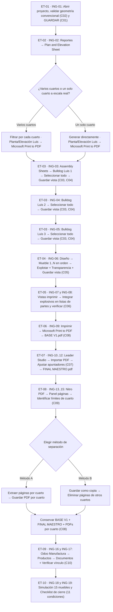

# Procedimiento Operativo Estándar (SOP): Generación de Ingeniería desde Cabinet Vision hacia Leader Studio, Nitro PDF y Odoo

**Código de flujo:** `WF-ING-DOC-01`  
**Versión:** `1.0`  
**Área responsable:** Ingeniería de Producto  
**Software:** `Cabinet Vision`, `Leader Studio Bulldog Design`, `Nitro PDF` y `Odoo`  
**Proyecto de referencia:** `Ibero` (ej. cuartos `Copy Station` y `Espacio de Descanso`)  
**Método aplicado:** Documentación de workflows visuales operativos (`Cerebro IA · 04_PROCESOS/GESTION_PROYECTOS/DOCUMENTAR_WORKFLOWS_VISUALES.md`)  
**Estado:** Flujo documentado a partir de ejecución narrada; pendiente de validación integral mediante simulación operativa en planta/equipos reales.

---

## 1. Objetivo, Alcance y Principio Operativo

### 1.1 Objetivo y entregable final
Generar, organizar, editar y publicar la ingeniería de fabricación de mobiliario modelado en `Cabinet Vision`:
- **Entregable final:** un conjunto de archivos de ingeniería organizados por cuarto, acompañado de un archivo **PDF Base** (`BASE V1`) y un archivo **PDF Maestro Final** (`FINAL MAESTRO`) que conservan la documentación completa del proyecto, publicados tanto en la estructura documental del proyecto como en los registros de `Odoo`.
- **Principio operativo:** generar de manera conjunta todo lo que pueda procesarse en lote; realizar manualmente únicamente los ajustes necesarios; separar la documentación al final; conservar siempre las versiones maestras; y publicar únicamente los archivos verificados.

### 1.2 Alcance y restricciones geométricas
- **Mobiliario compatible:** geometría convencional, componentes rectos y formas predominantemente rectangulares (gabinetes rectangulares, libreros convencionales, torres de almacenamiento, escritorios de geometría regular, muebles de puertas y entrepaños rectos, mobiliario modular convencional).
- **Mobiliario NO compatible (fuera de alcance):** componentes curvos, esquinas redondeadas, *fillets* o radios complejos, superficies orgánicas o geometrías especiales que no puedan documentarse con las plantillas establecidas. Estos casos requieren un procedimiento separado.

---

## 2. Mapa General de las 10 Etapas (`ET-01` a `ET-10`)

| Etapa | Nombre | Pasos fuente | Resultado esperado | Tipo | Controles | Fichas |
|---|---|---|---|---|---|---|
| `ET-01` | Preparación y guardado | Pasos 1–2 | Proyecto validado y guardado antes de reportear | Obligatoria | `C01`, `C02` | `ING-01` |
| `ET-02` | Plantas y elevaciones | Pasos 3–6 | Un PDF de planta y elevación por cada cuarto | Obligatoria (por cuarto) | — | `ING-02` |
| `ET-03` | Hojas de ensamble | Pasos 7–10 | 3 hojas automáticas por mueble en orden `1 → 2 → 3` | Obligatoria (lote) | `C03`, `C04` | `ING-03`, `ING-04`, `ING-05` |
| `ET-04` | Vistas explosivas manuales | Pasos 11–13 | 1 vista 3D explosiva por mueble en orden numérico | Obligatoria (manual) | `C05` | `ING-06` |
| `ET-05` | Integración en `Vistas imprimir` | Pasos 14–18 | Explosivos insertados y verificados en listas de partes | Obligatoria | `C06` | `ING-07`, `ING-08` |
| `ET-06` | Exportación de ingeniería base | Pasos 19–20 | `Ingeniería CB - Ibero - BASE V1.pdf` conservado | Obligatoria | `C08` | `ING-09` |
| `ET-07` | Procesamiento en `Leader Studio` | Pasos 21–24 | Apuntadores ajustados y `FINAL MAESTRO.pdf` exportado | Obligatoria | `C07`, `C08` | `ING-10`, `ING-11`, `ING-12` |
| `ET-08` | Separación por cuarto en `Nitro PDF` | Pasos 25–29 | PDFs por cuarto + conservación de Base y Maestro | Obligatoria (Método A o B) | `C08`, `C09` | `ING-13`, `ING-14`, `ING-15` |
| `ET-09` | Publicación en `Odoo` | Pasos 30–33 | PDFs en `Documentos` y vínculo documental verificado | Obligatoria | `C10` | `ING-16`, `ING-17` |
| `ET-10` | Simulación y cierre | §§12–15 | Caso de comprobación (15 muebles) y checklist de 11 pts | Verificación | `C01`–`C10` | `ING-18`, `ING-19` |

---

## 3. Diagrama de Flujo Principal y Variantes

---

## 4. Fichas Operativas por Actividad (`ING-01` a `ING-19`)

### `ING-01` — Apertura, validación geométrica y guardado previo en `Cabinet Vision` (`ET-01`, Pasos 1–2)
- **Tipo / Criticidad:** Obligatoria · **Controles Críticos (`C01`, `C02`)**
- **Punto de partida:** Lanzador de `Cabinet Vision`.
- **Ubicación:** Proyecto correspondiente (`Ibero`) y comando **Guardar**.
- **Acción:** Abrir `Cabinet Vision`, abrir el proyecto correcto, confirmar cuartos/muebles y que su geometría sea compatible (convencional/rectangular), y **guardar el proyecto antes de generar cualquier reporte**.
- **Configuración:** Mobiliario recto/modular convencional; guardar para proteger contra interrupciones o bloqueos durante el reporteado.
- **Condición:** Obligatoria. **Si el mobiliario tiene curvas, radios complejos o superficies orgánicas, este flujo NO aplica.**
- **Entrada / Salida:** Entrada: modelo 3D del proyecto. Salida: proyecto guardado y validado para documentación.
- **Verificación (`C01`, `C02`):** Proyecto guardado sin cambios pendientes y 100 % compatible geométricamente.
- **Error potencial y recuperación:** Perder cambios ante un error de procesamiento o intentar usar plantillas estándar en muebles curvos. *Recuperación:* guardar antes de reportear; derivar muebles curvos al flujo especial.
- **Evidencia visual:** `Captura pendiente` — proyecto `Ibero` abierto y guardado en `Cabinet Vision`.
- **Fuente / Estado:** §§2–3 (Pasos 1–2) · Reportado en narración / Pendiente validación operativa.

### `ING-02` — Generación de plantas y elevaciones por cuarto (`ET-02`, Pasos 3–6)
- **Tipo / Criticidad:** Obligatoria (por cuarto)
- **Punto de partida:** Workflow de **Diseño** en `Cabinet Vision`.
- **Ubicación:** Pestaña **Reportes** → generación de documentación → **`Plan and Elevation Sheet`** → plantillas Bulldog Design (**`Planta Luis`**, **`Elevación Luis`**) → **Imprimir** → **`Microsoft Print to PDF`**.
- **Acción:**
  1. Abrir `Reportes` y seleccionar `Plan and Elevation Sheet`.
  2. Posicionarse en el cuarto correspondiente, identificar su nombre y aplicar el filtro de cuarto (si el modelo tiene un solo cuarto a escala real, generar directamente).
  3. Seleccionar las plantillas **`Planta Luis`** y **`Elevación Luis`** (personalizaciones de Bulldog Design sin alterar su estructura técnica aprobada).
  4. Seleccionar todo el contenido requerido, pulsar **Imprimir**, elegir **`Microsoft Print to PDF`** y guardar un PDF por cuarto. Repetir para los demás cuartos.
- **Configuración:** Plantillas personales del usuario basadas en Bulldog Design (`Planta Luis` / `Elevación Luis`).
- **Condición:** Obligatoria por cada cuarto del proyecto.
- **Entrada / Salida:** Entrada: cuartos modelados en Diseño. Salida: un PDF de planta y elevación por cada cuarto.
- **Verificación:** Confirmar que el PDF corresponde al cuarto correcto y que medidas y vistas son legibles.
- **Error potencial y recuperación:** Mezclar cuartos en un mismo plano por omitir el filtro. *Recuperación:* filtrar explícitamente por cuarto y re-imprimir.
- **Evidencia visual:** `Captura pendiente` — `Reportes ‣ Plan and Elevation Sheet` con filtro de cuarto y plantillas `Planta Luis` / `Elevación Luis`.
- **Fuente / Estado:** §4 (Pasos 3–6) · Reportado en narración / Pendiente confirmar integración en PDF final (`PEND-A`).

### `ING-03` — Generación automática de Hojas de Ensamble: Plantilla 1 (`ET-03`, Pasos 7–8)
- **Tipo / Criticidad:** Obligatoria (en lote) · **Controles Críticos (`C03`, `C04`)**
- **Punto de partida:** Apartado **Reportes** en `Cabinet Vision`.
- **Ubicación:** **Reportes** → **Hojas de ensamble** (*Assembly Sheets*) → selector de plantillas → **`Bulldog Luis 1`**.
- **Acción:** Seleccionar `Bulldog Luis 1` (vista frontal, superior, lateral e isométrica), hacer clic en **Seleccionar todo**, ejecutar **Guardar vista** y **esperar a que `Cabinet Vision` termine de procesar** antes de continuar.
- **Configuración:** Se procesan **todos los muebles del proyecto en una sola ejecución** (sin filtrar por cuarto).
- **Condición:** Respetar estrictamente el orden `1 → 2 → 3`.
- **Entrada / Salida:** Entrada: proyecto guardado. Salida: vistas generales guardadas para todos los muebles.
- **Verificación (`C03`, `C04`):** Confirmar que terminó el procesamiento de `Bulldog Luis 1` antes de pasar a la plantilla 2.
- **Error potencial y recuperación:** Cambiar de plantilla o repetir comandos antes de que termine el cálculo. *Recuperación:* esperar finalización completa.
- **Evidencia visual:** `Captura pendiente` — `Assembly Sheets` con `Bulldog Luis 1` y botón `Guardar vista`.
- **Fuente / Estado:** §5 (Pasos 7–8) · Reportado en narración.

### `ING-04` — Generación automática de Hojas de Ensamble: Plantilla 2 (`ET-03`, Paso 9)
- **Tipo / Criticidad:** Obligatoria (en lote) · **Controles Críticos (`C03`, `C04`)**
- **Punto de partida:** **Hojas de ensamble** tras finalizar `Bulldog Luis 1`.
- **Ubicación:** **Hojas de ensamble** → selector de plantillas → **`Bulldog Luis 2`**.
- **Acción:** Cambiar a `Bulldog Luis 2` (corte frontal y corte lateral), hacer clic en **Seleccionar todo**, ejecutar **Guardar vista** y esperar a que termine el procesamiento.
- **Configuración:** Todos los muebles en lote.
- **Condición:** Ejecutar inmediatamente después de `Bulldog Luis 1`.
- **Entrada / Salida:** Entrada: lote completo. Salida: cortes frontal y lateral guardados.
- **Verificación (`C03`, `C04`):** Procesamiento concluido sin interrupciones.
- **Error potencial y recuperación:** Invertir orden de plantillas dificulta organizar las vistas. *Recuperación:* mantener secuencia `1 → 2 → 3`.
- **Evidencia visual:** `Captura pendiente` — `Assembly Sheets` con `Bulldog Luis 2`.
- **Fuente / Estado:** §5 (Paso 9) · Reportado en narración.

### `ING-05` — Generación automática de Hojas de Ensamble: Plantilla 3 (`ET-03`, Paso 10)
- **Tipo / Criticidad:** Obligatoria (en lote) · **Controles Críticos (`C03`, `C04`)**
- **Punto de partida:** **Hojas de ensamble** tras finalizar `Bulldog Luis 2`.
- **Ubicación:** **Hojas de ensamble** → selector de plantillas → **`Bulldog Luis 3`**.
- **Acción:** Seleccionar `Bulldog Luis 3` (lista de partes + espacio reservado para vista 3D explosiva), hacer clic en **Seleccionar todo**, ejecutar **Guardar vista** y esperar finalización.
- **Configuración:** Todos los muebles en lote; integración del explosivo se realiza manualmente en `ET-05`.
- **Condición:** Tercer y último paso de la secuencia `1 → 2 → 3`.
- **Entrada / Salida:** Entrada: lote completo. Salida: 3 hojas automáticas generadas por cada mueble.
- **Verificación (`C03`, `C04`):** Confirmar que finalizaron las 3 plantillas para todo el proyecto.
- **Error potencial y recuperación:** Omitir la plantilla 3 deja sin listas de partes. *Recuperación:* ejecutar `Bulldog Luis 3` antes de pasar a explosivos.
- **Evidencia visual:** `Captura pendiente` — `Assembly Sheets` con `Bulldog Luis 3`.
- **Fuente / Estado:** §5 (Paso 10) · Reportado en narración.

### `ING-06` — Creación manual de vistas 3D explosivas en orden numérico (`ET-04`, Pasos 11–13)
- **Tipo / Criticidad:** Obligatoria (manual) · **Punto Crítico (`C05`)**
- **Punto de partida:** Espacio de **Diseño** en `Cabinet Vision`.
- **Ubicación:** Vista del mueble individual → botones **Explotar**, **Transparencia** → clic secundario → **Guardar vista** (parte superior del menú contextual).
- **Acción:**
  1. Usar las plantas/elevaciones para identificar los muebles en orden numérico (`Mueble 1 → Mueble 2 → ... → Último mueble`).
  2. Entrar directamente al mueble, orientar la vista 3D para reconocer claramente los componentes.
  3. Hacer un clic en **Explotar** y un clic en **Transparencia**.
  4. Clic secundario → **Guardar vista** (parte superior del menú contextual).
  5. Repetir estrictamente en orden secuencial para todos los muebles.
- **Configuración:** El orden secuencial es indispensable porque las vistas manuales guardadas pueden mostrar el nombre del mueble (torre, gabinete, puerta) pero **no necesariamente su número de orden**.
- **Condición:** Obligatoria; prohibido saltar muebles o alterar el orden.
- **Entrada / Salida:** Entrada: plantas/elevaciones + modelo 3D. Salida: 1 vista 3D explosiva guardada por mueble en orden consecutivo.
- **Verificación (`C05`):** Conteo de vistas manuales igual al total de muebles del proyecto.
- **Error potencial y recuperación:** Alterar el orden provoca emparejamientos erróneos en `Vistas imprimir`. *Recuperación:* verificar contra plantas y geometría del mueble.
- **Evidencia visual:** `Captura pendiente` — mueble en vista 3D con `Explotar` + `Transparencia` activos y menú contextual `Guardar vista`.
- **Fuente / Estado:** §6 (Pasos 11–13) · Reportado en narración.

### `ING-07` — Localización de hojas y vistas manuales en `Vistas imprimir` (`ET-05`, Pasos 14–16)
- **Tipo / Criticidad:** Obligatoria
- **Punto de partida:** Workspace de `Cabinet Vision`.
- **Ubicación:** Pestaña **Vistas imprimir** (zona superior derecha) y menú izquierdo de vistas guardadas.
- **Acción:**
  1. Abrir **Vistas imprimir**.
  2. Identificar cada hoja de lista de partes por su encabezado superior (`Mueble 1 — [Nombre del gabinete]`).
  3. Distinguir en el menú izquierdo: **Vistas superiores** (automáticas de planos/ensamble) vs **Vistas inferiores** (explosivos guardados manualmente).
- **Configuración:** Referencia doble: orden consecutivo + nombre del mueble.
- **Condición:** Obligatoria antes de insertar explosivos.
- **Entrada / Salida:** Entrada: hojas automáticas + vistas manuales. Salida: correspondencia localizada.
- **Verificación:** Confirmar que aparecen tanto las hojas automáticas como las vistas manuales inferiores.
- **Error potencial y recuperación:** Confundir vistas automáticas superiores con explosivos manuales inferiores. *Recuperación:* ubicar siempre los explosivos en el bloque inferior del menú izquierdo.
- **Evidencia visual:** `Captura pendiente` — pestaña `Vistas imprimir` mostrando encabezado `Mueble X` y menú izquierdo dividido en vistas superiores/inferiores.
- **Fuente / Estado:** §7 (Pasos 14–16) · Reportado en narración.

### `ING-08` — Integración de explosivos en listas de partes y verificación (`ET-05`, Pasos 17–18)
- **Tipo / Criticidad:** Obligatoria · **Punto Crítico (`C06`)**
- **Punto de partida:** `Vistas imprimir`, hoja de lista de partes (`Bulldog Luis 3`) del Mueble 1..N.
- **Ubicación:** Espacio reservado para explosivo dentro de cada hoja de lista de partes.
- **Acción:**
  1. Abrir la lista de partes del Mueble 1, localizar su explosivo manual e incorporarlo en el espacio reservado.
  2. Confirmar visualmente por **geometría y componentes** (no solo por orden) que corresponde al mueble correcto.
  3. Repetir hasta el último mueble y ejecutar la verificación de 6 puntos (3 hojas por mueble, todas las listas con explosivo, sin cruces, sin faltantes, sin duplicados, piezas distinguibles).
- **Configuración:** Verificación visual obligatoria por geometría.
- **Condición:** Obligatoria antes de imprimir el PDF base.
- **Entrada / Salida:** Entrada: listas de partes vacías + vistas explosivas. Salida: hojas de ingeniería integradas y verificadas.
- **Verificación (`C06`):** Checklist de 6 puntos aprobado al 100 %.
- **Error potencial y recuperación:** Insertar el explosivo de otro mueble o duplicar uno accidentalmente (`INC-02`). *Recuperación:* reemplazar por la vista correcta antes de imprimir.
- **Evidencia visual:** `Captura pendiente` — lista de partes con vista explosiva integrada.
- **Fuente / Estado:** §7 (Pasos 17–18) · Reportado en narración / Pendiente registrar comando exacto de inserción (`PEND-C`).

### `ING-09` — Exportación y resguardo de Ingeniería Base (`ET-06`, Pasos 19–20)
- **Tipo / Criticidad:** Obligatoria · **Punto Crítico (`C08`)**
- **Punto de partida:** `Vistas imprimir` verificadas.
- **Ubicación:** Opción **Imprimir** en la franja azul superior → **`Microsoft Print to PDF`** → carpeta `Luis del Ángel / Ibero / Ingeniería /`.
- **Acción:** Imprimir todas las hojas mediante `Microsoft Print to PDF` y guardar como `Ingeniería CB - Ibero - BASE V1.pdf`.
- **Configuración:** Nombre propuesto: `Ingeniería CB - Ibero - BASE V1.pdf`. Incluye los muebles de todos los cuartos.
- **Condición:** **No sustituir ni sobrescribir** este archivo maestro inicial durante ediciones posteriores.
- **Entrada / Salida:** Entrada: hojas integradas en `Vistas imprimir`. Salida: `BASE V1.pdf` resguardado.
- **Verificación (`C08`):** PDF generado y guardado con nombre distinto al maestro procesado.
- **Error potencial y recuperación:** Sobrescribir `BASE V1` al exportar desde `Leader Studio`. *Recuperación:* mantener nombres diferenciados (`BASE V1` vs `FINAL MAESTRO`).
- **Evidencia visual:** `Captura pendiente` — franja azul superior con `Imprimir` y diálogo `Microsoft Print to PDF`.
- **Fuente / Estado:** §8 (Pasos 19–20) · Reportado en narración / Convención de nombres pendiente de aprobación (`PEND-F`).

### `ING-10` — Apertura de `Leader Studio Bulldog Design` e importación de PDF (`ET-07`, Pasos 21–22)
- **Tipo / Criticidad:** Obligatoria
- **Punto de partida:** Escritorio / lanzador de `Leader Studio Bulldog Design`.
- **Ubicación:** Pantalla principal `Leader Studio Bulldog Design` → **`Importar PDF`**.
- **Acción:** Iniciar `Leader Studio`, esperar carga, seleccionar **`Importar PDF`**, elegir `Ingeniería CB - Ibero - BASE V1.pdf` y permitir que la aplicación procese las vistas explosivas e incorpore los *leaders* basados en los números de pieza.
- **Configuración:** Archivo de entrada: `BASE V1.pdf`.
- **Condición:** Obligatoria para generar apuntadores normalizados.
- **Entrada / Salida:** Entrada: `BASE V1.pdf`. Salida: hojas con explosivos y leaders generados para ajuste.
- **Verificación:** Hojas que requieren ajuste de leaders visibles en pantalla.
- **Error potencial y recuperación:** Importar un PDF equivocado o ya separado. *Recuperación:* importar siempre el archivo `BASE V1`.
- **Evidencia visual:** `Captura pendiente` — pantalla principal de `Leader Studio` con botón `Importar PDF`.
- **Fuente / Estado:** §9 (Pasos 21–22) · Reportado en narración.

### `ING-11` — Ajuste manual de apuntadores (`leaders`) por pieza (`ET-07`, Paso 23)
- **Tipo / Criticidad:** Obligatoria (manual) · **Punto Crítico (`C07`)**
- **Punto de partida:** Vistas procesadas dentro de `Leader Studio`.
- **Ubicación:** Hojas con vistas explosivas y apuntadores mostradas por `Leader Studio`.
- **Acción:** Identificar los números de pieza, revisar el leader de cada número y **ajustar manualmente la dirección de su apuntador** para colocarlo inequívocamente sobre la pieza correspondiente. Repetir en todas las hojas que lo requieran (sin editar manualmente las demás hojas).
- **Configuración:** Criterio: cada número señala sin ambigüedad su componente en el explosivo.
- **Condición:** Obligatoria en todas las hojas de explosivos procesadas.
- **Entrada / Salida:** Entrada: leaders automáticos. Salida: leaders direccionados con precisión.
- **Verificación (`C07`):** Revisión visual de que ningún apuntador señala una pieza ajena o queda ambiguo.
- **Error potencial y recuperación:** Apuntador mal dirigido causa errores de armado en taller. *Recuperación:* reacomodar el vértice/punta del leader sobre la pieza correcta.
- **Evidencia visual:** `Captura pendiente` — vista explosiva en `Leader Studio` con leaders ajustados sobre piezas.
- **Fuente / Estado:** §9 (Paso 23) · Reportado en narración.

### `ING-12` — Exportación de Ingeniería Maestra Procesada (`ET-07`, Paso 24)
- **Tipo / Criticidad:** Obligatoria · **Punto Crítico (`C08`)**
- **Punto de partida:** `Leader Studio` con todos los leaders ajustados.
- **Ubicación:** Función de exportación PDF en `Leader Studio` → carpeta del proyecto (`Ingeniería/`).
- **Acción:** Exportar el documento PDF y guardarlo como versión maestra procesada (`Ingeniería CB - Ibero - FINAL MAESTRO.pdf`), conservando intacto `BASE V1.pdf`.
- **Configuración:** Nombre propuesto: `Ingeniería CB - Ibero - FINAL MAESTRO.pdf`.
- **Condición:** Obligatoria antes de separar por cuarto en `Nitro PDF`.
- **Entrada / Salida:** Entrada: documento ajustado. Salida: `FINAL MAESTRO.pdf` resguardado junto a `BASE V1.pdf`.
- **Verificación (`C08`):** Existen ambos archivos (`BASE V1` y `FINAL MAESTRO`).
- **Error potencial y recuperación:** Perder hojas no procesadas si `Leader Studio` no las conservara (`PEND-D`). *Recuperación:* verificar conteo de páginas contra `BASE V1`.
- **Evidencia visual:** `Captura pendiente` — carpeta del proyecto mostrando `BASE V1.pdf` y `FINAL MAESTRO.pdf`.
- **Fuente / Estado:** §9 (Paso 24) · Reportado en narración / Pendiente verificar conservación íntegra de hojas (`PEND-D`).

### `ING-13` — Apertura en `Nitro PDF` y activación de panel de páginas (`ET-08`, Pasos 25–27)
- **Tipo / Criticidad:** Obligatoria · **Punto Crítico (`C09`)**
- **Punto de partida:** `Nitro PDF`.
- **Ubicación:** Barra lateral izquierda → visualización por páginas/miniaturas.
- **Acción:** Abrir `FINAL MAESTRO.pdf`, activar y ampliar el panel izquierdo de miniaturas, revisar el orden de las hojas e identificar visualmente el primer y último mueble de cada cuarto (ej. muebles 1 a 15 para el primer cuarto).
- **Configuración:** **No asumir que el orden es correcto únicamente por la numeración**; confirmar visualmente la agrupación por cuarto.
- **Condición:** Obligatoria antes de extraer o eliminar páginas.
- **Entrada / Salida:** Entrada: `FINAL MAESTRO.pdf`. Salida: rangos de páginas exactos por cuarto.
- **Verificación (`C09`):** Límite inicial y final de cada cuarto confirmado visualmente en miniaturas.
- **Error potencial y recuperación:** Cortar en una página equivocada dejando muebles mezclados. *Recuperación:* revisar encabezados `Mueble X` en miniaturas antes de separar.
- **Evidencia visual:** `Captura pendiente` — `Nitro PDF` con panel lateral de miniaturas ampliado.
- **Fuente / Estado:** §10 (Pasos 25–27) · Reportado en narración.

### `ING-14` — Separación de PDFs independientes por cuarto (`ET-08`, Paso 28)
- **Tipo / Criticidad:** Obligatoria (2 variantes: Método A o B) · **Punto Crítico (`C09`)**
- **Punto de partida:** `FINAL MAESTRO.pdf` abierto en `Nitro PDF` con rangos identificados.
- **Ubicación:** Herramientas de página de `Nitro PDF`.
- **Acción:** Elegir el método más práctico:
  - **Método A (Extraer páginas):** seleccionar las páginas del cuarto → extraer → guardar con nombre del cuarto → repetir.
  - **Método B (Guardar como + eliminar):** `Guardar como` copia con nombre del cuarto → seleccionar y eliminar páginas de otros cuartos → guardar → repetir siempre desde `FINAL MAESTRO.pdf`.
- **Configuración:** Ejemplos de nombres: `Ingeniería CB - Ibero - Copy Station.pdf`, `Ingeniería CB - Ibero - Espacio de Descanso.pdf`.
- **Condición:** En Método B, abrir siempre `FINAL MAESTRO.pdf` como origen (nunca modificar el maestro destructivamente).
- **Entrada / Salida:** Entrada: `FINAL MAESTRO.pdf`. Salida: 1 PDF independiente por cuarto.
- **Verificación (`C09`):** Comprobar que cada PDF contiene únicamente los muebles de su cuarto sin páginas faltantes.
- **Error potencial y recuperación:** Guardar sobre `FINAL MAESTRO.pdf` tras eliminar páginas. *Recuperación:* usar `Guardar como` antes de borrar o recuperar desde `BASE V1`.
- **Evidencia visual:** `Captura pendiente` — cuadro de extracción/eliminación de páginas en `Nitro PDF`.
- **Fuente / Estado:** §10 (Paso 28) · Reportado en narración.

### `ING-15` — Resguardo de versiones maestras y derivadas (`ET-08`, Paso 29)
- **Tipo / Criticidad:** Obligatoria · **Punto Crítico (`C08`)**
- **Punto de partida:** Carpeta de ingeniería del proyecto (`Luis del Ángel / Ibero / Ingeniería /`).
- **Ubicación:** Estructura documental del proyecto.
- **Acción:** Confirmar que coexisten los tres niveles de archivo: 1) PDF base (`BASE V1`), 2) PDF maestro final (`FINAL MAESTRO`), y 3) PDFs independientes por cuarto.
- **Configuración:** Ningún archivo maestro debe eliminarse ni sobreescribirse.
- **Condición:** Obligatoria antes de publicar en `Odoo`.
- **Entrada / Salida:** Entrada: archivos exportados. Salida: repositorio de ingeniería completo y recuperable.
- **Verificación (`C08`):** Los 3 niveles existen y abren correctamente.
- **Error potencial y recuperación:** Eliminar maestros tras separar cuartos impide regenerar omisiones. *Recuperación:* restaurar respaldo si ocurrió.
- **Evidencia visual:** `Captura pendiente` — carpeta con `BASE V1`, `FINAL MAESTRO` y PDFs por cuarto.
- **Fuente / Estado:** §10 (Paso 29) · Reportado en narración.

### `ING-16` — Localización del producto y carga de ingeniería en `Odoo` (`ET-09`, Pasos 30–31)
- **Tipo / Criticidad:** Obligatoria · **Punto Crítico (`C10`)**
- **Punto de partida:** `Odoo` web.
- **Ubicación:** **`Manufactura`** → **`Productos`** → filtro por proyecto (`Ibero`) → tarjeta del producto (ej. mueble de `Espacio de Descanso`) → opción superior **`Documentos`**.
- **Acción:** Filtrar por proyecto, localizar el producto exacto, entrar a **`Documentos`**, incorporar el archivo de ingeniería correspondiente y comprobar que quedó asociado al producto correcto. Repetir para los demás muebles terminados.
- **Configuración:** Validar nombre y proyecto antes de adjuntar (`C10`).
- **Condición:** Obligatoria para consulta técnica centralizada. *(Pendiente definir si se adjunta PDF de cuarto completo o archivo individual por mueble, `PEND-E`).*
- **Entrada / Salida:** Entrada: PDFs de ingeniería verificados. Salida: ingeniería adjunta en `Odoo`.
- **Verificación (`C10`):** Archivo visible en `Documentos` del producto correcto.
- **Error potencial y recuperación:** Asociar ingeniería al producto equivocado. *Recuperación:* eliminar adjunto erróneo y cargar en la tarjeta correcta.
- **Evidencia visual:** `Captura pendiente` — `Odoo Manufactura ‣ Productos ‣ Documentos`.
- **Fuente / Estado:** §11 (Pasos 30–31) · Reportado en narración / Pendiente definir granularidad cuarto vs mueble (`PEND-E`).

### `ING-17` — Verificación de vinculación documental y cierre de publicación (`ET-09`, Pasos 32–33)
- **Tipo / Criticidad:** Obligatoria
- **Punto de partida:** Tarjeta de producto en `Odoo` y estructura de carpetas del proyecto.
- **Ubicación:** Vínculo hacia la carpeta de producción / estructura documental del proyecto (3D, CV originales, info base, ingeniería, producción, renders, requisiciones, submittals).
- **Acción:** Verificar que el enlace abre correctamente (actualmente apunta a producción como ubicación de uso frecuente, permitiendo navegar al resto de carpetas) y confirmar los 5 criterios de publicación (producto correcto, archivo en Documentos, versión liberada, ruta abre, acceso para áreas).
- **Configuración:** Comprobar acceso desde equipos y cuentas autorizadas (sin depender de carpeta local personal, `PEND-G`).
- **Condición:** Obligatoria para cerrar publicación.
- **Entrada / Salida:** Entrada: producto con documento adjunto. Salida: publicación y trazabilidad documental confirmadas.
- **Verificación:** Vínculo funcional y permisos comprobados.
- **Error potencial y recuperación:** Enlace apuntando a ruta local personal inaccesible para otros usuarios. *Recuperación:* actualizar a ruta compartida accesible.
- **Evidencia visual:** `Captura pendiente` — apertura del vínculo hacia la estructura documental del proyecto.
- **Fuente / Estado:** §11 (Pasos 32–33) · Reportado en narración / Pendiente validar acceso multiusuario (`PEND-G`).

### `ING-18` — Simulación de comprobación (caso de 15 muebles en `Copy Station`) (`ET-10`, §12)
- **Tipo / Criticidad:** Verificación / Referencia
- **Punto de partida:** Recorrido de 17 pasos de simulación del flujo completo.
- **Ubicación:** Tabla de simulación (§12).
- **Acción:** Contrastar el flujo completo usando el escenario de comprobación (ej. `Copy Station` con muebles 1–15: 15 juegos de 3 hojas, 15 explosivos manuales, 15 listas con explosivo, leaders verificados, páginas delimitadas en Nitro, PDF independiente de `Copy Station` y maestro conservando el resto).
- **Configuración:** La cifra de `15` es un ejemplo de comprobación de flujo, **no** una cantidad confirmada del proyecto completo.
- **Condición:** No sustituye una prueba real dentro de los programas.
- **Entrada / Salida:** Entrada: flujo documentado. Salida: validación lógica de integridad sin omisiones.
- **Verificación:** Consistencia 1:1 entre muebles, hojas, explosivos y páginas por cuarto.
- **Error potencial y recuperación:** Asumir la cifra de 15 como dato real de Ibero. *Recuperación:* usar siempre la cantidad real del proyecto.
- **Evidencia visual:** `N/A` (matriz de simulación).
- **Fuente / Estado:** §12 · Referencia de comprobación.

### `ING-19` — Checklist integral de cierre (`ET-10`, §15)
- **Tipo / Criticidad:** Obligatoria
- **Punto de partida:** Fin de publicación en `Odoo`.
- **Ubicación:** Criterio de cierre de 11 condiciones (§15).
- **Acción:** Verificar simultáneamente las 11 condiciones: proyecto CV guardado, plantas/elevaciones generadas, 3 hojas por mueble, explosivos en listas, BASE V1 y FINAL MAESTRO conservados, leaders direccionados, PDFs separados por cuarto, sin páginas faltantes/mezcladas, archivos en estructura del proyecto, asociados en Odoo y vínculos funcionales.
- **Configuración:** 11/11 condiciones cumplidas.
- **Condición:** Obligatoria para declarar terminada la ingeniería.
- **Entrada / Salida:** Entrada: evidencias `ING-01` a `ING-17`. Salida: ingeniería oficialmente liberada.
- **Verificación:** Checklist 11/11 marcado.
- **Error potencial y recuperación:** Liberar con algún pendiente crítico abierto. *Recuperación:* resolver antes de autorizar consulta/fabricación.
- **Evidencia visual:** `N/A` (checklist de cierre).
- **Fuente / Estado:** §15 · Estructurado según método.

---

## 5. Registro de Controles Críticos (`C01`–`C10`) e Incidencias (`INC-01`–`INC-06`)

### 5.1 Controles Críticos
| ID | Ficha | Control | Criterio de aceptación | Acción si falla |
|---|---|---|---|---|
| `C01` | `ING-01` | Guardado previo en `Cabinet Vision` | Proyecto guardado sin cambios pendientes antes de reportear | Guardar antes de ejecutar reportes |
| `C02` | `ING-01` | Compatibilidad geométrica | Mobiliario recto/convencional sin curvas ni radios complejos | Derivar a procedimiento especial |
| `C03` | `ING-03..05` | Secuencia de plantillas | Orden estricto `Bulldog Luis 1 → 2 → 3` | Re-ejecutar en orden correcto |
| `C04` | `ING-03..05` | Finalización del procesamiento | Esperar fin de generación antes de cambiar de plantilla | Esperar sin repetir comandos |
| `C05` | `ING-06` | Orden de explosivos manuales | Vistas guardadas de `Mueble 1` al último en orden | Cotejar contra plantas y geometría |
| `C06` | `ING-08` | Correspondencia de vistas | Cada explosivo coincide geométricamente con su lista de partes | Reemplazar vista antes de imprimir |
| `C07` | `ING-11` | Identificación de piezas en `Leader Studio` | Cada número apunta inequívocamente a su componente | Reacomodar apuntador manual |
| `C08` | `ING-09, 12, 15` | Conservación de versiones | Coexisten `BASE V1`, `FINAL MAESTRO` y PDFs por cuarto | No sobrescribir maestros; usar `Guardar como` |
| `C09` | `ING-13, 14` | Integridad por cuarto en `Nitro PDF` | Límites verificados; sin páginas faltantes ni mezcladas | Re-extraer desde `FINAL MAESTRO` |
| `C10` | `ING-16` | Publicación correcta en `Odoo` | Ingeniería asociada al producto y proyecto exactos | Corregir adjunto en tarjeta correcta |

### 5.2 Incidencias y Errores Frecuentes
| ID | Ficha | Incidencia | Impacto | Recuperación conocida |
|---|---|---|---|---|
| `INC-01` | `ING-02` | Omitir filtro de cuarto en plantas/elevaciones | Mezcla de áreas distintas en un mismo plano | Filtrar explícitamente por cuarto y re-imprimir |
| `INC-02` | `ING-06..08` | Vistas manuales sin número o en orden alterado | Inserción de explosivo equivocado en lista de partes | Verificar siempre por geometría y componentes |
| `INC-03` | `ING-09, 12` | Sobrescribir `BASE V1` o `FINAL MAESTRO` | Pérdida de páginas completas del proyecto | Mantener nombres diferenciados y usar `Guardar como` |
| `INC-04` | `ING-11` | Apuntador (`leader`) mal dirigido | Error de identificación de pieza en ensamble | Ajustar punta del leader sobre pieza exacta |
| `INC-05` | `ING-13, 14` | Asumir límites de cuarto solo por numeración | Cuartos incompletos o con muebles ajenos | Inspeccionar miniaturas y encabezados en Nitro |
| `INC-06` | `ING-16, 17` | Enlace a carpeta local personal en `Odoo` | Usuarios autorizados sin acceso a archivos | Usar ruta compartida accesible multiusuario |

---

## 6. Mapa de Transferencia entre Aplicaciones (`TR-01`–`TR-05`)

| ID | Emisor | Destino funcional | Objeto y formato | Convención | Comprobación | Pendiente de validar |
|---|---|---|---|---|---|---|
| `TR-01` | `Cabinet Vision` (`Diseño/Reportes`) | Carpeta de proyecto | Plantas y elevaciones (PDF por cuarto) | `Planta Luis` / `Elevación Luis` | Legibilidad y cuarto correcto | `PEND-A` (si se integran al PDF final) |
| `TR-02` | `Cabinet Vision` (`Vistas imprimir`) | Carpeta `Ingeniería/` | Hojas de ensamble + explosivos (PDF) | `Ingeniería CB - Ibero - BASE V1.pdf` | `C06`, `C08` | `PEND-B`, `PEND-C`, `PEND-F` |
| `TR-03` | `BASE V1.pdf` | `Leader Studio Bulldog Design` | PDF con leaders ajustados | `Ingeniería CB - Ibero - FINAL MAESTRO.pdf` | `C07`, `C08` | `PEND-D` (conservación íntegra de hojas) |
| `TR-04` | `FINAL MAESTRO.pdf` | `Nitro PDF` → Carpeta `Ingeniería/` | PDFs independientes por cuarto | `Ingeniería CB - Ibero - [Cuarto].pdf` | `C09` (miniaturas y conteo) | `PEND-F` |
| `TR-05` | PDFs por cuarto + Estructura | `Odoo` (`Manufactura ‣ Productos`) | Adjunto en `Documentos` + vínculo de red | Producto por proyecto/cuarto | `C10` + acceso vínculo | `PEND-E` (cuarto vs mueble), `PEND-G` |

---

## 7. Aspectos Pendientes de Comprobar en Ejecución Real (`PEND-A` a `PEND-G`)

- **`PEND-A` (Integración de plantas y elevaciones):** Confirmar si deben incorporarse al PDF final de ingeniería, en qué orden y mediante qué acción de `Nitro PDF`.
- **`PEND-B` (Cantidad y orden de hojas):** Comprobar que cada mueble produce las 3 hojas previstas y permanecen ordenadas para separarse por cuarto.
- **`PEND-C` (Inserción del explosivo):** Registrar el comando específico en `Cabinet Vision` para colocar la vista manual dentro de la plantilla `Bulldog Luis 3`.
- **`PEND-D` (Comportamiento de `Leader Studio`):** Comprobar si el PDF exportado conserva todas las hojas originales o si requiere re-integración con el maestro.
- **`PEND-E` (Publicación por producto en `Odoo`):** Definir si se adjunta el PDF completo del cuarto o un archivo individual extraído por mueble.
- **`PEND-F` (Estandarización de nombres):** Aprobar formalmente la convención de nombres (`BASE V1`, `FINAL MAESTRO`, `[Cuarto]`).
- **`PEND-G` (Enlaces documentales):** Verificar que la ruta en `Odoo` abre desde todos los equipos/cuentas autorizadas sin depender de carpetas locales personales.
