# Procedimiento Operativo Estándar (SOP): Generación, Organización y Liberación de Entregables de Maquinado desde Cabinet Vision hacia Odoo y Producción

**Código de flujo:** `WF-ING-MAQ-01`  
**Versión:** `1.0`  
**Método aplicado:** Documentación de workflows visuales operativos (`Cerebro IA · 04_PROCESOS/GESTION_PROYECTOS/DOCUMENTAR_WORKFLOWS_VISUALES.md`)  
**Caso de referencia documentado:** Proyecto **Ibero** — Concepto **Puerta Intercom Grande** (aplicable a otros proyectos y conceptos de mobiliario)  
**Principio rector:** Garantizar que los archivos de fabricación sean correctos, estén organizados, sean rastreables y puedan consultarse desde un punto de referencia compartido (`Odoo` + carpeta compartida), evitando la dispersión de información y la dependencia de comunicaciones informales.

---

## 1. Alcance, Condición Previa y Reglas de Fidelidad

### 1.1 Condición previa obligatoria (Planeación)
Antes de abrir `Cabinet Vision`, debe existir un **archivo de configuración de lotes de corte o lotes de maquinado** definido por el **líder de Ingeniería** en coordinación con el área de **Maquinados**.

El documento de referencia debe establecer:
1. Proyecto al que pertenece el mobiliario.
2. Concepto o mueble que se fabricará.
3. Cantidad de unidades que integran cada lote.
4. Agrupación de los muebles que deberán procesarse juntos (un solo mueble, varias unidades del mismo concepto o combinación de muebles diferentes).
5. Seccionadora o dimensionadora asignada.
6. Enchapadora asignada.
7. Máquina de perforado o maquinado posterior (CNC punto a punto / P2P), cuando corresponda.
8. Cualquier indicación especial relacionada con el procesamiento.

> **Regla fundamental:** Ingeniería **no** debe definir arbitrariamente los lotes durante la generación de programas. Debe utilizar exclusivamente la configuración previamente acordada y autorizada. Cualquier discrepancia entre lo solicitado y lo configurado en `Cabinet Vision` debe resolverse antes de continuar.

### 1.2 Reglas de fidelidad y alcance aplicadas a este documento
- Este documento **describe fielmente el procedimiento ejecutado**, sin automatizarlo ni modificar el funcionamiento actual.
- Se distinguen explícitamente:
  - **Operaciones obligatorias** vs **operaciones condicionales** (dependientes de máquina o lote).
  - **Procedimiento observado**, **recomendaciones operativas** y **verificaciones pendientes**.
- Ningún paso se da por obvio, ninguna ruta no comprobada se marca como validada y ningún resumen de materiales cortables (`Material Summary`) se confunde con una lista de materiales integral (`BOM`).

---

## 2. Mapa General de las 12 Etapas (`ET-01` a `ET-12`)

| Etapa | Nombre | Resultado esperado | Tipo | Controles críticos | Fichas |
|---|---|---|---|---|---|
| `ET-01` | Planeación | Lote de corte definido y autorizado | Obligatoria | `C01` | `MQ-01` |
| `ET-02` | Preparación | Perfil y proyecto correctos en `Cabinet Vision` | Obligatoria | — | `MQ-02` |
| `ET-03` | Filtrado | Concepto y cantidades validadas en `C2M Center` | Obligatoria | `C02` | `MQ-03` |
| `ET-04` | Configuración | Máquinas y `Premill Edge Banding` seleccionados | Obligatoria / Condicional (P2P) | `C03`, `C04` | `MQ-04`, `MQ-05` |
| `ET-05` | Optimización | Diagramas de corte generados (`Run` → `OK`) | Obligatoria | `C05` | `MQ-06` |
| `ET-06` | Exportación | Códigos NC y etiquetas generados en rutas cortas | Obligatoria / Condicional (P2P) | `C06` | `MQ-07`, `MQ-08`, `MQ-09` |
| `ET-07` | Reportes | PDFs de materiales cortables y diagramas exportados | Obligatoria | — | `MQ-10`, `MQ-11` |
| `ET-08` | Organización | Carpeta consolidada por concepto y verificada | Obligatoria | `C07` | `MQ-12` |
| `ET-09` | Integración | Documentos y ruta de red vinculados a `Odoo` | Obligatoria | `C08`, `C09` | `MQ-13`, `MQ-14` |
| `ET-10` | Validación | Acceso y permisos comprobados desde 2.ª PC | Obligatoria | `C10` | `MQ-15` |
| `ET-11` | Comunicación | Información transmitida directamente a `Maquinados` | Obligatoria | `C11` | `MQ-16` |
| `ET-12` | Acceso alternativo y cierre | Ruta disponible en PC de seccionadora (si aplica) y cierre | Condicional / Obligatoria | `C12` | `MQ-17`, `MQ-18` |

---

## 3. Diagrama de Flujo Principal y Decisiones

```mermaid
flowchart TD
    A["ET-01 · MQ-01: Archivo de lotes autorizado (C01)"] --> B["ET-02 · MQ-02: Perfil Machine Edit + Proyecto Ibero en Diseño"]
    B --> C["ET-03 · MQ-03: C2M Center → Filtrar concepto (C02)"]
    C --> D{"¿1.er número = cantidad del lote?"}
    D -- "No" --> D1["DETENER: Resolver discrepancia antes de continuar"]
    D -- "Sí" --> E["ET-04 · MQ-04: Configurar Dimensionadora y Enchapadora (C03)"]
    E --> F{"¿Lote requiere máquina P2P?"}
    F -- "Sí (según archivo de lotes)" --> F1["Seleccionar máquina P2P (ej. Nanxing)"]
    F -- "No (ej. Puerta Intercom Grande)" --> F2["Dejar Sin máquina P2P (perforaciones manuales)"]
    F1 --> G["ET-04 · MQ-05: File ‣ Preferences ‣ Geometry → Premill Edge Banding (C04)"]
    F2 --> G
    G --> H{"¿Enchapadora nueva Nanxing?"}
    H -- "Sí (con precorte)" --> H1["Activar Premill Edge Banding · Valor máx = 3"]
    H -- "No (sin precorte)" --> H2["Desactivar Premill Edge Banding"]
    H1 --> I["ET-05 · MQ-06: Verificar lote/máquinas → Run → OK (C05)"]
    H2 --> I
    I --> J["ET-06 · MQ-07: Crear SEC, NANXING, LABEL en Producción"]
    J --> K["ET-06 · MQ-08: Output Data → Asignar LABEL y SEC (C06)"]
    K --> L["ET-06 · MQ-09: Ejecutar exportación y validar archivos en disco"]
    L --> M["ET-07 · MQ-10 y MQ-11: Exportar PDF Material Summary y Saw Cut List Landscape"]
    M --> N["ET-08 · MQ-12: Renombrar y mover carpetas (Ctrl+X) a Puerta Intercom Grande (C07)"]
    N --> O["ET-09 · MQ-13 y MQ-14: Odoo Manufactura → Productos → Documentos + Notas internas (C08, C09)"]
    O --> P["ET-10 · MQ-15: Probar acceso y permisos desde 2.ª PC (C10)"]
    P --> Q["ET-11 · MQ-16: Comunicación directa de 8 puntos con Maquinados (C11)"]
    Q --> R{"¿PC de seccionadora tiene acceso a Odoo?"}
    R -- "No / Sin usuario" --> S["ET-12 · MQ-17: Flujo B — Nota visible con ruta en PC de seccionadora (C12)"]
    R -- "Sí" --> T["ET-12 · MQ-18: Verificación integral y liberación cerrada"]
    S --> T
```



---

## 4. Fichas Operativas por Actividad (`MQ-01` a `MQ-18`)

### `MQ-01` — Recepción y validación del archivo de configuración de lotes de corte (`ET-01`)
- **Tipo / Criticidad:** Obligatoria · **Punto Crítico (`C01`)**
- **Punto de partida:** Documento de planeación emitido por el líder de Ingeniería en coordinación con Maquinados.
- **Ubicación:** Archivo de configuración de lotes de corte / maquinado del proyecto.
- **Acción:** Revisar el archivo de lotes y extraer proyecto, concepto, cantidad de unidades, agrupación, seccionadora, enchapadora, máquina P2P (si aplica) e indicaciones especiales.
- **Configuración:** Caso de referencia: Proyecto `Ibero`, Concepto `Puerta Intercom Grande`, Corte `Dimensionadora Zaragoza` (Nanxing), Enchapado `Enchapadora nueva Nanxing`, Maquinado posterior `Sin máquina P2P` (perforaciones manuales).
- **Condición:** Obligatoria antes de iniciar cualquier operación en `Cabinet Vision`.
- **Entrada / Salida:** Entrada: acuerdo Ingeniería–Maquinados. Salida: parámetros autorizados del lote listos para cotejar en `Cabinet Vision`.
- **Verificación (`C01`):** Confirmar que existen los 8 datos mínimos del lote y que no hay ambigüedad sobre máquinas ni cantidades.
- **Error potencial y recuperación:** Definir lotes arbitrariamente durante la programación genera retrabajo y desalineación con planta. *Recuperación:* detener el proceso y solicitar confirmación al líder de Ingeniería antes de programar.
- **Evidencia visual:** `Captura pendiente` — debe verse el archivo de lotes autorizado con proyecto, concepto, cantidad y máquinas asignadas.
- **Fuente / Estado:** §2 · Reportado en narración / Pendiente de verificación con archivo real de lotes.

---

### `MQ-02` — Selección de perfil `Machine Edit` y apertura del proyecto (`ET-02`)
- **Tipo / Criticidad:** Obligatoria · Estándar
- **Punto de partida:** Escritorio / lanzador de `Cabinet Vision`.
- **Ubicación:** Selector de perfil de `Cabinet Vision` y menú de apertura de proyectos.
- **Acción:**
  1. Seleccionar el perfil **`Machine Edit`** (preferentemente, por si se requiere generar o modificar reportes durante el proceso).
  2. Abrir `Cabinet Vision`.
  3. Abrir el archivo del proyecto previamente proporcionado (`Ibero`).
  4. Confirmar que se trata del proyecto correcto.
  5. Acceder al workspace de **Diseño**.
- **Configuración:** Perfil `Machine Edit`; proyecto `Ibero`.
- **Condición:** Obligatoria en todos los lotes.
- **Entrada / Salida:** Entrada: archivo del proyecto proporcionado. Salida: proyecto abierto en el workspace de `Diseño`.
- **Verificación:** Verificar en la barra superior/título que el proyecto abierto es `Ibero` y que el perfil activo es `Machine Edit`.
- **Error potencial y recuperación:** Abrir un proyecto o revisión anterior, o usar un perfil sin permisos/herramientas de reporte. *Recuperación:* cerrar el proyecto sin guardar cambios y reabrir con `Machine Edit`.
- **Evidencia visual:** `Captura pendiente` — debe verse el selector de perfil `Machine Edit`, el nombre del proyecto `Ibero` y la pestaña `Diseño`.
- **Fuente / Estado:** §3 · Reportado en narración / Pendiente de verificación en instalación local.

---

### `MQ-03` — Acceso a `C2M Center` y filtrado de mobiliario (`ET-03`)
- **Tipo / Criticidad:** Obligatoria · **Punto Crítico (`C02`)**
- **Punto de partida:** Workspace de `Diseño` en `Cabinet Vision`.
- **Ubicación:** Pestaña **`C2M Center`** (`Screen to Machine Center`), ubicada al **extremo derecho** del workspace de `Diseño`.
- **Acción:**
  1. Abrir **`C2M Center`**.
  2. Localizar la función de filtrado del mobiliario.
  3. Seleccionar el concepto correspondiente al lote de corte (`Puerta Intercom Grande`).
  4. Confirmar mediante el botón **`OK`**.
  5. Revisar el resultado del filtro: observar el **primer número mostrado**, que corresponde a la cantidad de muebles incluidos en el procesamiento.
- **Configuración:** Concepto filtrado: `Puerta Intercom Grande`. (La cantidad proviene de la configuración previa del concepto en la vista de diseño).
- **Condición:** Obligatoria. **Punto de control bloqueante:** solo continuar si el primer número del resultado coincide exactamente con la cantidad del lote autorizado.
- **Entrada / Salida:** Entrada: proyecto completo en `Diseño`. Salida: selección filtrada en `C2M Center` con cantidad validada.
- **Verificación (`C02`):** Cotejar el primer número del resultado del filtro contra el archivo de lotes de corte (`MQ-01`).
- **Error potencial y recuperación:** Procesar una cantidad distinta a la autorizada (por configuración desactualizada en vista de diseño o selección errónea). *Recuperación:* si no coincide, **no continuar**; revisar la configuración del concepto en Diseño o consultar con Ingeniería.
- **Evidencia visual:** `Captura pendiente` — debe verse la pestaña `C2M Center`, el diálogo de filtrado con `Puerta Intercom Grande` seleccionado y el primer número del resultado visible.
- **Fuente / Estado:** §4 · Reportado en narración / Pendiente de captura y verificación en instalación local.

---

### `MQ-04` — Selección de máquinas en `Screen to Machine Center` (`ET-04`)
- **Tipo / Criticidad:** Obligatoria (corte y enchapado) / Condicional (maquinado P2P) · **Punto Crítico (`C03`)**
- **Punto de partida:** `Screen to Machine Center` (`C2M Center`) con el concepto filtrado.
- **Ubicación:** Parte inferior del menú lateral izquierdo de `Screen to Machine Center`.
- **Acción:** Revisar y configurar las tres categorías de máquinas según el archivo de lotes:
  1. Máquina de corte o dimensionadora.
  2. Máquina de enchapado.
  3. Máquina de maquinado posterior al corte (CNC punto a punto / P2P).
- **Configuración:** Caso de referencia (`Puerta Intercom Grande`):
  - Corte: **`Dimensionadora Zaragoza`** (correspondiente a una Nanxing).
  - Enchapado: **`Enchapadora nueva Nanxing`**.
  - Maquinado posterior: **Sin máquina P2P** (las perforaciones posteriores se realizan manualmente).
- **Condición:** La máquina secundaria P2P **no es obligatoria**; solo se selecciona (por ejemplo, `Nanxing`) cuando el archivo de lotes lo indique.
- **Entrada / Salida:** Entrada: archivo de lotes (`MQ-01`). Salida: máquinas configuradas en `C2M Center`.
- **Verificación (`C03`):** Confirmar visualmente en el menú lateral izquierdo que las tres categorías coinciden con el archivo de lotes autorizado.
- **Error potencial y recuperación:** Seleccionar una dimensionadora o enchapadora equivocada, o asignar P2P a un mueble de perforación manual (o viceversa). *Recuperación:* corregir la selección antes de configurar `Premill Edge Banding` y antes de ejecutar `Run`.
- **Evidencia visual:** `Captura pendiente` — debe verse el menú lateral izquierdo inferior con las tres categorías de máquina seleccionadas.
- **Fuente / Estado:** §5 · Reportado en narración / Pendiente de verificación en instalación local.

---

### `MQ-05` — Configuración de `Premill Edge Banding` para enchapadora (`ET-04`)
- **Tipo / Criticidad:** Obligatoria · **Punto Crítico (`C04`)**
- **Punto de partida:** `Screen to Machine Center`.
- **Ubicación:** Menú **`File`** (área superior izquierda, debajo de la barra superior) → **`Preferences`** (icono de engrane) → pestaña **`Geometry`** → opción **`Premill Edge Banding`**.
- **Acción:**
  1. Abrir `File` → `Preferences` → `Geometry`.
  2. Localizar `Premill Edge Banding`.
  3. Revisar su casilla y su valor máximo configurado.
  4. Activar o desactivar la casilla según la enchapadora asignada al lote.
- **Configuración:**
  - Valor máximo: conservar en **`3`** (no modificar durante este procedimiento).
  - Si el lote va a **`Enchapadora nueva Nanxing`** (dispone de precorte): **activar** `Premill Edge Banding` y conservar valor máximo `3`.
  - Si el lote va a **cualquier otra enchapadora** (sin precorte): **desactivar** `Premill Edge Banding` para no aplicar compensación.
  - Caso de referencia: permanece **activado** con valor máximo `3`.
- **Condición:** **Advertencia crítica:** debe revisarse en **cada lote**; nunca asumir que `Cabinet Vision` conservó la configuración correcta del lote anterior.
- **Entrada / Salida:** Entrada: enchapadora seleccionada en `MQ-04`. Salida: compensación de precorte correctamente habilitada o deshabilitada.
- **Verificación (`C04`):** Comprobar estado de la casilla (`ON` para `Enchapadora nueva Nanxing`, `OFF` para otras) y valor máximo = `3`.
- **Error potencial y recuperación:** Dejar `Premill Edge Banding` activado para una enchapadora sin precorte (o desactivado para la Nanxing) altera las dimensiones finales de las piezas respecto al cubrecanto. *Recuperación:* corregir antes de optimizar (`Run`); si ya se optimizó, volver a optimizar y regenerar archivos.
- **Evidencia visual:** `Captura pendiente` — debe verse `File ‣ Preferences ‣ Geometry` con `Premill Edge Banding` marcado y valor máximo `3`.
- **Fuente / Estado:** §6 · Reportado en narración / Pendiente de verificación en instalación local.

---

### `MQ-06` — Verificación previa, optimización y generación de diagramas (`ET-05`)
- **Tipo / Criticidad:** Obligatoria · **Punto Crítico (`C05`)**
- **Punto de partida:** `Screen to Machine Center` tras configurar máquinas y `Premill Edge Banding`.
- **Ubicación:** Barra/controles de ejecución de optimización en `Screen to Machine Center`.
- **Acción:**
  1. Verificar nuevamente: lote seleccionado, dimensionadora asignada, enchapadora asignada, existencia o no de máquina P2P y estado de `Premill Edge Banding`.
  2. Seleccionar **`Run`**.
  3. Esperar a que termine el procesamiento.
  4. Confirmar con **`OK`**.
- **Configuración:** Según checklist de pre-optimización (`MQ-03`, `MQ-04`, `MQ-05`).
- **Condición:** Obligatoria antes de exportar códigos NC o reportes.
- **Entrada / Salida:** Entrada: lote filtrado y máquinas/precorte validados. Salida: diagramas de corte y desarrollo de la optimización visibles en pantalla.
- **Verificación (`C05`):** Confirmar que la optimización concluyó sin errores y que los diagramas de corte aparecen en pantalla.
- **Error potencial y recuperación:** Optimizar sin haber revisado `Premill Edge Banding` o con un filtro incompleto. *Recuperación:* ajustar el parámetro erróneo y volver a ejecutar `Run`.
- **Evidencia visual:** `Captura pendiente` — debe verse el botón `Run`, el cuadro de confirmación `OK` y los diagramas de corte generados.
- **Fuente / Estado:** §7 · Reportado en narración / Pendiente de verificación en instalación local.

---

### `MQ-07` — Creación de carpetas temporales de ruta corta en `Producción` (`ET-06`)
- **Tipo / Criticidad:** Obligatoria · Estándar
- **Punto de partida:** Explorador de archivos de Windows.
- **Ubicación:** Carpeta compartida `Luis del Ángel / Ibero / Producción`.
- **Acción:**
  1. Acceder a `Luis del Ángel / Ibero / Producción`.
  2. Verificar/crear la carpeta del concepto (`Puerta Intercom Grande`).
  3. Crear las tres carpetas temporales directamente dentro de `Producción` (para evitar que una ruta larga cause fallos de lectura en `Cabinet Vision`):
     - Presionar **`Ctrl + Shift + N`** para crear **`SEC`**.
     - Duplicar la carpeta `SEC` dos veces.
     - Renombrar las copias con **`F2`** a **`NANXING`** y **`LABEL`**.
     - Confirmar que existen las tres carpetas (`SEC`, `NANXING`, `LABEL`).
  4. Copiar la ruta completa de cada carpeta: en la ejecución observada se utilizó **`F4`** para acceder a la barra de dirección, copia de la ruta y regreso a la carpeta anterior (manteniendo habilitado el historial del portapapeles).
- **Configuración:** Estructura temporal:
  - `Luis del Ángel/Ibero/Producción/Puerta Intercom Grande/`
  - `Luis del Ángel/Ibero/Producción/SEC/`
  - `Luis del Ángel/Ibero/Producción/NANXING/`
  - `Luis del Ángel/Ibero/Producción/LABEL/`
- **Condición:** Obligatoria como estructura estándar, incluso si el lote no utiliza máquina P2P (`NANXING` queda creada aunque no reciba archivos).
- **Entrada / Salida:** Entrada: carpeta `Producción`. Salida: 3 carpetas temporales con rutas cortas copiadas en portapapeles.
- **Verificación:** Comprobar existencia exacta de `SEC`, `NANXING` y `LABEL` dentro de `Producción` y que las rutas copiadas no apuntan a otro proyecto.
- **Error potencial y recuperación:** Crear las subcarpetas directamente dentro de `Puerta Intercom Grande` antes de exportar puede provocar rutas demasiado largas que `Cabinet Vision` no procese. *Recuperación:* crearlas en `Producción`, exportar y moverlas al final (`MQ-12`). *(Nota: los atajos exactos `Ctrl + Shift + N`, `F2`, `F4` quedan marcados como verificables en el equipo del operador).*
- **Evidencia visual:** `Captura pendiente` — debe verse la carpeta `Producción` con `Puerta Intercom Grande`, `SEC`, `NANXING` y `LABEL`.
- **Fuente / Estado:** §9 · Reportado en narración / Atajos y rutas largas documentados según ejecución observada.

---

### `MQ-08` — Asignación de rutas en `Output Data` (`NC Codes and Labels`) (`ET-06`)
- **Tipo / Criticidad:** Obligatoria / Condicional (P2P) · **Punto Crítico (`C06`)**
- **Punto de partida:** `Screen to Machine Center` con la optimización completada.
- **Ubicación:** Botón **`NC Codes and Labels`** → ventana emergente **`Output Data`**.
- **Acción:** Pegar (usando el historial del portapapeles) las rutas de salida en los campos correspondientes:
  - `Image Output Path` → ruta de **`LABEL`**
  - `Label Output Path` → ruta de **`LABEL`**
  - `Dimensionadora Zaragoza` → ruta de **`SEC`**
  - Salida de máquina P2P → **sin configurar** en este ejemplo (condicional: asignar ruta de `NANXING` solo si el lote incluye máquina P2P).
- **Configuración:** Rutas cortas dentro de `Producción`.
- **Condición:** Asignación P2P condicional según `MQ-04`.
- **Entrada / Salida:** Entrada: rutas copiadas en `MQ-07`. Salida: ventana `Output Data` configurada sin rutas cruzadas.
- **Verificación (`C06`):** Revisar campo por campo que ninguna ruta apunte a otro proyecto, otro lote o una carpeta incorrecta.
- **Error potencial y recuperación:** Sobrescribir entregables de otro lote o enviar archivos de `SEC` a `LABEL`. *Recuperación:* corregir la ruta antes de ejecutar la exportación.
- **Evidencia visual:** `Captura pendiente` — debe verse la ventana `Output Data` con `Image Output Path`, `Label Output Path` y `Dimensionadora Zaragoza` apuntando a `LABEL` y `SEC`.
- **Fuente / Estado:** §8, §10 · Reportado en narración / Pendiente de verificación en instalación local.

---

### `MQ-09` — Ejecución de exportación NC/etiquetas y verificación en disco (`ET-06`)
- **Tipo / Criticidad:** Obligatoria · Estándar
- **Punto de partida:** Ventana `Output Data` con rutas verificadas.
- **Ubicación:** Botón de ejecución en `Output Data` y ventanas de consola/progreso de `Cabinet Vision`.
- **Acción:**
  1. Ejecutar la generación de archivos.
  2. Observar el procesamiento de comandos y revisar los mensajes del sistema (pueden aparecer referencias a `Starting Output Runtime` y `Create SCM Automatic Fields`).
  3. Esperar a que finalice la ejecución y cerrar las ventanas de ejecución cuando corresponda.
  4. Esperar la confirmación **`OK`** y confirmar para finalizar.
  5. **Abrir las carpetas de destino (`SEC` y `LABEL`) en el explorador** para comprobar que los archivos físicos realmente se generaron.
- **Configuración:** Destinos configurados en `MQ-08`.
- **Condición:** Obligatoria. Los mensajes en pantalla (`Starting Output Runtime`, `Create SCM Automatic Fields`) **no** son prueba suficiente por sí solos; la validación válida es la inspección en disco.
- **Entrada / Salida:** Entrada: optimización + rutas `Output Data`. Salida: programas de seccionadora en `SEC` y archivos de etiquetado en `LABEL`.
- **Verificación:** Confirmar presencia de archivos no vacíos en `SEC` y `LABEL` (y `NANXING` vacía si no hubo P2P).
- **Error potencial y recuperación:** Confiar solo en el `OK` cuando la ruta era inválida o tuvo error de escritura. *Recuperación:* revisar permisos/longitud de ruta y re-exportar.
- **Evidencia visual:** `Captura pendiente` — debe verse la ventana con mensajes `Starting Output Runtime` / `Create SCM Automatic Fields` y el contenido real en disco de `SEC` y `LABEL`.
- **Fuente / Estado:** §11 · Reportado en narración / Pendiente de verificación en instalación local.

---

### `MQ-10` — Exportación del reporte PDF `Material Summary` (`ET-07`)
- **Tipo / Criticidad:** Obligatoria · Estándar
- **Punto de partida:** `Screen to Machine Center`.
- **Ubicación:** Sección **`Reports`** en el menú lateral izquierdo de `Screen to Machine Center` (debajo del área donde se visualizan los tableros apilados) → **`Material Summary`**.
- **Acción:**
  1. Seleccionar **`Material Summary`**.
  2. Exportar en formato **PDF**.
  3. Navegar a `Luis del Ángel / Ibero / Producción / Puerta Intercom Grande`.
  4. Guardar con nombre identificable del contenido y concepto.
- **Configuración:** Nombre propuesto: **`Lista de materiales_Puerta Intercom Grande.pdf`**.
- **Condición:** Obligatoria. **Aclaración crítica:** este documento es un **resumen exclusivo de materiales cortables** considerados en la optimización; **no** debe confundirse con una lista de materiales integral de fabricación (no necesariamente incluye herrajes, adhesivos, componentes eléctricos u otros insumos).
- **Entrada / Salida:** Entrada: optimización ejecutada. Salida: `Lista de materiales_Puerta Intercom Grande.pdf` en la carpeta del concepto.
- **Verificación:** Abrir o comprobar la existencia y peso del PDF en `Puerta Intercom Grande` y verificar que corresponde al concepto.
- **Error potencial y recuperación:** Usar este PDF como si fuera la BOM completa de compras/ensamble. *Recuperación:* documentar y comunicar explícitamente su alcance limitado a materiales cortables.
- **Evidencia visual:** `Captura pendiente` — debe verse `Reports ‣ Material Summary` en el menú lateral izquierdo y el diálogo de exportación PDF.
- **Fuente / Estado:** §12 (Reporte 1) · Reportado en narración / Pendiente de verificación en instalación local.

---

### `MQ-11` — Exportación del reporte PDF `Saw Cut List Landscape` (`ET-07`)
- **Tipo / Criticidad:** Obligatoria · Estándar
- **Punto de partida:** `Screen to Machine Center`, sección `Reports`.
- **Ubicación:** Sección **`Reports`** → **`Saw Cut List Landscape`** → función **`Export Report`** en herramientas superiores → **`Adobe PDF`**.
- **Acción:**
  1. Seleccionar **`Saw Cut List Landscape`**.
  2. Hacer clic en **`Export Report`** en las herramientas superiores.
  3. Elegir **`Adobe PDF`** e iniciar la exportación.
  4. Guardar dentro de `Luis del Ángel / Ibero / Producción / Puerta Intercom Grande`.
- **Configuración:** Nombre propuesto: **`Diagramas de corte_Puerta Intercom Grande.pdf`**.
- **Condición:** Obligatoria. Permite contrastar visualmente los diagramas de corte con los programas generados para la seccionadora.
- **Entrada / Salida:** Entrada: diagramas optimizados. Salida: `Diagramas de corte_Puerta Intercom Grande.pdf` en la carpeta del concepto.
- **Verificación:** Comprobar que existen **ambos** reportes PDF (`Lista de materiales_...` y `Diagramas de corte_...`) dentro de `Puerta Intercom Grande`.
- **Error potencial y recuperación:** Exportar en un formato distinto a PDF o guardar fuera de la carpeta del concepto. *Recuperación:* re-exportar seleccionando `Adobe PDF` hacia la carpeta correcta.
- **Evidencia visual:** `Captura pendiente` — debe verse `Saw Cut List Landscape`, `Export Report` y la opción `Adobe PDF`.
- **Fuente / Estado:** §12 (Reporte 2) · Reportado en narración / Pendiente de verificación en instalación local.

---

### `MQ-12` — Consolidación de carpetas y verificación final de entregables (`ET-08`)
- **Tipo / Criticidad:** Obligatoria · **Punto Crítico (`C07`)**
- **Punto de partida:** Explorador de archivos en `Luis del Ángel / Ibero / Producción`.
- **Ubicación:** Carpeta `Producción` y subcarpeta `Puerta Intercom Grande`.
- **Acción:**
  1. Localizar `SEC`, `NANXING` y `LABEL` en `Producción`.
  2. Renombrarlas conservando su clasificación e identificando el concepto: `SEC_Puerta Intercom Grande`, `NANXING_Puerta Intercom Grande`, `LABEL_Puerta Intercom Grande`.
  3. Seleccionar las tres carpetas y cortarlas con **`Ctrl + X`**.
  4. Ingresar a `Puerta Intercom Grande` y pegarlas dentro.
  5. Conservar intactos los nombres reales de los archivos generados por `Cabinet Vision`.
- **Configuración:** Estructura consolidada final:
  ```text
  Luis del Ángel/
  └── Ibero/
      └── Producción/
          └── Puerta Intercom Grande/
              ├── Lista de materiales_Puerta Intercom Grande.pdf
              ├── Diagramas de corte_Puerta Intercom Grande.pdf
              ├── SEC_Puerta Intercom Grande/
              ├── NANXING_Puerta Intercom Grande/
              └── LABEL_Puerta Intercom Grande/
  ```
- **Condición:** Obligatoria. Prohibido eliminar archivos generados o sobrescribir entregables de otros lotes sin comprobar correspondencia.
- **Entrada / Salida:** Entrada: carpetas temporales + 2 PDFs. Salida: carpeta consolidada del concepto lista para respaldo en `Odoo` y consulta en planta.
- **Verificación (`C07`):** Checklist obligatorio de 7 puntos:
  1. Existe PDF de materiales cortables.
  2. Existe PDF de diagramas de corte.
  3. `SEC_...` contiene los archivos de seccionadora.
  4. `LABEL_...` contiene los archivos de etiquetado.
  5. `NANXING_...` puede permanecer vacía si no hubo P2P.
  6. Archivos corresponden al concepto y lote procesados.
  7. Nombres y rutas identifican el mobiliario sin ambigüedades.
- **Error potencial y recuperación:** Dejar las carpetas sueltas en `Producción` (genera colisión con el siguiente lote). *Recuperación:* renombrar y mover inmediatamente antes de iniciar otro concepto.
- **Evidencia visual:** `Captura pendiente` — debe verse el contenido completo dentro de `Puerta Intercom Grande` con los 2 PDFs y las 3 subcarpetas renombradas.
- **Fuente / Estado:** §13 · Reportado en narración / Pendiente de captura real.

---

### `MQ-13` — Identificación y validación del producto en `Odoo` (`ET-09`)
- **Tipo / Criticidad:** Obligatoria · **Punto Crítico (`C08`)**
- **Punto de partida:** Navegador web / sesión de `Odoo`.
- **Ubicación:** Módulo **`Manufactura`** → **`Productos`** → filtro de proyecto (`Ibero`) → tarjeta de **`Puerta Intercom Grande`**.
- **Acción:**
  1. Abrir `Odoo` e ingresar con el usuario correspondiente.
  2. Entrar a `Manufactura` → `Productos`.
  3. Aplicar el filtro de proyecto previamente configurado y seleccionar `Ibero`.
  4. Localizar y abrir la tarjeta de `Puerta Intercom Grande`.
  5. Validar correspondencia antes de cargar documentos.
- **Configuración:** Proyecto `Ibero`, Producto `Puerta Intercom Grande`.
- **Condición:** Obligatoria.
- **Entrada / Salida:** Entrada: carpeta consolidada del concepto. Salida: tarjeta de producto correcta abierta en `Odoo`.
- **Verificación (`C08`):** Confirmar los 4 criterios de correspondencia: nombre del producto, proyecto al que pertenece, imagen de referencia (cuando exista) y coincidencia exacta con el concepto seleccionado en `Cabinet Vision`.
- **Error potencial y recuperación:** Cargar archivos de maquinado en un producto homónimo o de otro proyecto. *Recuperación:* verificar los 4 criterios antes de abrir la pestaña `Documentos`.
- **Evidencia visual:** `Captura pendiente` — debe verse `Manufactura ‣ Productos`, filtro `Ibero` y la ficha de `Puerta Intercom Grande`.
- **Fuente / Estado:** §14 (Identificación) · Reportado en narración / Pendiente de verificación en instancia real de Odoo.

---

### `MQ-14` — Carga de archivos en `Documentos` y ruta de red en `Notas internas` (`ET-09`)
- **Tipo / Criticidad:** Obligatoria · **Punto Crítico (`C09`)**
- **Punto de partida:** Tarjeta del producto en `Odoo` (`Puerta Intercom Grande`) y Explorador de archivos.
- **Ubicación:** Tercera pestaña de izquierda a derecha (**`Documentos`**) → botón **`Cargar`**; y apartado **`Notas internas`** de la misma tarjeta.
- **Acción:**
  1. En la pestaña **`Documentos`**, seleccionar **`Cargar`** e incorporar: diagrama de corte PDF, resumen de materiales cortables PDF, archivos de etiquetado, programas de seccionadora y (solo si existen) programas P2P.
  2. Abrir la carpeta `Puerta Intercom Grande` en el explorador de archivos y copiar su dirección de red (en la ejecución se utilizó **`Ctrl + Shift + C`**).
  3. Regresar a `Odoo`, localizar **`Notas internas`**, pegar la dirección completa, **eliminar las comillas iniciales y finales** que pueda traer la ruta copiada, y **guardar** el producto.
- **Configuración:** Distinguir estrictamente entre **`Referencia interna`** (identificador del producto en `Odoo`) y **ruta de red** en **`Notas internas`**.
- **Condición:** Obligatoria. **Nota sobre carpetas en Odoo:** cuando los entregables de máquina sean carpetas o conjuntos de archivos, debe verificarse previamente qué formato de carga admite la instancia de `Odoo` (no suponer que admite carpetas completas sin empaquetado/preparación).
- **Entrada / Salida:** Entrada: entregables en carpeta compartida. Salida: tarjeta de producto guardada con documentos cargados y ruta de red limpia en `Notas internas`.
- **Verificación (`C09`):** Comprobar que los archivos aparecen en `Documentos`, que la ruta en `Notas internas` no tiene comillas al inicio/fin y que se presionó Guardar.
- **Error potencial y recuperación:** Dejar comillas en la ruta (impide abrirla en el explorador), pegar la ruta en `Referencia interna`, o perder archivos originales. *Recuperación:* editar `Notas internas`, limpiar comillas y guardar; verificar que la carpeta compartida sigue intacta.
- **Evidencia visual:** `Captura pendiente` — debe verse la pestaña `Documentos` con los archivos cargados y `Notas internas` con la ruta sin comillas.
- **Fuente / Estado:** §14 (Carga y Notas internas) · Reportado en narración / Pendiente validar formato de carga de conjuntos/carpetas en instancia de Odoo.

---

### `MQ-15` — Prueba de acceso desde una segunda computadora (`ET-10`)
- **Tipo / Criticidad:** Obligatoria · **Punto Crítico (`C10`)**
- **Punto de partida:** Una segunda computadora (distinta a la de generación; en el ejercicio estaba conectada a otra red Wi-Fi, con acceso a la carpeta compartida).
- **Ubicación:** `Odoo` (`Manufactura ‣ Productos`) y Explorador de archivos en la 2.ª PC.
- **Acción:**
  1. Abrir `Odoo` en la 2.ª computadora.
  2. Ir a `Manufactura` → `Productos` → filtrar por proyecto (`Ibero`) → abrir `Puerta Intercom Grande`.
  3. Copiar la ruta compartida desde `Notas internas`.
  4. Abrir el explorador de archivos en la 2.ª PC, pegar la dirección y abrir.
  5. Comprobar acceso a diagramas de corte, resumen de materiales, etiquetado y programas.
- **Configuración:** Red y permisos de carpeta compartida activos en el segundo equipo.
- **Condición:** Obligatoria antes de dar por liberado el enlace.
- **Entrada / Salida:** Entrada: producto guardado en `Odoo`. Salida: acceso verificado de forma independiente al equipo de origen.
- **Verificación (`C10`):** La ruta abre la carpeta correcta desde la 2.ª PC y los archivos pueden abrirse/consultarse (permisos de lectura comprobados).
- **Error potencial y recuperación:** Que la ruta solo sea local (ej. `C:\...` o unidad mapeada distinta) o falten permisos de red. *Recuperación:* usar ruta UNC/compartida válida y ajustar permisos antes de liberar a Maquinados.
- **Evidencia visual:** `Captura pendiente` — debe verse la carpeta compartida abierta en la 2.ª PC usando la ruta copiada de `Odoo`.
- **Fuente / Estado:** §15 · Reportado en narración / Pendiente de validación formal en equipos de planta.

---

### `MQ-16` — Comunicación directa y liberación al área de `Maquinados` (`ET-11`)
- **Tipo / Criticidad:** Obligatoria · **Punto Crítico (`C11`)**
- **Punto de partida:** Entregables generados, vinculados en `Odoo` y validados en 2.ª PC.
- **Ubicación:** Canal directo con personal de `Maquinados` (reunión presencial, llamada telefónica o reunión de `Google Meet`).
- **Acción:** Comunicar formalmente la liberación confirmando los **8 puntos obligatorios**:
  1. Qué concepto se liberó.
  2. Qué cantidad de unidades comprende el lote.
  3. Qué archivos se generaron.
  4. Qué máquinas se utilizarán.
  5. Dónde están almacenados los entregables.
  6. Cómo se pueden consultar desde `Odoo`.
  7. Qué acuerdos previos dieron origen a la configuración del lote.
  8. Qué operaciones se realizarán manualmente y cuáles mediante máquina.
- **Configuración:** N/A (protocolo de comunicación).
- **Condición:** Obligatoria. **Regla:** nunca dar por concluida la liberación operativa únicamente porque los archivos fueron exportados.
- **Entrada / Salida:** Entrada: entregables validados. Salida: alineación confirmada entre Ingeniería y Maquinados.
- **Verificación (`C11`):** Confirmación explícita del responsable de Maquinados sobre los 8 puntos.
- **Error potencial y recuperación:** Exportar sin avisar provoca uso de archivos obsoletos o dudas sobre perforaciones manuales vs P2P. *Recuperación:* ejecutar la llamada/reunión antes de liberar a piso.
- **Evidencia visual:** `N/A` (registro de comunicación / minuta / llamada).
- **Fuente / Estado:** §16 · Reportado en narración.

---

### `MQ-17` — Flujo complementario B: acceso directo en PC de la seccionadora (`ET-12`)
- **Tipo / Criticidad:** Condicional · **Punto Crítico (`C12`)**
- **Punto de partida:** Equipo (laptop o PC) asignado a la seccionadora del lote.
- **Ubicación:** Computadora física de la seccionadora asignada y carpeta compartida.
- **Acción:**
  1. Identificar la seccionadora asignada y localizar su PC/laptop.
  2. Comprobar acceso a la carpeta compartida desde ese equipo.
  3. Crear una nota visible con: **proyecto**, **concepto** y **ruta completa** de los entregables, en un lugar fácilmente localizable.
  4. Explicar personalmente al operador dónde consultar los archivos.
  5. Confirmar en sitio que el operador puede abrir la carpeta, consultar los diagramas y localizar los programas.
- **Configuración:** Nota visible con Proyecto + Concepto + Ruta completa.
- **Condición:** Se aplica **únicamente cuando** la PC de la seccionadora no tenga acceso a `Odoo` o no exista usuario de producción habilitado. No reemplaza al procedimiento principal ni a `Odoo` como canal habitual a largo plazo.
- **Entrada / Salida:** Entrada: ruta compartida validada. Salida: operador de seccionadora con acceso comprobado en su estación.
- **Verificación (`C12`):** El operador abre la carpeta, visualiza diagramas y localiza programas en presencia de Ingeniería.
- **Error potencial y recuperación:** Dejar la nota sin probar permisos en esa PC. *Recuperación:* abrir la ruta junto con el operador antes de retirarse.
- **Evidencia visual:** `Captura pendiente` — debe verse la nota visible y la carpeta abierta en la PC de la seccionadora.
- **Fuente / Estado:** §17 · Reportado en narración.

---

### `MQ-18` — Verificación integral de cierre y liberación (`ET-12`)
- **Tipo / Criticidad:** Obligatoria · Estándar
- **Punto de partida:** Fin de `ET-11` (y `ET-12` si aplicó Flujo B).
- **Ubicación:** Checklist de cierre del lote.
- **Acción:** Confirmar que se cumplieron todas las etapas obligatorias, los puntos críticos aplicables (`C01`–`C12`), la trazabilidad en carpeta compartida + `Odoo` y la comunicación efectiva con `Maquinados`.
- **Configuración:** Registro del lote completado.
- **Condición:** Obligatoria para cerrar la liberación de cada lote.
- **Entrada / Salida:** Entrada: evidencias de `MQ-01` a `MQ-17`. Salida: lote oficialmente liberado a Producción.
- **Verificación:** Todos los controles aplicables en estado `OK`.
- **Error potencial y recuperación:** Cerrar con pendientes críticos abiertos. *Recuperación:* resolver el control pendiente antes de autorizar corte en planta.
- **Evidencia visual:** `N/A` (checklist de cierre).
- **Fuente / Estado:** §18–§19 · Estructurado según método.

---

## 5. Registro de Controles Críticos (`C01`–`C12`) e Incidencias (`INC-01`–`INC-06`)

### 5.1 Controles Críticos
| ID | Ficha | Control | Criterio de aceptación | Acción si falla |
|---|---|---|---|---|
| `C01` | `MQ-01` | Lote autorizado por Ingeniería + Maquinados | Existen los 8 datos del lote sin ambigüedad | Detener y solicitar definición oficial |
| `C02` | `MQ-03` | Cantidad filtrada en `C2M Center` (bloqueante) | El 1.er número coincide con el lote autorizado | No continuar; corregir cantidad en Diseño o lote |
| `C03` | `MQ-04` | Selección de 3 categorías de máquinas | Coincide con archivo de lotes (P2P solo si aplica) | Corregir en menú lateral izquierdo antes de `Run` |
| `C04` | `MQ-05` | Estado de `Premill Edge Banding` en cada lote | `ON` + máx `3` solo para `Enchapadora nueva Nanxing`; `OFF` en otras | Ajustar en `Preferences ‣ Geometry` y re-optimizar |
| `C05` | `MQ-06` | Confirmación de optimización | `Run` → `OK` sin errores; diagramas visibles | Revisar parámetros y re-ejecutar |
| `C06` | `MQ-08` | Rutas de salida en `Output Data` | `LABEL` y `SEC` correctos; P2P solo si aplica | Corregir ruta antes de exportar |
| `C07` | `MQ-12` | Consolidación e integridad en carpeta del concepto | 2 PDFs + 3 subcarpetas renombradas con archivos reales | Re-exportar o reubicar antes de subir a Odoo |
| `C08` | `MQ-13` | Correspondencia de producto en `Odoo` | Nombre, proyecto, imagen y concepto coinciden | Buscar tarjeta correcta antes de cargar |
| `C09` | `MQ-14` | Carga en `Documentos` y ruta limpia en `Notas internas` | Archivos cargados; ruta sin comillas; producto guardado | Limpiar comillas y guardar |
| `C10` | `MQ-15` | Prueba de acceso desde 2.ª PC | Carpeta abre y archivos legibles desde otro equipo | Corregir ruta UNC / permisos de red |
| `C11` | `MQ-16` | Comunicación directa de 8 puntos | Maquinados confirma recepción y alcance | Realizar llamada/reunión antes de cortar |
| `C12` | `MQ-17` | Acceso en PC de seccionadora (condicional) | Operador abre carpeta, diagramas y programas | Configurar acceso/nota en sitio |

### 5.2 Incidencias y Errores Frecuentes
| ID | Ficha asociada | Incidencia | Impacto | Recuperación conocida |
|---|---|---|---|---|
| `INC-01` | `MQ-03` | Cantidad filtrada no coincide con lote | Corte de piezas faltantes o excedentes | Detener flujo (`C02`) y conciliar Diseño vs lote |
| `INC-02` | `MQ-05` | `Premill Edge Banding` heredado de lote previo | Desfase dimensional por compensación indebida | Revisar en cada lote; corregir y re-optimizar |
| `INC-03` | `MQ-07` | Ruta de salida demasiado larga | `Cabinet Vision` falla al leer o procesar | Exportar a `Producción/SEC|NANXING|LABEL` y mover al final |
| `INC-04` | `MQ-09` | Confiar en mensajes `Starting Output Runtime` sin revisar disco | Carpeta vacía o exportación incompleta | Verificar archivos reales en `SEC` y `LABEL` |
| `INC-05` | `MQ-10` | Confundir `Material Summary` con BOM integral | Omisión de herrajes, adhesivos o eléctricos | Aclarar que solo lista materiales cortables |
| `INC-06` | `MQ-14` | Comillas en ruta pegada o confusión con `Referencia interna` | Ruta inutilizable al copiar/pegar en otro equipo | Eliminar comillas iniciales/finales en `Notas internas` |

---

## 6. Mapa de Transferencia entre Aplicaciones (`TR-01`–`TR-05`)

| ID | Emisor | Destino funcional | Objeto y formato | Unidad / Convención | Comprobación de recepción | Pendiente de validar |
|---|---|---|---|---|---|---|
| `TR-01` | Ingeniería + Maquinados | `Cabinet Vision` (`C2M Center`) | Archivo de lotes de corte | Unidades, concepto, 3 máquinas | `C01`, `C02`, `C03` | Formato estándar del archivo de lotes |
| `TR-02` | `Cabinet Vision` (`Output Data`) | Carpeta temporal `Producción/SEC|NANXING|LABEL` | Programas NC y etiquetas | Nombres nativos de CV | Inspección física en disco (`MQ-09`) | Nombres exactos de extensiones NC/etiquetas |
| `TR-03` | `Cabinet Vision` (`Reports`) | Carpeta del concepto (`Puerta Intercom Grande`) | `Material Summary` + `Saw Cut List Landscape` (PDF) | `Lista de materiales_...pdf` / `Diagramas de corte_...pdf` | `C07` (existencia y legibilidad) | — |
| `TR-04` | Carpeta consolidada | `Odoo` (`Manufactura ‣ Productos`) | Archivos en `Documentos` + ruta en `Notas internas` | Ruta UNC sin comillas | `C08`, `C09`, `C10` | Formato admitido por Odoo para carpetas/conjuntos NC |
| `TR-05` | Ingeniería (`Odoo` + Carpeta) | `Maquinados` / PC Seccionadora | Liberación 8 puntos + (si aplica) nota visible | Lote + concepto + ruta | `C11`, `C12` | Estandarización de acceso Odoo en piso |

---

## 7. Separación Explícita: Observado vs Recomendaciones vs Pendientes de Validación

1. **Procedimiento observado (ejecutado en el caso `Ibero · Puerta Intercom Grande`):**
   - Perfil `Machine Edit`, `C2M Center`, filtrado de `Puerta Intercom Grande`, `Dimensionadora Zaragoza`, `Enchapadora nueva Nanxing`, `Sin máquina P2P`, `Premill Edge Banding` activo con máximo `3`, carpetas temporales en `Producción`, exportación con mensajes `Starting Output Runtime` / `Create SCM Automatic Fields`, reportes `Material Summary` y `Saw Cut List Landscape`, consolidación en `Puerta Intercom Grande`, carga en `Odoo` (3.ª pestaña `Documentos` + ruta sin comillas en `Notas internas`), prueba en 2.ª PC en otra red Wi-Fi, comunicación directa y nota en PC de seccionadora.
2. **Recomendaciones operativas incluidas:**
   - Mantener historial del portapapeles habilitado durante la copia de rutas `SEC`, `NANXING`, `LABEL`.
   - Conservar la carpeta `NANXING` en la estructura estándar aunque el lote no use P2P.
   - Migrar gradualmente la consulta en planta hacia `Odoo` manteniendo la carpeta compartida como repositorio operativo.
3. **Verificaciones pendientes (no asumidas):**
   - Capturas de pantalla reales de cada interfaz (`MQ-02` a `MQ-15`, `MQ-17`).
   - Confirmación en la instancia de `Odoo` sobre el formato permitido para cargar carpetas o conjuntos de archivos de máquina/etiquetado (ej. archivo individual vs `.zip`).
   - Confirmación de atajos exactos en el equipo del operador (`Ctrl + Shift + N`, `F2`, `F4`, `Ctrl + X`, `Ctrl + Shift + C`).
   - Verificación formal de permisos de red entre la 2.ª PC y la PC de la seccionadora en producción.
