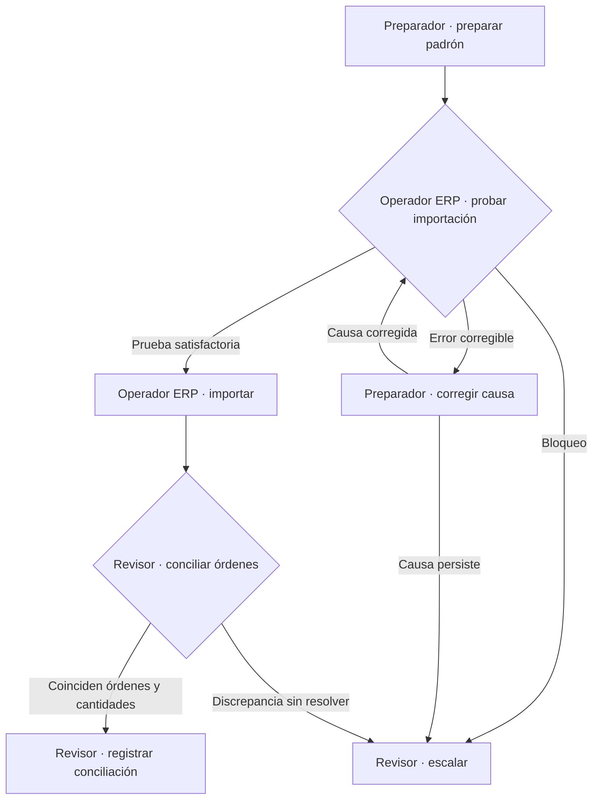

# Base enciclopédica del sistema de workflows visuales operativos

**Proyecto** · Creación de Workflows  
**Fecha de corte** · 12 de noviembre de 2026, Ciudad de México  
**Alcance** · Especificación de referencia para un manual vivo de procesos humanos, físicos, digitales e híbridos. Aplicación al piloto Zapata 324 y a futuras familias de entregables.

## 1. Arquitectura y alcance del sistema

El manual responde a la consulta «Necesito entregar X». La persona encuentra el resultado esperado, identifica la revisión aplicable a su contexto y sigue tres vistas vinculadas: el mapa para entender, la guía para ejecutar y el checkpoint para cerrar. El último registro vincula el objeto producido, la evidencia, la decisión de aceptación y el siguiente responsable. Una misma revisión gobierna esas vistas y se puede recuperar después para reconstruir qué instrucciones se usaron. [L1, arquitectura y modelo de datos](deep-research-report.md) · [L2, §§1, 3–4 y 7–8](Sistema%20de%20Workflows%20Visuales%20Operativos.md)

La especificación amplía el corpus en cuatro puntos. Define qué identidad lleva cada objeto y qué versión se fija al ejecutar. Traduce los controles documentales y de liberación a reglas comprobables. Convierte la importación de Zapata en un caso respaldado por evidencia local. Define pruebas para la navegación, las decisiones, el handoff y el mantenimiento. La especificación conserva su carácter de diseño. La validación operativa del resto de Zapata y la selección de plataforma requieren pruebas locales.

**Estados de evidencia usados en esta base.** *Verificado externo* indica que una fuente primaria acredita la afirmación dentro de su alcance. *Verificado local* se aplica al dato leído de un artefacto o al resultado confirmado en el caso, con el contexto indicado. *Propuesto* identifica una decisión de diseño. *Pendiente* indica la observación o decisión que falta. Una ficha puede combinar afirmaciones con distinto grado de evidencia. El estado de la ficha como documento es un campo distinto.

### Corpus y mapa de cobertura

La revisión partió de los tres archivos Markdown de la raíz, incluidas las tres figuras incrustadas de L2. El temario ordenó la matriz. Se consultó Cerebro IA con variantes sobre Zapata, revisión gobernante, control de partidas, evidencia y handoff. Se abrieron las notas recuperadas y se contrastó el aprendizaje principal con el procedimiento y el archivo de importación. Las preguntas prioritarias orientaron la búsqueda de estándares, estudios primarios y documentación de los mantenedores. Los localizadores y límites de las fuentes figuran al final.

| Eje del temario | Evidencia y cobertura previa | Vacío y ampliación |
| --- | --- | --- |
| 1 · Arquitectura | L1 arquitectura y L2 §1. Taxonomía amplia con diferencias de granularidad. | Alto · Convención 0–5 y distinción entre definición e instancia (§2). |
| 2 · Levantamiento | L1 AS-IS y L2 §2. Entrevista, observación y reconciliación. | Alto · Afirmaciones verificables por contexto y pruebas de caso (§3). |
| 3 · Contrato | L1 arquitectura y L2 §3. Campos detallados. | Crítico · Identidad, revisión gobernante, ejecución y reglas de integridad (§2). |
| 4 · Diseño visual | L1 sistema gráfico y L2 §4 y figuras 1 y 3. Paleta y accesibilidad, con cifras de alcance dudoso. | Alto · Diferenciar evidencia sobre errores estructurales y pruebas de comprensión (§4). |
| 5 · Notaciones | L1 sistema gráfico y L2 §5. Matrices comparativas. | Alto · Elegir por pregunta y comprobar ramas, sincronización y esperas (§4). |
| 6 · Pantalla y clic | L1 pantallas y L2 §6. Detalle de fichas y ejemplos de diferentes ediciones. | Crítico · Perfil de ejecución, vigencia y comprobación del cambio en el sistema (§3 y §6). |
| 7 · Plantillas A–F | L1 sistema gráfico y L2 §7. Componentes y campos bien desarrollados. | Alto · Relación entre cada vista, la fuente y una prueba concreta (§5 y §6). |
| 8 · Índice y búsqueda | L1 arquitectura y L2 §8. Entregables, facetas y sinónimos. | Alto · Resolver versión y permisos en búsqueda, QR y archivo histórico (§5). |
| 9 · Roles y handoff | L1 gobierno y L2 §§7, 9. Contrato y responsabilidades. | Crítico · Eventos, destinatario, versión del objeto y aceptación comprobable (§2 y §5). |
| 10 · Excepciones y riesgos | L1 gobierno y L2 §§3, 7. Controles y recuperación. | Alto · Probar rechazo, repetición, espera y resultado ambiguo (§4, §6 y §7). |
| 11 · Gobierno y versiones | L1 gobierno y L2 §9. Diferentes ediciones ISO citadas. | Alto · Edición vigente, transición y política de vigencia, archivo y cambios (§5). |
| 12 · Herramientas | L1 herramientas. Matriz ponderada sin calificación desglosada por criterio. | Medio-alto · Evaluar conjuntos funcionales con pruebas comparables, TCO y sensibilidad (§8). |
| 13 · Pruebas y adopción | L1 adopción y L2 §2. Walkthrough y metas preliminares. | Alto · Definir éxito sin ayuda, denominadores, fallos críticos y regresiones (§7). |
| 14 · Piloto Zapata | L1 piloto. Secuencia amplia planteada como hipótesis. | Crítico · Importación confirmada, evidencia directa del archivo y límites del resultado (§6). |
| 15 · Modelo de datos | L1 arquitectura y L2 §§3, 7–8. Entidades y relaciones generales. | Crítico · Cardinalidad, procedencia, esquema, reglas entre registros y prueba reproducible (§2, §7 y §9). |

## 2. Modelo de información y contrato operativo

### Granularidad y vocabulario

**Propuesta.** N0 es la cadena de valor. N1 agrupa procesos con resultados reconocibles. N2 identifica un workflow por entregable y alcance. N3 muestra actividades asignables y decisiones. N4 desarrolla pasos observables. N5 describe una pantalla, un campo, un control físico o una regla de excepción. Esta convención combina los niveles de L1 y L2. Un subproceso puede aparecer como actividad en un mapa y tener su propio workflow vinculado si produce un resultado reutilizable. La correspondencia con APQC es orientativa. [L1, tabla de niveles](deep-research-report.md) · [L2, §1.2](Sistema%20de%20Workflows%20Visuales%20Operativos.md)

Un **proceso** describe una capacidad recurrente. Un **workflow** define la coordinación para producir un resultado. Un **procedimiento** es la instrucción controlada para ejecutar esa definición. Una **actividad** agrupa trabajo asignable y un **paso** tiene una acción y un resultado observables. Una **plantilla** define una estructura reutilizable y un **checklist** enumera comprobaciones. La ejecución concreta genera **registros**, entre ellos evidencias, entregas y decisiones. Al hablar del «flujo de hoy», el índice puede llevar a la definición vigente mientras el padrón o ERP conserva la instancia del trabajo.

### Entidades y cardinalidades

| Entidad | Identidad y datos mínimos propuestos | Relaciones e invariantes |
| --- | --- | --- |
| Proceso y entregable | ID estable, nombre, sinónimos, alcance, propietario y receptor del tipo de salida | Un proceso agrupa workflows. Un tipo de entregable puede tener varios flujos según contexto. Un workflow identifica su salida principal y puede declarar salidas secundarias. |
| Workflow y revisión | ID estable de definición. La revisión tiene número, alcance de vigencia, estado, autor, aprobador, fechas y dependencias fijadas | Un workflow admite varias revisiones. Para una combinación aplicable de alcance y fecha, la consulta resuelve una sola revisión vigente o solicita aclarar el alcance. Las revisiones históricas conservan su dirección. |
| Paso y transición | ID de paso, rol, lugar o sistema, acción, entrada, resultado, verificación, recuperación. La transición guarda origen, destino, condición y tipo | Los pasos pertenecen a una revisión. El mapa solo usa los pasos y transiciones de esa revisión y las dependencias que fija. Cada salida operativa se alcanza desde un inicio aplicable. |
| Perfil de ejecución y control | Sistema o estación, versión/configuración relevante, rol, idioma, dispositivo y modo. Control con etiqueta o referencia física, valor/origen y respuesta esperada | Un paso puede tener instrucciones por perfil. Las diferencias significativas de acción, permiso o resultado se prueban por perfil. El contexto desconocido se registra como tal. |
| Ejecución | ID de caso, proyecto o posición, revisión del workflow aplicada, actor y marcas de tiempo | Varias ejecuciones pueden compartir revisión. Cada registro identifica qué revisión usó. Una migración de trabajo en curso registra revisión anterior y nueva, motivo, alcance y autorización. |
| Revisión de un insumo o resultado | Identidad del objeto, revisión o identificador de registro, procedencia y decisión aplicable | Una misma revisión de objeto puede alimentar varias ejecuciones. Cada transferencia fija la revisión o el identificador exacto del objeto recibido. La definición del workflow y el plano o LdM tienen sus propias revisiones. |
| Evidencia y decisión | ID, afirmación o criterio, artefacto y localizador, fecha, autor o sistema, contexto, resultado | Una evidencia puede respaldar varios criterios si queda claro qué parte aplica. Cada aprobación identifica persona, autoridad, alcance y revisión aprobada. |
| Handoff | ID de ejecución, objeto y revisión, emisor, receptor, canal, plazo, resultado y eventos | Un handoff puede producir varios eventos. Un reenvío conserva vínculo con el rechazo y con la nueva revisión cuando proceda. |

La procedencia puede representarse como **entidad → actividad → entidad** con un agente asociado. Por ejemplo, una revisión de plano y un despiece son entidades, la revisión técnica es una actividad y la persona que la ejecuta es un agente. El resultado vincula las fuentes de las que deriva. W3C PROV-DM ofrece ese vocabulario y distingue generación, uso, derivación y revisión. Para el piloto basta conservar estas relaciones en registros o tablas. [W09, W3C PROV-DM, §§2 y 5](https://www.w3.org/TR/prov-dm/)

### Campos exigibles y validación

En borrador se admiten datos pendientes con responsable y prueba prevista. Para publicar una ruta como operativa se requieren identidad, versión, propietario, alcance, disparador, entradas, responsables de ejecución, pasos y decisiones, salidas, receptor, criterios de terminado y evidencia de los pasos críticos. Cada campo condicional se activa por el contexto. Un paso en ERP requiere perfil y ruta o interfaz comprobada. Un traspaso exige identificar qué recibe la otra parte. Un control formal requiere autoridad y registro de decisión. Una espera exige el evento que la resuelve y una regla de escalamiento cuando el plazo sea relevante. Un paso físico crítico remite al método aprobado y a sus prerrequisitos.

| Capa | Qué comprobar | Ejemplo de defecto |
| --- | --- | --- |
| Forma | Campos, tipos, valores admitidos y presencia condicional | Un perfil digital publicado carece de versión observada o localizador de evidencia. |
| Integridad | Unicidad por ID, referencias, revisión fijada y cardinalidad | Un mapa apunta a un paso de otra revisión o un handoff tiene dos receptores implícitos. |
| Comportamiento | Alcanzabilidad, salida válida, exclusividad o paralelismo, espera, rechazo y retorno | Un camino exclusivo desemboca en una unión que espera dos ramas. |
| Autoridad y evidencia | Quién puede decidir, sobre qué alcance, con qué revisión y prueba | Un PDF fechado recientemente desplaza a la revisión aprobada sin una decisión. |
| Publicación | Todas las vistas corresponden a la revisión efectiva, están accesibles y enlazan sus controles | El QR abre una página vigente cuyo checkpoint apunta a un PDF obsoleto. |

JSON Schema 2020-12 permite validar estructura y condiciones dentro del documento. `uniqueItems` compara ítems completos. Dos registros con el mismo ID y campos diferentes aún requieren una comprobación de unicidad por clave. Las referencias entre registros se comprueban en el repositorio o con claves foráneas cuando se use una base relacional. Las reglas del grafo y las políticas de vigencia requieren pruebas de dominio. [W07, JSON Schema Validation, §§6.4.3 y 6.5](https://json-schema.org/draft/2020-12/json-schema-validation) · [W08, PostgreSQL, §5.5](https://www.postgresql.org/docs/current/ddl-constraints.html)

### Revisión gobernante y ejecución en curso

**Control reutilizado de Cerebro IA.** Un nombre de archivo, una fecha o un sufijo de revisión son indicios para buscar. La autoridad proviene del registro de aprobación y su alcance. Si se confirma la liberación de una parte del proyecto, solo esa parte habilita el trabajo dependiente. Registrar por separado la disponibilidad de evidencia, la aprobación y la aptitud para la siguiente operación. [C01, líneas 3 y 11–14](<C:/Users/Luis/Documents/Codex/Cerebro IA/boveda/01_CONOCIMIENTO/INGENIERIA_PRODUCTO/REVISIONES_Y_LIBERACIONES.md:3>) · [C02, líneas 3–6](<C:/Users/Luis/Documents/Codex/Cerebro IA/boveda/04_PROCESOS/INGENIERIA/FLUJO_DE_CONTROL_DE_PARTIDAS.md:3>)

**Propuesta.** Para resolver la revisión aplicable se consulta por objeto, alcance y fecha efectiva. Una liberación nueva abre un análisis de impacto sobre trabajo futuro, borradores, órdenes confirmadas, trabajo en curso y casos cerrados. Registrar la disposición de cada conjunto afectado y reconciliar efectos como reservas, compras, consumos, entregas o evidencias. Un caso cerrado conserva la revisión usada y se relaciona con el retrabajo o la reposición. La versión de un plano, la revisión de una LdM, la versión instalada de Odoo y la revisión del manual se registran de forma independiente. [Z01, §§6–8 y «Qué ocurre con las órdenes ya creadas»](<K:/Mi unidad/CODEX ODOO/Estructura mobiliario/procedimiento-alta-odoo-zapata.md:157>)

## 3. Levantamiento y verificación de instrucciones

### De una afirmación a una prueba

1. **Delimitar el resultado.** Identificar quién lo acepta, qué lo inicia y dónde empieza y termina la observación. Partir de un caso terminado y recorrer sus fuentes hacia atrás. Luego presenciar un caso desde el inicio para identificar trabajo informal, saltos, esperas o devoluciones.
2. **Registrar una afirmación por fila.** Describir actor, acción, condición, objeto, resultado y alcance. Marcar su origen como observado, declarado, prescrito o propuesto. Una entrevista acredita lo declarado. Un procedimiento acredita lo prescrito. Un registro de sistema acredita el hecho que deja registrado en ese contexto.
3. **Contrastar la afirmación.** Verificar que la fuente corresponde a la versión y al caso. Para una decisión crítica, cruzar un artefacto o evento de sistema con el ejecutor o receptor. Si las fuentes discrepan, abrir una pregunta con responsable y evidencia exigida. Preservar la variante si resulta legítima y acotarla a su condición.
4. **Reproducir.** Un segundo ejecutor recibe el objetivo y los insumos. La prueba sigue el resultado, las dudas y el manejo de las excepciones. En una actividad de riesgo, usar simulación, demostración segura o un entorno de ensayo.
5. **Validar con quienes reciben el resultado.** El receptor comprueba que puede usar la versión, el formato y la evidencia. Registrar la diferencia entre lo observado y el cambio TO-BE acordado. [L2, §2 y protocolo Try-Out](Sistema%20de%20Workflows%20Visuales%20Operativos.md) · [W15, GOV.UK, pruebas moderadas](https://www.gov.uk/service-manual/user-research/using-moderated-usability-testing)

Registro mínimo de una afirmación. `ID | afirmación | tipo de evidencia | caso, rol y versión | artefacto y localizador | fecha | corroboración o discrepancia | estado | próxima prueba`. La fuerza de la evidencia se decide por correspondencia con la afirmación. Para un comportamiento del importador local, un resultado confirmado en esa base tiene más alcance local que la descripción de una capacidad del fabricante. Para una regla de liberación, el aprobador autorizado y su registro gobiernan la decisión.

### Perfil de pantalla o estación

La ficha C de un paso digital debe permitir que otra persona llegue al mismo control y compruebe el efecto. Registrar versión, módulos y configuración relevante, rol, idioma, dispositivo, estado inicial, vista y filtros, ruta reproducida, etiqueta exacta, origen y formato del dato, acción y cambio esperado. Añadir evidencia de cuándo y con qué contexto se verificó, error típico, tratamiento y criterio de revisión. En un paso físico, los equivalentes son la estación, su estado inicial, el control identificable, la respuesta observable y el documento técnico aplicable. [L1, pantallas](deep-research-report.md) · [L2, §6](Sistema%20de%20Workflows%20Visuales%20Operativos.md)

**Prueba propuesta.** Con una cuenta del rol destinatario y un dato de ensayo, recorrer la ruta a partir del estado inicial. Comprobar que el objeto correcto cambió y conserva la referencia después de volver a abrirlo. Repetir con una entrada inválida o sin el permiso requerido y registrar el mensaje, el estado resultante y la ruta de ayuda. Cuando la interfaz cambie, verificar primero controles críticos y enlaces a otras vistas que compartan esa ficha. Cuando solo exista una ruta del proveedor, registrar la edición de la referencia y dejar pendiente la reproducción local.

La captura muestra el control y el contexto para volver a ubicarlo. Se publica una copia con datos de ejemplo o con enmascaramiento irreversible, revisada también en el archivo exportado. La ruta, las etiquetas y el resultado quedan en texto. Conservar versión observada, fecha y localizador de evidencia. Un esquema de demostración se marca como ilustrativo. En una imagen compleja, una descripción breve identifica la imagen y una explicación textual cercana transmite la secuencia, las decisiones y sus efectos. [W10, WCAG 2.2, SC 1.1.1](https://www.w3.org/TR/WCAG22/#non-text-content) · [W11, WAI, Complex Images](https://www.w3.org/WAI/tutorials/images/complex/)

## 4. Selección de notación y legibilidad

| Pregunta del lector | Representación | Criterio de elección y límite práctico |
| --- | --- | --- |
| ¿Dónde empieza el proceso y qué intercambia? | SIPOC o mapa de procesos | Resume proveedores, insumos, salidas y receptores. El detalle de secuencia vive en el workflow. |
| ¿Qué hago y qué sigue? | Flujograma o ficha secuencial | Adecuado si hay pocas ramas y el rol se entiende. Añadir carriles si los cambios de responsable son centrales. |
| ¿Quién entrega qué y a quién? | Swimlane descriptivo o BPMN de colaboración | Los carriles hacen visible la responsabilidad. Usar BPMN formal cuando se necesite semántica precisa de eventos, mensajes o compuertas. |
| ¿Dónde está el tiempo de espera o desperdicio? | VSM | Muestra flujo material e informativo, trabajo y espera para diagnóstico. |
| ¿Qué experimenta el usuario y qué lo soporta? | Journey o service blueprint | Journey recoge la experiencia. Blueprint añade acciones visibles, soporte interno y puntos de contacto. |
| ¿Qué estado puede cambiar y cuándo? | Diagrama de estados | Adecuado para ciclo de vida de revisión, entrega, orden o incidencia. |
| ¿Qué combinación de datos decide el resultado? | Tabla de decisión, o DMN si se requiere especificación formal | Revisar entradas, límites, cobertura, solapamientos y prioridad cuando corresponda. |
| ¿En qué control actúo en esta variante? | Ficha C, mapa de interfaz u OPL | Documenta una acción, su contexto y el resultado comprobable en el puesto. |

En **BPMN 2.0.2**, la secuencia conecta actividades del mismo proceso y puede cruzar carriles dentro del pool. El mensaje representa comunicación entre participantes en pools distintos. Una compuerta exclusiva selecciona una alternativa y puede tener una salida por defecto. Una unión paralela sincroniza ramas requeridas. Si una revisión elige entre «aceptar» y «devolver», unir ambas salidas con una compuerta paralela puede dejar el flujo esperando una rama imposible. Si dos verificaciones son obligatorias, la unión espera a las dos o el modelo representa de forma explícita el camino de interrupción. Cada espera operativa indica qué señal la resuelve y qué ocurre si vence el plazo. DMN 1.6 es formal en el catálogo de OMG. DMN 1.7 figura como beta al corte. [W04, BPMN 2.0.2, §§7.3, 9.4 y 10.6](https://www.omg.org/spec/BPMN/2.0.2/PDF) · [W05, OMG DMN](https://www.omg.org/spec/DMN/)

**Complejidad.** L2 describe 31 nodos como máximo absoluto y su figura 1 muestra una curva de riesgo y degradación cognitiva. La evidencia publicada deriva umbrales para detectar **errores estructurales** a partir de unos 2.000 modelos, con validación en 429 modelos EPC de una institución financiera. 7PMG plantea 50 elementos como heurística de descomposición en el contexto de sus fuentes. La síntesis de Mendling sobre calidad estructural y textual distingue esa evidencia de un umbral de comprensión. En esta base, 31 nodos es un disparador de revisión editorial. El límite práctico se decide con estructura, número de decisiones, cruces, audiencia, dispositivo y resultados de prueba. El rango de 8–20 nodos, el conteo de símbolos y los porcentajes de las figuras 1 y 3 de L2 requieren validación contextual antes de convertirse en política. La curva ilustrativa carece de base suficiente para estimar la probabilidad de error del manual. [W06a, Mendling et al., método y validación](https://research.wu.ac.at/en/publications/thresholds-for-error-probability-measures-of-business-process-mod-5/) · [W06b, 7PMG, G7](https://www.vdaalst.com/publications/p574.pdf) · [W06c, Mendling, §3.1 y tabla 1](https://dl.ifip.org/db/conf/simpda/simpda2012/Mendling12.pdf)

**Criterios de lectura.** Dar a cada vista una pregunta y una escala. Mantener etiquetas verbo–objeto, dirección predecible y un vocabulario pequeño de símbolos. Identificar decisiones por texto en cada salida. Llevar a vista hija una operación especializada o repetida cuando pueda describirse mediante su entrada, resultado y excepciones. Probar que el lector distingue el camino normal, las devoluciones y el criterio de cierre. Un estudio de ensamblaje encontró mejores resultados con instrucciones digitales interactivas frente a dibujos en papel para su tarea y condiciones. Ofrecer ambos materiales simultáneamente no aportó beneficio adicional en ese experimento. Otro estudio de ensamblaje reporta límites de muestra y contexto. El proyecto puede probar estos efectos con sus propios usuarios y soportes. [W16a, Letmathe y Rößler, discusión](https://doi.org/10.1002/joom.1159) · [W16b, estudio experimental de 2026](https://www.mdpi.com/2076-3417/16/13/6442)

**Accesibilidad digital.** Revisar contraste del texto normal de al menos 4.5:1 y del texto grande de 3:1, contraste de los componentes y gráficos necesarios según SC 1.4.11, y distinciones perceptibles mediante etiquetas o formas además del color. En web se prueban teclado, foco visible, orden de lectura y reflujo a 320 px CSS. El criterio de reflujo contempla contenido que necesita una disposición bidimensional. Acompañar un mapa complejo con una vista lineal para la consulta operativa. En controles interactivos, SC 2.5.8 establece 24 × 24 px CSS o una excepción aplicable. En PDF e impresión probar legibilidad, significado en escala de grises y localización de revisión e instrucción a distancia real de uso. [W10, WCAG 2.2, SC 1.4.1, 1.4.3, 1.4.10, 1.4.11, 2.1.1, 2.4.7 y 2.5.8](https://www.w3.org/TR/WCAG22/)

## 5. Plantillas, búsqueda y gobierno documental

### Seis vistas del mismo workflow

Las seis plantillas del corpus tienen funciones diferentes. Cada vista muestra el ID de workflow y la revisión aplicable y hereda etiquetas, roles y vínculos del registro fuente. Se puede materializar una vista como página, mapa, PDF o tarjeta impresa. La ficha rápida puede apuntar directamente a la guía cuando la persona ya sabe a qué flujo pertenece el entregable. [L1, seis plantillas](deep-research-report.md) · [L2, §7](Sistema%20de%20Workflows%20Visuales%20Operativos.md)

| Vista | Contenido específico | Prueba de aceptación |
| --- | --- | --- |
| A · Ficha rápida | Resultado, ámbito, quién lo ejecuta, cuándo empezar, cómo verificarlo y enlaces a B, C y D | Al buscar por nombre o sinónimo, el lector distingue la versión aplicable y ubica el primer paso. |
| B · Mapa por roles | Inicio, pasos clave, decisiones, esperas, devoluciones y handoffs | El lector reconstruye el camino normal y explica quién actúa tras una devolución. |
| C · Guía de ejecución | Perfil de interfaz o estación, acción, campo o control, respuesta observable, evidencia y recuperación | Otro ejecutor obtiene el resultado y sabe comprobarlo con el perfil documentado. |
| D · Checkpoint | Criterio, valor o condición, prueba, autoridad, disposición y salida | Un resultado inválido queda sin liberación y la decisión se puede auditar. |
| E · Excepción | Señal, alcance afectado, estado seguro, recuperación, reintento y escalamiento | El ejecutor reconoce la falla, conserva la trazabilidad y conoce la condición de reanudación. |
| F · Handoff | Emisor, receptor, revisión, canal, plazo, criterio, recepción y devolución | El receptor localiza el objeto exacto, registra decisión y puede devolverlo con motivo. |

### Índice, búsqueda y distribución

**Propuesta.** Indexar por entregable, sinónimo, ID, proceso, rol, área, proyecto, sistema y estado. Resolver primero el alcance y los permisos. Buscar «LdM», «BOM» o «lista de materiales» debe llevar a las entregas correspondientes. Si varias familias comparten término, mostrar el alcance y pedir al lector seleccionar la familia. El resultado operativo muestra estado, versión, vigencia y propietario. El índice histórico se consulta por revisión o fecha. Si no hay una versión aprobada para el contexto, la ficha remite al propietario o a la aclaración pendiente.

El enlace del QR debe llevar a la entrada estable de un entregable con el alcance de la estación, y desde ahí a la versión efectiva. Un enlace de auditoría o de un caso debe fijar la revisión. La copia de trabajo sin conexión muestra la revisión, la fecha de emisión y el punto de consulta vigente. Para procesos críticos acordar qué operación queda en espera cuando no es posible comprobar vigencia. Medir enlaces y permisos desde la vista de un ejecutor, un receptor y un lector sin acceso. [L2, §8.2–8.3](Sistema%20de%20Workflows%20Visuales%20Operativos.md) · [W20, Google Drive, historial de revisiones](https://developers.google.com/workspace/drive/api/guides/manage-revisions)

### Responsabilidades, recepción y liberación

El propietario mantiene el alcance y la responsabilidad documental. El ejecutor genera el resultado. El revisor verifica los criterios. El aprobador autoriza dentro de su ámbito y el responsable de liberación registra cuándo el resultado queda disponible para uso. El receptor comprueba que puede usarlo. Registrar suplencia y autorizaciones cuando se requieran. RASCI permite documentar responsable, autoridad final, apoyo, consulta e información por actividad. En cada decisión crítica se asigna una autoridad inequívoca y se indica qué roles pueden coincidir según el proceso aprobado. [L2, §9.1](Sistema%20de%20Workflows%20Visuales%20Operativos.md) · [C01, liberación por alcance](<C:/Users/Luis/Documents/Codex/Cerebro IA/boveda/01_CONOCIMIENTO/INGENIERIA_PRODUCTO/REVISIONES_Y_LIBERACIONES.md:11>)

**Eventos propuestos para una transferencia.** `enviado → recibido → aceptado o devuelto`. Cuando la aprobación o liberación técnica sea formal, se registra como evento adicional con autoridad, revisión y alcance. «Enviado» se sustenta con un registro de emisión. «Recibido» identifica quién obtuvo el paquete. «Aceptado» exige decisión del receptor o regla aprobada con prueba suficiente. Un rechazo conserva motivo, versión, persona responsable de corregir y vínculo a la nueva entrega. Para casos con más de un receptor se define la aceptación de cada receptor y cuándo el conjunto se considera cerrado.

### Vigencia normativa y cambio controlado

**Verificado externo.** ISO publicó ISO 9001:2026 el 16 de septiembre de 2026 y retiró del catálogo ISO 9001:2015 y su enmienda de 2024. La guía de ISO/TC 176/SC 2 indica el 30 de septiembre de 2029 como límite de transición para organizaciones certificadas con la edición anterior. La edición de referencia del proyecto, el esquema de certificación y los compromisos contractuales requieren confirmación de su responsable. ISO 10013:2021 sigue publicada y orienta el desarrollo de información documentada adaptada a la organización. El catálogo de ISO y la guía pública permiten verificar vigencia y alcance general. Cualquier correspondencia de cláusulas para auditoría requiere consultar el texto autorizado de la edición aplicable. [W01, catálogo ISO 9001](https://www.iso.org/standard/9001) · [W02, guía del comité](https://committee.iso.org/sites/tc176sc2/home/news/content-left-area/news-and-updates/news-2.html) · [W03, ISO 10013](https://www.iso.org/standard/75736.html)

En gestión del conocimiento, ISO 30401:2018 y sus enmiendas de 2022 y 2024 figuran publicadas. El proyecto ISO/DIS 30401 para la segunda edición está en desarrollo. Si la organización incorpora ese marco, el registro normativo identifica la edición y la aplicación de cada control. [W23a, edición publicada](https://www.iso.org/standard/68683.html) · [W23b, proyecto de revisión](https://www.iso.org/standard/89436.html)

**Propuesta de gobierno.** Mantener el ciclo `propuesto → levantado → borrador → validado → aprobado → publicado → obsoleto`. Levantado acredita evidencia disponible. Validado acredita reproducción en el alcance definido. Aprobado registra la autoridad. Publicado establece la disponibilidad y la vigencia para el público destinatario. El mismo cambio puede aprobarse y entrar en vigor en fechas distintas. Conservar la revisión anterior como histórica y preservar el vínculo desde los casos que la usaron. Una corrección de emergencia requiere registrar alcance, responsable, vigencia y posterior revisión. [L1, gobierno](deep-research-report.md) · [L2, §9.2](Sistema%20de%20Workflows%20Visuales%20Operativos.md)

Ante cambio de interfaz, datos, roles, insumos, aceptación o riesgo, registrar motivo, objetos afectados, casos abiertos, prueba de regresión, decisión y fecha efectiva. Publicar las vistas enlazadas bajo una misma revisión y comprobar que el índice apunta al paquete correcto. Ante publicación incompleta, restaurar o conservar como vigente el último paquete aprobado aplicable y corregir antes de activar el nuevo. La reversión documental y las transacciones en sistemas operativos se gestionan según sus propios registros. Para archivo, el manifiesto identifica revisiones, formatos, ubicación y, cuando sea útil, huellas para verificar integridad. Una huella confirma integridad de los bytes comparados. La aprobación se acredita en su registro propio.

## 6. Piloto Zapata 324

### Qué acredita la evidencia

| Tramo | Evidencia | Estado y aplicación |
| --- | --- | --- |
| Solicitud, levantamiento y planos | L1, hipótesis de piloto. C01–C02, precedentes de revisión gobernante | Pendiente de reconstruir para la muestra. Aplicar la regla de liberación solo al alcance demostrado. |
| Posición, variante y LdM | Z01, «Decisión para el piloto» y §§1–6. Odoo documenta que una LdM puede servir a varias variantes | Diseño local documentado y capacidad externa verificada. Sigue pendiente confirmar medidas, tolerancias, líneas de la LdM aplicables y pruebas de cambio. |
| Importación y agrupación de OF | C03, confirmación registrada del usuario. Z01 §7.1. Z02, `Importar OF!A1:E11`, verificado directamente | Verificado local para diez órdenes de cantidad 1, nueve IDs de variante y un Origen común. La versión instalada, el rol ejecutor y la navegación inicial quedan pendientes. |
| Compras, fabricación y calidad | Z01 §§7–8, pasos prescritos. L1 plantea la secuencia general | Pendiente seguir un caso en registros operativos. Las transiciones de reserva, consumo y aceptación requieren evidencia propia. |
| Entrega e instalación | Z01 §8 prescribe comprobar serie, destino y aceptación | Pendiente localizar transferencia, unidad instalada y aceptación enlazadas con posición y OF. |

La lectura del XLSX comprobó diez filas de importación, diez IDs externos de orden distintos, cantidad 1 en las diez filas, nueve IDs externos de variante y un valor de Origen. Una variante aparece en dos filas. El procedimiento identifica F03 como el formato compartido por dos departamentos. El archivo acredita la preparación y el aprendizaje registra la confirmación del resultado por el usuario. Esta base no repitió la transacción en Odoo. [C03, aprendizaje `apr-608302975c194b76`, líneas 8–16](<C:/Users/Luis/Documents/Codex/Cerebro IA/boveda/05_MEMORIA/HISTORIAL/apr-608302975c194b76-v0003.md:8>) · [Z01, §7.1](<K:/Mi unidad/CODEX ODOO/Estructura mobiliario/procedimiento-alta-odoo-zapata.md:88>) · [Z02, hoja Importar OF](<K:/Mi unidad/CODEX ODOO/Listas de materiales por proceso/outputs/01a1cccd-38ca-7212-a142-ed044849cb8c/Zapata_324_Importar_Ordenes_de_Fabricacion_Agrupadas.xlsx>)

**Distinciones operativas.** La posición identifica dónde se instala una puerta. La variante identifica una definición fabricable que varias posiciones pueden compartir. El ID externo de la orden identifica el registro importable. La referencia identifica la OF en la lista. Origen reúne las órdenes para consulta. La serie identifica una unidad física cuando se usa ese seguimiento. El vínculo posición–variante–OF–serie permite rastrear cada unidad aunque el formato se repita. Odoo documenta referencias por ID externo y advierte que cambiarlo o quitarlo en una actualización puede crear un duplicado. El uso de un Origen común y el mapeo de Proyecto a Proyectos son resultados de la configuración del caso. [Z01, §§5, 7.1 y 8](<K:/Mi unidad/CODEX ODOO/Estructura mobiliario/procedimiento-alta-odoo-zapata.md:79>) · [W12, Odoo 19, importación y actualización](https://raw.githubusercontent.com/odoo/documentation/19.0/content/applications/essentials/export_import_data.rst) · [W13, Odoo 19, LdM para variantes](https://raw.githubusercontent.com/odoo/documentation/19.0/content/applications/inventory_and_mrp/manufacturing/advanced_configuration/product_variants.rst)

La documentación de Hexagon acredita capacidades CAD/CAM, despieces, listas de materiales, planos de taller y generación de salidas para CNC. Para validar el tramo Zapata se necesita un paquete emitido en el caso, con revisión, variante o posición a la que aplica, receptor y evidencia de aceptación. El resultado de importación no acredita el uso de ninguna ruta de Cabinet Vision. [W14, Hexagon Cabinet Vision](https://hexagon.com/products/cabinet-vision)

### Ejemplo de las seis vistas para el tramo acreditado

Los roles de ejemplo y los criterios de transferencia propuestos deben confirmarse con los equipos. El alcance de esta ficha es la importación y conciliación del grupo de OF.

| Vista | Aplicación al caso |
| --- | --- |
| A · Ficha rápida | **Entregable** · Grupo de órdenes de fabricación de puertas de lavado con correspondencia por posición. **Entrada** · Padrón y referencias de variantes de la base aplicable. **Cierre del tramo** · Diez OF de una unidad conciliadas con el padrón. |
| B · Mapa | El preparador cruza padrón y variantes → el operador del ERP prueba la importación → si hay error, devuelve al preparador con el diagnóstico → si pasa, importa → el revisor concilia grupo y posiciones → el receptor operativo registra aceptación o devolución. La importación y agrupación tienen evidencia. Las asignaciones y la aceptación del receptor son propuestas. |
| C · Instrucción por control | Z01 §7.1 prescribe verificar los campos, ejecutar **Probar** y después **Importar** cuando la prueba pasa. La agrupación confirmada usa **Agrupar por → Origen**. La ruta inicial indicada en Z01 y las etiquetas, versión instalada y permisos se vuelven a comprobar con el rol operativo al publicar la ficha. |
| D · Checkpoint | Conciliar el conjunto de diez IDs externos de orden y sus variantes contra el padrón. Verificar diez registros de cantidad 1 y un Origen común. Un total correcto puede ocultar una posición duplicada o ausente. Exigir concordancia por ID y cantidad, con evidencia del resultado en la lista o exportación. |
| E · Excepción | Si la referencia interna no se resuelve en Producto, contrastar la variante con la exportación de la misma base y mapear su ID externo. Si el resultado del importador es ambiguo, consultar los IDs externos en el sistema y conciliar qué existe antes de repetir la operación. Si aparecen varios grupos, revisar el valor de Origen por fila. |
| F · Handoff | Propuesta: entregar al responsable operativo el grupo, la revisión aplicable, el vínculo al padrón y el resultado de la conciliación. El receptor valida cobertura, registra incidencias y devuelve posiciones concretas cuando hay discrepancia. La preparación para fabricar requiere la liberación de Diseño y las demás condiciones operativas aplicables. |

**Orden del levantamiento restante.** Elegir una posición con variante compartida y otra con formato diferente. Seguir cada una desde el plano y despiece aplicables hasta su OF y la evidencia de calidad o instalación. Contrastar una devolución o cambio de revisión con los registros y los roles afectados. El dueño del piloto confirma criterios, perfiles, permisos y documentos de control. Si un tramo carece de evidencia, mantenerlo como hipótesis o instrucción prescrita hasta completar la prueba. [L1, piloto](deep-research-report.md) · [Z01, §§7–8](<K:/Mi unidad/CODEX ODOO/Estructura mobiliario/procedimiento-alta-odoo-zapata.md:79>)

## 7. Pruebas, publicación y adopción

### Protocolo de aceptación

Hacer un recorrido con un experto para comprobar fidelidad y reglas de negocio. Luego probar con un ejecutor elegible nuevo en la tarea y con el receptor. Entregar una situación y un resultado esperado sin revelar la ruta. El moderador registra ayudas, errores, tiempo y artefactos. Una ayuda que revela la ruta o resuelve una decisión convierte ese resultado en «completado con ayuda». Registrar tareas que no llegaron a ejecutarse y por qué. GOV.UK propone 4–8 participantes por ronda para investigación cualitativa usual. Aplicar la cifra como referencia logística e incluir perfiles pertinentes, dispositivos y necesidades de acceso. Reportar `n/N` y hallazgos por perfil. Una ronda formativa aporta problemas y correcciones concretas. Estimar una tasa poblacional requiere un diseño de muestra adecuado. [W15, GOV.UK, diseño de tareas y número de participantes](https://www.gov.uk/service-manual/user-research/plan-user-research-for-your-service)

| Escenario de ensayo | Evidencia esperada | Defecto que impide publicar esa ruta |
| --- | --- | --- |
| Buscar por un sinónimo y abrir el entregable | El ejecutor identifica alcance, revisión, primer paso y checkpoint. | Abre una revisión inaplicable o carece de acceso a la instrucción indispensable. |
| Camino normal con dos posiciones que comparten variante | Dos identidades de posición y de orden, una variante compartida y dos cantidades de una unidad. | Se fusionan dos posiciones o se pierde el vínculo con una orden. |
| Entrada incompleta o plano sin liberación demostrada | El usuario identifica la condición incumplida y el rol que debe resolverla. | La guía permite avanzar al trabajo dependiente con revisión incierta. |
| Importación con error de mapeo o resultado ambiguo | El ejecutor conserva evidencia, consulta qué existe por ID y decide cómo reanudar. | La recuperación puede generar duplicados o sobrescribir una OF fuera del alcance. |
| Permiso, idioma o vista distintos | El usuario reconoce su perfil y encuentra una ruta verificada o el canal de escalamiento. | Se confunde una variante de interfaz con un paso ausente o se elude un control de acceso. |
| Rechazo y nuevo envío | Quedan motivo, revisión rechazada, responsable y versión nueva. | La devolución elimina evidencia o se interpreta como aceptación. |
| Cambio de revisión durante un caso | El caso conserva su revisión original y registra la disposición autorizada. | El índice o el nuevo PDF altera retrospectivamente qué se ejecutó. |
| Consulta en móvil, PDF o planta | La información crítica se comprende con texto, sin depender del color, y se ubica revisión y destino. | El lector pierde el significado de una decisión o no puede localizar el siguiente paso. |

**Criterios de publicación propuestos.** Resolver cada defecto que afecte autorización, seguridad, alcance o correspondencia de objetos antes de declarar vigente el tramo afectado. Los controles críticos, vínculos obligatorios y evidencias de liberación deben pasar sus pruebas. Un 95 % global de enlaces válidos puede ocultar un enlace roto en el único checkpoint crítico. Registrar quién valida, revisión, perfil, fecha y escenario. Repetir el escenario corregido y uno adyacente que pueda verse afectado. El propietario aprueba el alcance que se publica. Los defectos cosméticos se registran con severidad y responsable. Los umbrales de desempeño se fijan después de observar una línea base local.

### Métricas que permiten actuar

| Métrica | Definición y unidad de observación | Interpretación |
| --- | --- | --- |
| Localización correcta | Intentos que abren el entregable en la revisión aplicable ÷ intentos de búsqueda iniciados. | Revisar sinónimos, alcance, permisos e índice. Mantener tiempos separados de la exactitud. |
| Ejecución sin ayuda | Intentos que alcanzan el resultado y pasan el control sin ayudas sustantivas ÷ intentos elegibles iniciados. | Mostrar `n/N` por perfil, revisión y escenario. Contar abandonos y fallos iniciados. |
| Tiempo de ejecución | Minutos desde el inicio de la tarea hasta el resultado. Reportar mediana en casos completados junto con número de abandonos y resultados censurados. | Medir aparte espera, búsqueda y ejecución cuando el diagnóstico lo requiera. |
| Aceptación en primera entrega | Entregables aceptados en el primer envío ÷ primeros envíos con decisión. Reportar también pendientes y vencidos. | Una caída puede indicar problemas de insumos, versión, criterios o coordinación. |
| Retrabajo atribuible | Casos que repiten trabajo por una causa documentada ÷ casos elegibles cerrados en la ventana. | Clasificar causas con evidencia. Separar cambio legítimo, error de ejecución y defecto del manual. |
| Mantenimiento | Mediana de días desde la detección de un cambio hasta la publicación validada y número de vistas dependientes afectadas. | Comparar actualizaciones de tamaño similar para entender el costo de propagación. |

Para estimar impacto, comparar casos con alcance, complejidad y experiencia comparables. Conservar población, periodo, exclusiones y revisión. Un cambio observado después del lanzamiento puede deberse a aprendizaje, mezcla de casos o modificaciones del sistema. Una comparación antes y después permite monitoreo operativo. Atribuir causalidad requiere controlar esas diferencias.

### Orden de implementación

1. **Primera entrega.** Modelar el tramo de importación de Zapata, comprobar el perfil real, levantar un handoff y construir las vistas A–F. Mantener visibles la evidencia directa, la confirmación registrada y las pendientes del flujo amplio.
2. **Reglas reutilizables.** Acordar identidad, revisión, alcance, vigencia y evidencia. Probar referencias, decisiones, versión y recuperación con el ejemplo de §9.
3. **Prueba con personas.** Recorrer con un ejecutor nuevo y un receptor. Corregir fallos críticos y medir línea base de búsqueda, ejecución y aceptación. Habilitar feedback con vínculo a paso y revisión.
4. **Plataforma y continuidad.** Comparar alternativas con el mismo material y actores. Ensayar publicación, reversión y restauración de exportaciones. Registrar costo y horas de mantenimiento.
5. **Escalamiento.** Incorporar otro entregable físico y uno híbrido. Reutilizar vistas, controles y vocabulario si las pruebas confirman compatibilidad. Priorizar los pasos con impacto alto, cambios frecuentes, devoluciones o conocimiento concentrado en una persona.

## 8. Herramientas, portabilidad y costo total

L1 compara suites, editores de diagramas y capturadores en una sola tabla. Los puntajes publicados carecen de notas por criterio, por lo que el ranking no se puede reconstruir. El piloto puede comparar paquetes completos mediante el mismo trabajo, con resultados demostrados y costo en un horizonte común. La herramienta de descubrimiento puede ser distinta del editor y del repositorio que publica la versión efectiva. [L1, herramientas](deep-research-report.md)

| Opción de referencia | Función comprobable en documentación del proveedor | Prueba local antes de elegir |
| --- | --- | --- |
| Drive con editor de mapas draw.io | Drive ofrece revisiones con límites según el tipo de archivo. draw.io conserva una fuente editable y exporta a formatos como SVG y PDF. Su aplicación de escritorio puede trabajar sin conexión. | Con un lector y un editor, probar permisos, búsqueda por sinónimos, publicación de revisión enlazada, lectura offline y reapertura del mapa editable. Restaurar el paquete desde sus exportaciones. |
| Markdown y Git con Mermaid | GitHub Docs ejemplifica reutilización de contenido y control de variantes documentales. Mermaid genera un título y una descripción accesibles en los SVG cuando se configuran. | Hacer que un autor operativo corrija un paso y que otro rol publique la revisión. Probar un lector sin herramientas técnicas, exportación y accesibilidad de la página resultante. |
| Wiki estructurada y editor de mapas | Confluence ofrece páginas, espacios, bases y plantillas según plan. Evaluar la organización, el control editorial y los límites de portabilidad del plan exacto. | Repetir con un receptor, probar permisos efectivos de anexos y reconstruir enlaces, revisión y archivos desde una exportación. |

Fuentes de capacidades. [W17, GitHub Docs, contenido reutilizable](https://docs.github.com/en/contributing/writing-for-github-docs/creating-reusable-content) · [W18, Mermaid, accesibilidad](https://mermaid.js.org/config/accessibility) · [W19a, draw.io, exportación](https://www.drawio.com/docs/manual/export/) · [W19b, draw.io, operación sin conexión](https://www.drawio.com/docs/security/diagrams-offline/) · [W20, Drive, revisiones](https://developers.google.com/workspace/drive/api/guides/manage-revisions) · [W22, Confluence, planes](https://www.atlassian.com/en/software/confluence/pricing)

**Matriz reproducible propuesta.** Calificar cada paquete por control de vigencia y evidencia (25 %), búsqueda y accesibilidad (20 %), facilidad de edición y revisión (15 %), exportación y recuperación (15 %), permisos y continuidad (15 %) y costo total (10 %). Usar `0` si falla, `1` si resuelve parcialmente o con trabajo manual recurrente y `2` si pasa el escenario en el contexto operativo. Un criterio sin prueba queda pendiente y no produce un puntaje total comparable. El porcentaje final es `Σ(peso × nota / 2)`. Adjuntar observación, perfil y localizador por nota. Antes de elegir, mover diez puntos entre facilidad de edición y control de vigencia y comprobar si cambia el orden. Tratar el acceso, la publicación controlada y la restauración como condiciones de aceptación del piloto. Las ponderaciones son una decisión de esta especificación.

**Costo total comparable.** Calcular 12 meses de licencias incrementales, implementación, migración, horas de autores y revisores, capacitación, actualizaciones, almacenamiento, respaldo y exportación. Identificar usuarios por rol y moneda, plazo, impuestos y tipo de cambio en la fecha de comparación. Ejemplo de referencia pública en México: Business Starter indica MXN 140 por usuario al mes en compromiso anual y MXN 168 en flexible. Con diez cuentas, doce meses y tarifas constantes, la parte de licencia sería MXN 16.800 o 20.160, antes de otros costos. La página de Confluence calcula por tamaño y modalidad y mostraba USD 5.78 por usuario al mes para Standard en la vista consultada. Aplicar precio real por plan y región al comparar. Para una suite ya contratada, medir el costo marginal y el esfuerzo de operar el manual. [W21, Google Workspace, tabla Business Starter](https://knowledge.workspace.google.com/admin/billing/compare-flexible-and-annual-fixed-term-payment-plans) · [W22, Atlassian, calculadora de planes](https://www.atlassian.com/en/software/confluence/pricing)

## 9. Ejemplo reproducible de integridad

**Ejemplo ilustrativo.** Representa la parte de prueba y conciliación, con un retorno tras corrección. Los IDs, la revisión y las condiciones son de demostración. El registro no describe las aprobaciones reales del piloto. Este fragmento permite comprobar referencias y probar escenarios antes de elegir un editor o repositorio.



El preparador entrega el padrón al operador. Si la prueba pasa, el operador importa y el revisor concilia. Un error corregible vuelve a prueba después de resolver la causa. El bloqueo, la causa persistente o la discrepancia que no se logra conciliar terminan en escalamiento. La tabla de pruebas de esta sección desarrolla los caminos del mapa.

```json
{
  "workflow_id": "WF-EJEMPLO-01",
  "revision": 1,
  "estado": "borrador",
  "inicio": "preparar",
  "cierres": ["conciliado", "escalado"],
  "pasos": [
    {"id": "preparar", "rol": "preparador"},
    {"id": "probar", "rol": "operador_erp"},
    {"id": "corregir", "rol": "preparador"},
    {"id": "importar", "rol": "operador_erp"},
    {"id": "conciliar", "rol": "revisor"},
    {"id": "conciliado", "rol": "revisor"},
    {"id": "escalado", "rol": "revisor"}
  ],
  "transiciones": [
    {"origen": "preparar", "destino": "probar", "condicion": "padrón preparado"},
    {"origen": "probar", "destino": "importar", "condicion": "prueba satisfactoria"},
    {"origen": "probar", "destino": "corregir", "condicion": "error corregible"},
    {"origen": "probar", "destino": "escalado", "condicion": "bloqueo sin corrección en el rol"},
    {"origen": "corregir", "destino": "probar", "condicion": "causa corregida"},
    {"origen": "corregir", "destino": "escalado", "condicion": "causa persiste"},
    {"origen": "importar", "destino": "conciliar", "condicion": "resultado registrado o ambiguo"},
    {"origen": "conciliar", "destino": "conciliado", "condicion": "órdenes y cantidades coinciden"},
    {"origen": "conciliar", "destino": "escalado", "condicion": "discrepancia sin resolver"}
  ]
}
```

| Caso | Mutación o camino | Resultado esperado |
| --- | --- | --- |
| Estructura base | Comprobar IDs, inicio, cierres y extremos de todas las transiciones | Siete IDs únicos y nueve transiciones resolubles. Todos los pasos se alcanzan desde el inicio y pueden llegar a un cierre. |
| ID duplicado | Repetir `probar` con otro rol | Falla unicidad por clave aunque los objetos completos sean diferentes. |
| Referencia rota | Cambiar el destino `conciliar` a `conciliar-v2` | Falla integridad por destino ausente. |
| Cierre aislado | Quitar las tres transiciones hacia `escalado` | Falla alcanzabilidad del cierre `escalado`. |
| Retorno legítimo | `probar → corregir → probar → importar → conciliar → conciliado` | El ciclo permite recuperar y cerrar. La prueba registra la causa corregida. |
| Corrección agotada | `probar → corregir → escalado` | La instancia queda dispuesta para escalamiento y registra la causa. |
| Resultado ambiguo | `importar → conciliar → escalado` ante discrepancia sin resolver | Se conserva la evidencia y se consulta el estado antes de un nuevo intento. |

La alcanzabilidad se comprueba recorriendo el grafo desde `inicio`. Un segundo recorrido por las aristas invertidas desde los cierres detecta pasos sin salida posible. En un modelo paralelo se requieren pruebas adicionales de sincronización y de condiciones en ejecución. Una rama alcanzable en papel puede quedar bloqueada por permisos, insumos o estados del sistema. El ejemplo tampoco verifica las condiciones en lenguaje natural. Estas se validan con escenarios y reglas aprobadas.

## 10. Registro de fuentes y decisiones abiertas

### Fuentes del proyecto y Cerebro IA

| ID | Fuente y localizador | Alcance de uso |
| --- | --- | --- |
| P | [Prompt de Deep Research](prompt_deep_research_workflows_visuales.md), líneas 11–41 y 49–64 | Temario de 15 ejes y entregables. Sin versión declarada. |
| L1 | [Master Deep Research](deep-research-report.md), secciones de arquitectura (l. 27), levantamiento (l. 80), gráficos (l. 114), pantallas (l. 176), gobierno (l. 211), herramientas (l. 236) y piloto (l. 279) | Investigación previa. Su encabezado declara 13 de noviembre de 2026, un día después del corte de este documento. Se usó como corpus disponible y se contrastaron los hechos temporales. Sus marcadores de citas son identificadores del reporte original sin URL directa en el archivo. |
| L2 | [Sistema de Workflows Visuales Operativos](Sistema%20de%20Workflows%20Visuales%20Operativos.md), §§0–9, figuras en ll. 64, 110 y 283, bibliografía desde l. 567 | Especificación previa y ejemplos. Se revisaron las figuras. Los umbrales y afirmaciones de vigencia requieren la interpretación de §§4–5 de esta base. |
| C01 | [Revisiones, evidencia y liberaciones](<C:/Users/Luis/Documents/Codex/Cerebro IA/boveda/01_CONOCIMIENTO/INGENIERIA_PRODUCTO/REVISIONES_Y_LIBERACIONES.md:3>), ll. 3, 7 y 11–14 | Guía interna para precedencia documental, aprobación y liberación por alcance. Los incidentes de cronograma son antecedentes, con el alcance que declara la nota. |
| C02 | [Control de partidas, compras y liberación](<C:/Users/Luis/Documents/Codex/Cerebro IA/boveda/04_PROCESOS/INGENIERIA/FLUJO_DE_CONTROL_DE_PARTIDAS.md:3>), ll. 3–6 | Guía interna para trazabilidad plano–revisión–partida y cierre con snapshot. |
| C03 | [Aprendizaje `apr-608302975c194b76`](<C:/Users/Luis/Documents/Codex/Cerebro IA/boveda/05_MEMORIA/HISTORIAL/apr-608302975c194b76-v0003.md:8>), v3 validada, ll. 8–16 | Confirmación registrada de la importación y agrupación local. |
| C04 | [Proyecto Zapata](<C:/Users/Luis/Documents/Codex/Cerebro IA/boveda/02_PROYECTOS/ZAPATA/ZAPATA.md:3>) y [nota del procedimiento](<C:/Users/Luis/Documents/Codex/Cerebro IA/boveda/09_FUENTES/GOOGLE_DRIVE/PROCEDIMIENTO_ZAPATA.md:3>) | Localización de la fuente original. |
| Z01 | [Procedimiento de alta en Odoo para Zapata](<K:/Mi unidad/CODEX ODOO/Estructura mobiliario/procedimiento-alta-odoo-zapata.md:88>), §§1–8, en especial 7.1 (ll. 88–96) y cambios de OF (ll. 157–162) | Fuente local prescriptiva y registro del alcance confirmado. La versión instalada tiene su propia comprobación. |
| Z02 | [Archivo de importación](<K:/Mi unidad/CODEX ODOO/Listas de materiales por proceso/outputs/01a1cccd-38ca-7212-a142-ed044849cb8c/Zapata_324_Importar_Ordenes_de_Fabricacion_Agrupadas.xlsx>), `Importar OF!A1:E11` | Evidencia primaria del archivo preparado. Se cotejó en modo de solo lectura. |

### Evidencia externa y aplicación

Consulta al 12 de noviembre de 2026. Las páginas de proveedor sustentan las capacidades descritas para su edición o plan. Los estudios sostienen inferencias de diseño dentro de sus tareas y muestras. La decisión local se comprueba en el contexto del manual.

| IDs | Fuente, versión y localizador | Uso y límite |
| --- | --- | --- |
| W01–W03 | [ISO 9001:2026, ciclo de vida](https://www.iso.org/standard/9001), [guía de transición del comité, 28 sep 2026](https://committee.iso.org/sites/tc176sc2/home/news/content-left-area/news-and-updates/news-2.html), [ISO 10013:2021, resumen y estado](https://www.iso.org/standard/75736.html) | Vigencia y alcance general. Aplicación contractual y mapeo detallado de cláusulas pendientes. |
| W04–W05 | [OMG BPMN 2.0.2, documento normativo](https://www.omg.org/spec/BPMN/2.0.2/PDF), [DMN, historial de versiones](https://www.omg.org/spec/DMN/) | Semántica de secuencia, mensajes y compuertas. Edición formal de DMN y beta disponibles. |
| W06a–W06c | [Mendling et al., JSS 85(5), 2012](https://research.wu.ac.at/en/publications/thresholds-for-error-probability-measures-of-business-process-mod-5/), [7PMG, G7](https://www.vdaalst.com/publications/p574.pdf), [Mendling, §3.1](https://dl.ifip.org/db/conf/simpda/simpda2012/Mendling12.pdf) | Densidad como heurística de inspección estructural. Se usó el resumen del artículo y el texto público de los trabajos complementarios para el localizador del umbral. |
| W07–W09 | [JSON Schema 2020-12, validación](https://json-schema.org/draft/2020-12/json-schema-validation), [PostgreSQL, restricciones](https://www.postgresql.org/docs/current/ddl-constraints.html), [W3C PROV-DM, 2013, §§2 y 5](https://www.w3.org/TR/prov-dm/) | Reglas de forma e integridad y vocabulario de procedencia. Referencias de diseño, con tecnología pendiente de selección. |
| W10–W11 | [WCAG 2.2, criterios](https://www.w3.org/TR/WCAG22/), [WAI, imágenes complejas](https://www.w3.org/WAI/tutorials/images/complex/) | Criterios digitales y alternativa textual. Legibilidad física evaluada por separado. |
| W12–W14 | [Odoo 19, importación](https://raw.githubusercontent.com/odoo/documentation/19.0/content/applications/essentials/export_import_data.rst), [Odoo 19, LdM y variantes](https://raw.githubusercontent.com/odoo/documentation/19.0/content/applications/inventory_and_mrp/manufacturing/advanced_configuration/product_variants.rst), [Hexagon Cabinet Vision, capacidades](https://hexagon.com/products/cabinet-vision) | Se abrió la fuente de documentación oficial de Odoo publicada en su repositorio. El entorno y la ejecución del caso se acreditan por fuentes locales. |
| W15 | [GOV.UK, diseño de pruebas moderadas](https://www.gov.uk/service-manual/user-research/using-moderated-usability-testing) y [plan de investigación y participantes](https://www.gov.uk/service-manual/user-research/plan-user-research-for-your-service) | Guías de ejecución y reclutamiento para pruebas formativas. |
| W16a–W16b | [Letmathe y Rößler, JOM, 2022, discusión](https://doi.org/10.1002/joom.1159), [Applied Sciences 16(13), 2026, estudio experimental y limitaciones](https://www.mdpi.com/2076-3417/16/13/6442) | Evidencia experimental para instrucciones de ensamblaje. Traslado a Zapata sujeto a prueba local. |
| W17–W20 | [GitHub Docs, reutilización](https://docs.github.com/en/contributing/writing-for-github-docs/creating-reusable-content), [Mermaid, accesibilidad](https://mermaid.js.org/config/accessibility), [draw.io, exportación](https://www.drawio.com/docs/manual/export/) y [modo offline](https://www.drawio.com/docs/security/diagrams-offline/), [Drive, revisiones](https://developers.google.com/workspace/drive/api/guides/manage-revisions) | Diseño de pruebas comparables sobre edición, acceso, exportación e historial. |
| W21–W22 | [Google Workspace, modalidades Business Starter](https://knowledge.workspace.google.com/admin/billing/compare-flexible-and-annual-fixed-term-payment-plans), [Atlassian Confluence, selector de plan](https://www.atlassian.com/en/software/confluence/pricing) | Precios públicos de referencia al corte. Costo real según contrato, región, número de usuarios y modalidad. |
| W23a–W23b | [ISO 30401:2018, estado y ciclo de vida](https://www.iso.org/standard/68683.html), [ISO/DIS 30401, estado del proyecto](https://www.iso.org/standard/89436.html) | Gestión del conocimiento. Distingue la edición publicada y sus enmiendas de la revisión en curso. |

### Decisiones que requieren evidencia local

| Pendiente | Qué evidencia lo cierra |
| --- | --- |
| Validación extremo a extremo de Zapata | Dos recorridos trazables por posición, incluido el vínculo entre la revisión liberada, el paquete de ingeniería, la OF, la calidad y la entrega. |
| Publicación de las instrucciones de interfaz | Perfil real, ejecución con el rol operativo, ruta y controles reproducidos, prueba con permisos insuficientes y evidencia fechada. |
| Autoridad para liberar y aceptar | Confirmación de propietarios, receptores, suplencias y reglas de liberación por alcance. |
| Plataforma, umbrales y costo total | Pruebas de publicación, exportación y restauración, licencias aplicables, costo de mantenimiento y línea base con participantes. |
| Aplicación normativa | Texto autorizado, edición exigida y verificación por el responsable de calidad. |
